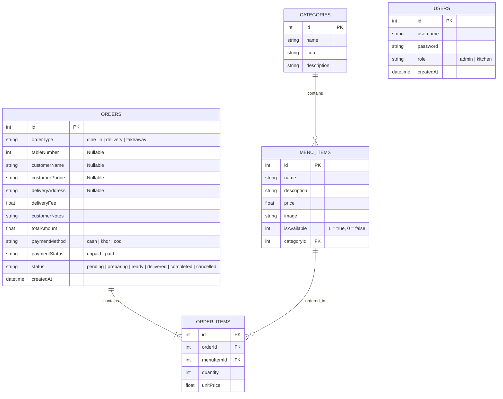

# 🍽️ Restaurant Ordering System (ROS)
### ប្រព័ន្ធគ្រប់គ្រងការកម្ម៉ង់ម្ហូបក្នុងភោជនីយដ្ឋាន និងដឹកជញ្ជូនតាមអនឡាញ

> **Course / Subject:** Topic 5: Software Project Development  
> **Level:** Intermediate Full-Stack Web Application  
> **Architecture:** Decoupled Client-Server (RESTful API & Single Page Application)  
> **Tech Stack:** React.js, Tailwind CSS, Node.js, Express.js, SQLite  

---

## 📌 មាតិកាគម្រោង (Table of Contents)
- [១. ទិដ្ឋភាពទូទៅនៃគម្រោង (Project Overview)](#-១-ទិដ្ឋភាពទូទៅនៃគម្រោង-project-overview)
- [២. មុខងារចម្បងៗ (Key Features)](#-២-មុខងារចម្បងៗ-key-features)
- [៣. ស្ថាបត្យកម្មប្រព័ន្ធ និងបច្ចេកវិទ្យា (System Architecture & Tech Stack)](#-៣-ស្ថាបត្យកម្មប្រព័ន្ធ-និងបច្ចេកវិទ្យា-system-architecture--tech-stack)
- [៤. រចនាសម្ព័ន្ធ Folder (Project Directory Structure)](#-៤-រចនាសម្ព័ន្ធ-folder-project-directory-structure)
- [៥. រចនាសម្ព័ន្ធទិន្នន័យ (Database Schema & ERD)](#-៥-រចនាសម្ព័ន្ធទិន្នន័យ-database-schema--erd)
- [៦. តារាងកិច្ចព្រមព្រៀង API (RESTful API Specification)](#-៦-តារាងកិច្ចព្រមព្រៀង-api-restful-api-specification)
- [៧. របៀបតម្លើង និងដំណើរការ (Installation & Quickstart Guide)](#-៧-របៀបតម្លើង-និងដំណើរការ-installation--quickstart-guide)
- [៨. គណនីគំរូសម្រាប់ធ្វើតេស្ត (Demo User Credentials)](#-៨-គណនីគំរូសម្រាប់ធ្វើតេស្ត-demo-user-credentials)
- [៩. ឯកសារផែនការប្រចាំសប្តាហ៍ (Weekly Documentation Wiki)](#-៩-ឯកសារផែនការប្រចាំសប្តាហ៍-weekly-documentation-wiki)

---

## 📖 ១. ទិដ្ឋភាពទូទៅនៃគម្រោង (Project Overview)

**Restaurant Ordering System (ROS)** គឺជាប្រព័ន្ធគ្រប់គ្រងការបញ្ជាទិញម្ហូបបែបឌីជីថលទំនើប ដែលត្រូវបានរចនាឡើងដើម្បីដោះស្រាយបញ្ហានៃការកត់ត្រាក្រដាសបុរាណ។ ប្រព័ន្ធនេះផ្តល់នូវដំណោះស្រាយពេញលេញពីរផ្លូវ (**Dual-Channel Ordering System**) គឺ៖
1. **Dine-In System:** អនុញ្ញាតឱ្យភ្ញៀវដែលមកទទួលទានផ្ទាល់នៅភោជនីយដ្ឋាន អាចជ្រើសរើសលេខតុ មើលបញ្ជីមុខម្ហូប និងកម្ម៉ង់ម្ហូបផ្ទាល់ពីទូរស័ព្ទដៃ ឬ Tablet លើតុ។
2. **Online Delivery System:** អនុញ្ញាតឱ្យអតិថិជនពីចម្ងាយអាចកម្ម៉ង់ម្ហូបដឹកជញ្ជូនដល់ផ្ទះ ឬខ្ចប់យកទៅផ្ទះ (Takeaway) ដោយបញ្ចូលឈ្មោះ លេខទូរស័ព្ទ និងអាសយដ្ឋានដឹកជញ្ជូន ព្រមទាំងគណនាថ្លៃដឹកជញ្ជូនដោយស្វ័យប្រវត្តិ។

---

## ✨ ២. មុខងារចម្បងៗ (Key Features)

### 👤 ក. សម្រាប់អតិថិជន (Customer Portal)
* **Dual-Channel Mode Switcher:** ចុចប្តូរបានយ៉ាងងាយស្រួលរវាង `🍽️ ញ៉ាំនៅហាង (Dine-in)` និង `🛵 កម្ម៉ង់ដឹកជញ្ជូន (Online Delivery)`។
* **Menu Browsing & Search:** មើលមុខម្ហូបតាមប្រភេទ (Appetizers, Mains, Drinks, Desserts) និងមានប្រអប់ស្វែងរក (Search Bar) លឿនរហ័ស។
* **Dish Customization & Notes:** អាចបន្ថែមចំណាំពិសេសសម្រាប់ម្ហូបនីមួយៗ (ឧ. មិនដាក់ស្ករ, មិនសូវហិរ)។
* **Smart Shopping Cart:** គណនាតម្លៃសរុប តម្លៃពន្ធ និងថ្លៃដឹកជញ្ជូនដោយស្វ័យប្រវត្តិ។
* **Live Order Tracking:** តាមដានស្ថានភាពម្ហូបផ្ទាល់ (Status Tracker: Pending ➔ Preparing ➔ Ready / Out for Delivery ➔ Completed)។

### 👨‍🍳 ខ. សម្រាប់ផ្ទះបាយ (Kitchen Display System - KDS)
* **Real-time Order Queue:** ទទួល Order ថ្មីៗភ្លាមៗដោយបែងចែកពណ៌ច្បាស់ៗតាមស្ថានភាព (Color-coded Badges)។
* **Visual Ticket Distinction:** បែងចែកច្បាស់ៗរវាង Order សម្រាប់តុ `Table #` និង Order ដឹកជញ្ជូន `🛵 Delivery`។
* **One-Click Status Updater:** ប៊ូតុងផ្លាស់ប្តូរស្ថានភាពពី Pending ទៅ Preparing និង Mark as Ready ដោយចុចតែម្តង។

### 👑 គ. សម្រាប់អ្នកគ្រប់គ្រងហាង (Admin Management Dashboard)
* **Staff Authentication:** ប្រព័ន្ធ Login សុវត្ថិភាពខ្ពស់ដោយប្រើ **JWT (JSON Web Token)** និងការ Hash ពាក្យសម្ងាត់ជាមួយ **bcryptjs**។
* **Menu Management (Full CRUD):** បន្ថែមមុខម្ហូបថ្មី កែប្រែតម្លៃ រូបភាព និងលុបមុខម្ហូបចេញពីប្រព័ន្ធ។
* **Instant Stock Toggle:** បិទ/បើក ស្តុកម្ហូប (In-stock / Out-of-stock) ភ្លាមៗ ពេលម្ហូបអស់ពីផ្ទះបាយ។
* **Sales Analytics & Summary:** របាយការណ៍សង្ខេបពីចំណូលសរុប (Total Revenue) និងចំនួន Order សរុបប្រចាំថ្ងៃ។

---

## 🏗️ ៣. ស្ថាបត្យកម្មប្រព័ន្ធ និងបច្ចេកវិទ្យា (System Architecture & Tech Stack)

```
┌────────────────────────────────────────────────────────┐
│                   React.js Frontend                    │
│   (Vite + Tailwind CSS + Lucide Icons + React Context) │
└───────────────────────────┬────────────────────────────┘
                            │ REST APIs (JSON / Bearer JWT)
┌───────────────────────────▼────────────────────────────┐
│                 Node.js / Express Backend              │
│        (Controllers, Middlewares, Routes, CORS)        │
└───────────────────────────┬────────────────────────────┘
                            │ SQL Queries (better-sqlite3)
┌───────────────────────────▼────────────────────────────┐
│              SQLite Embedded Database                  │
│       (Users, Categories, MenuItems, Orders)           │
└────────────────────────────────────────────────────────┘
```

* **Frontend:** [React.js](https://react.dev/) (Vite), [Tailwind CSS](https://tailwindcss.com/), [Lucide React](https://lucide.dev/) (Icons), Fetch API / Axios.
* **Backend:** [Node.js](https://nodejs.org/), [Express.js](https://expressjs.com/), [better-sqlite3](https://github.com/WiseLibs/better-sqlite3), [jsonwebtoken](https://jwt.io/), [bcryptjs](https://github.com/dcodeIO/bcrypt.js).
* **Database:** SQLite3 (Zero configuration, ងាយស្រួលចម្លង និងដាក់បង្ហាញ Demo)។

---

## 📁 ៤. រចនាសម្ព័ន្ធ Folder (Project Directory Structure)

```
restaurant-ordering-system/
│
├── 📁 backend/                             # ផ្នែក Backend Server (Node.js & Express)
│   ├── 📁 database/                        # Database Connection & SQL Scripts
│   │   ├── db.js                           # SQLite Connection Manager
│   │   ├── schema.sql                      # SQL Table DDL Script
│   │   └── seed.js                         # ទិន្នន័យគំរូ (Admin, Categories, Menu Items)
│   ├── 📁 src/
│   │   ├── 📁 controllers/                 # Business Logic Handlers
│   │   │   ├── authController.js           # Login & Token logic
│   │   │   ├── menuController.js           # Menu CRUD & Stock toggle
│   │   │   ├── orderController.js          # Order Placement & Status update
│   │   │   └── statsController.js          # Analytics calculation
│   │   ├── 📁 middlewares/
│   │   │   └── authMiddleware.js           # JWT Authentication Guard
│   │   ├── 📁 routes/
│   │   │   ├── authRoutes.js               # /api/auth
│   │   │   ├── menuRoutes.js               # /api/menu & /api/categories
│   │   │   ├── orderRoutes.js              # /api/orders
│   │   │   └── statsRoutes.js              # /api/stats
│   │   └── server.js                       # Express App Entry Point
│   ├── .env.example
│   └── package.json
│
├── 📁 frontend/                            # ផ្នែក Frontend Web Client (React + Vite)
│   ├── 📁 public/                          # Static Assets (Favicon, placeholder images)
│   ├── 📁 src/
│   │   ├── 📁 components/                  # Reusable UI Components
│   │   │   ├── Navbar.jsx                  # Header, Mode switcher, Table & Cart badges
│   │   │   ├── TableSelector.jsx           # Modal សម្រាប់រើសលេខតុ (Dine-in)
│   │   │   ├── DishCard.jsx                # កាតបង្ហាញមុខម្ហូប និងប៊ូតុងកម្ម៉ង់
│   │   │   ├── CartModal.jsx               # ផ្ទាំង Checkout (Dine-in / Delivery)
│   │   │   ├── OrderCard.jsx               # កាតបង្ហាញ Order សម្រាប់ចុងភៅ
│   │   │   └── DishFormModal.jsx           # Form បន្ថែម/កែប្រែម្ហូប (Admin)
│   │   ├── 📁 context/
│   │   │   ├── CartContext.jsx             # គ្រប់គ្រងទំនិញក្នុងកន្ត្រក និង Order Type
│   │   │   └── AuthContext.jsx             # គ្រប់គ្រង Login Token & Role
│   │   ├── 📁 pages/                       # អេក្រង់កម្មវិធី
│   │   │   ├── CustomerMenu.jsx            # ទំព័រដើមកម្ម៉ង់ម្ហូបសម្រាប់អតិថិជន
│   │   │   ├── TrackOrder.jsx              # ទំព័រតាមដានស្ថានភាពម្ហូបផ្ទាល់
│   │   │   ├── KitchenDashboard.jsx        # ផ្ទាំងបញ្ជាសម្រាប់ចុងភៅ
│   │   │   ├── AdminMenu.jsx               # ផ្ទាំងគ្រប់គ្រងបញ្ជីម្ហូបសម្រាប់ Admin
│   │   │   └── Login.jsx                   # ទំព័រ Login សម្រាប់បុគ្គលិក
│   │   ├── 📁 services/
│   │   │   └── api.js                      # API Calls Helper (Fetch / Axios)
│   │   ├── App.jsx                         # Main Routing Switcher
│   │   ├── main.jsx                        # React Root
│   │   └── index.css                       # Tailwind CSS Styling
│   ├── tailwind.config.js
│   ├── vite.config.js
│   └── package.json
│
├── run.bat                                 # Script ដំណើរការទាំង Frontend និង Backend ដោយចុចតែម្តង
├── README.md                               # ឯកសារណែនាំគម្រោង (ឯកសារនេះ)
├── week-1-wiki.md                          # ឯកសារលម្អិត Week 1: SRS & Requirements
└── week-2-wiki.md                          # ឯកសារលម្អិត Week 2: UI/UX, ERD & Architecture
```

---

## 🗄️ ៥. រចនាសម្ព័ន្ធទិន្នន័យ (Database Schema & ERD)



---

## 📡 ៦. តារាងកិច្ចព្រមព្រៀង API (RESTful API Specification)

| Method | Endpoint | សិទ្ធិចូលប្រើ (Access) | ការពិពណ៌នា (Description) |
|---|---|---|---|
| `POST` | `/api/auth/login` | Public | ចូលប្រើប្រាស់ប្រព័ន្ធ (ផ្តល់ជូន JWT Token) |
| `GET` | `/api/categories` | Public | យកបញ្ជីប្រភេទមុខម្ហូបទាំងអស់ |
| `GET` | `/api/menu` | Public | យកបញ្ជីមុខម្ហូបទាំងអស់ (អាច filter តាម category & search) |
| `POST` | `/api/menu` | Staff / Admin | បន្ថែមមុខម្ហូបថ្មី (Protected) |
| `PUT` | `/api/menu/:id` | Staff / Admin | កែប្រែព័ត៌មានមុខម្ហូប (Protected) |
| `PATCH`| `/api/menu/:id/toggle` | Staff / Admin | បិទ/បើក ស្តុកមុខម្ហូប In-stock / Out-of-stock (Protected) |
| `DELETE`| `/api/menu/:id` | Admin | លុបមុខម្ហូបចេញពីប្រព័ន្ធ (Protected) |
| `POST` | `/api/orders` | Public | បង្កើត Order ថ្មី (គាំទ្រទាំង Dine-in និង Online Delivery) |
| `GET` | `/api/orders` | Staff / Admin | យកបញ្ជី Order សម្រាប់ផ្ទះបាយ (Protected) |
| `GET` | `/api/orders/:id` | Public | ពិនិត្យមើលស្ថានភាព Order សម្រាប់ភ្ញៀវ |
| `PATCH`| `/api/orders/:id/status`| Staff / Admin | ផ្លាស់ប្តូរស្ថានភាព Order (Pending ➔ Preparing ➔ Ready...) |
| `GET` | `/api/stats/summary` | Admin | របាយការណ៍ចំណូលសរុប និងស្ថិតិ Order (Protected) |

---

## 🚀 ៧. របៀបតម្លើង និងដំណើរការ (Installation & Quickstart Guide)

### លក្ខខណ្ឌតម្រូវជាមុន (Prerequisites):
- [Node.js](https://nodejs.org/) (កំណែ Version 18.x ឬខ្ពស់ជាងនេះ)
- កម្មវិធីរុករកគេហទំព័រ (Chrome, Edge, Firefox)

### ជំហានទី ១: តម្លើង Dependencies
បើក Terminal (Command Prompt ឬ PowerShell) ក្នុង Folder គម្រោង ហើយដំណើរការ៖

```bash
# ១. តម្លើង Dependencies សម្រាប់ Backend
cd backend
npm install

# ២. តម្លើង Dependencies សម្រាប់ Frontend
cd ../frontend
npm install
```

### ជំហានទី ២: បញ្ចូលទិន្នន័យគំរូដំបូង (Seed Database)
នៅក្នុង Folder `backend` ដំណើរការបញ្ជាខាងក្រោមដើម្បីបង្កើតតារាង និងបញ្ចូលមុខម្ហូបគំរូ៖

```bash
cd backend
node database/seed.js
```

### ជំហានទី ៣: ដំណើរការប្រព័ន្ធ (Start the Application)
លោកអ្នកអាចដំណើរការតាម ២ វិធី៖

#### វិធីសាស្ត្រទី ១: ចុចលើ File `run.bat` (ងាយស្រួលបំផុតសម្រាប់ Windows 🌟)
គ្រាន់តែ Double-click លើឯកសារ `run.bat` នៅខាងក្រៅ Folder វានឹងបើកដំណើរការទាំង Backend និង Frontend ព្រមគ្នាដោយស្វ័យប្រវត្តិ!

#### វិធីសាស្ត្រទី ២: ដំណើរការដោយប្រើ Terminal ដោយឡែកពីគ្នា
* **Terminal ទី ១ (Backend API):**
  ```bash
  cd backend
  npm run dev
  # Server នឹងដំណើរការនៅ: http://localhost:5000
  ```
* **Terminal ទី ២ (Frontend UI):**
  ```bash
  cd frontend
  npm run dev
  # Web App នឹងដំណើរការនៅ: http://localhost:5173
  ```

---

## 🔑 ៨. គណនីគំរូសម្រាប់ធ្វើតេស្ត (Demo User Credentials)

| តួនាទី (Role) | ឈ្មោះអ្នកប្រើប្រាស់ (Username) | ពាក្យសម្ងាត់ (Password) | សិទ្ធិប្រើប្រាស់ (Access Level) |
|---|---|---|---|
| **Admin (Manager)** | `admin` | `admin123` | គ្រប់គ្រងមុខម្ហូប (CRUD), មើលស្ថិតិចំណូល, គ្រប់គ្រង Order |
| **Kitchen Staff** | `chef` | `chef123` | ផ្ទាំងផ្ទះបាយ (KDS), ប្តូរ Status Order, បិទ/បើក ស្តុកម្ហូប |

---

## 📚 ៩. ឯកសារផែនការប្រចាំសប្តាហ៍ (Weekly Documentation Wiki)

* 📄 [week-1-wiki.md](file:///d:/Desktop/Restaurant%20Ordering%20System/week-1-wiki.md): ឯកសារលម្អិតពីការរៀបចំផែនការ, Problem Statement, Stakeholders, Use Cases, និងតម្រូវការមុខងារ (SRS)។
* 📄 [week-2-wiki.md](file:///d:/Desktop/Restaurant%20Ordering%20System/week-2-wiki.md): ឯកសារលម្អិតពីការរចនា UI/UX Design System, Wireframes, Database ERD, Data Dictionary, DFD, និង Architecture។

---
**អភិវឌ្ឍន៍សម្រាប់:** Topic 5: Software Project Development  
**ឆ្នាំសិក្សា:** ២០២៦ | រក្សាសិទ្ធិគ្រប់យ៉ាង 🚀
