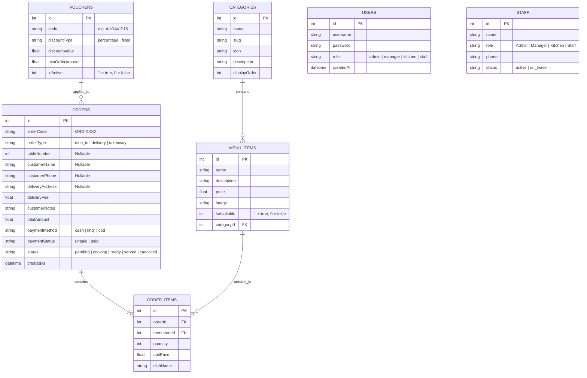

# 🍽️ Restaurant Ordering System (ROS)
### ប្រព័ន្ធគ្រប់គ្រងការកម្ម៉ង់ម្ហូបក្នុងភោជនីយដ្ឋាន និងដឹកជញ្ជូនតាមអនឡាញ

> **Course / Subject:** Topic 5: Software Project Development  
> **Level:** Intermediate Full-Stack Web Application  
> **Architecture:** Decoupled Client-Server (RESTful API & Single Page Application) — Clean MVC Pattern  
> **Tech Stack:** React.js, Vite, Tailwind CSS, Node.js (v24), Express.js, Native `node:sqlite` (DatabaseSync)  

---

## 📌 មាតិកាគម្រោង (Table of Contents)
- [១. ទិដ្ឋភាពទូទៅនៃគម្រោង (Project Overview)](#-១-ទិដ្ឋភាពទូទៅនៃគម្រោង-project-overview)
- [២. មុខងារចម្បងៗ (Key Features)](#-២-មុខងារចម្បងៗ-key-features)
- [៣. ស្ថាបត្យកម្មប្រព័ន្ធ និងបច្ចេកវិទ្យា (System Architecture & Tech Stack)](#-៣-ស្ថាបត្យកម្មប្រព័ន្ធ-និងបច្ចេកវិទ្យា-system-architecture--tech-stack)
- [៤. រចនាសម្ព័ន្ធ Folder (Project Directory Structure)](#-៤-រចនាសម្ព័ន្ធ-folder-project-directory-structure)
- [៥. រចនាសម្ព័ន្ធទិន្នន័យ (Database Schema & ERD)](#-៥-រចនាសម្ព័ន្ធទិន្នន័យ-database-schema--erd)
- [៦. តារាងកិច្ចព្រមព្រៀង API (RESTful API Specification)](#-៦-តារាងកិច្ចព្រមព្រៀង-api-restful-api-specification)
- [៧. របៀបតម្លើង និងដំណើរការ (Installation & Quickstart Guide)](#-៧-របៀបតម្លើង-និងដំណើរការ-installation--quickstart-guide)
- [៨. ប្រព័ន្ធតេស្តស្វ័យប្រវត្តិ (Automated Testing Suite)](#-៨-ប្រព័ន្ធតេស្តស្វ័យប្រវត្តិ-automated-testing-suite)
- [៩. គណនីគំរូសម្រាប់ធ្វើតេស្ត (Demo User Credentials)](#-៩-គណនីគំរូសម្រាប់ធ្វើតេស្ត-demo-user-credentials)
- [១០. ឯកសារផែនការប្រចាំសប្តាហ៍ (Weekly Documentation Wiki)](#-១០-ឯកសារផែនការប្រចាំសប្តាហ៍-weekly-documentation-wiki)

---

## 📖 ១. ទិដ្ឋភាពទូទៅនៃគម្រោង (Project Overview)

**Restaurant Ordering System (ROS)** គឺជាប្រព័ន្ធគ្រប់គ្រងការបញ្ជាទិញម្ហូបបែបឌីជីថលទំនើប ដែលត្រូវបានរចនាឡើងដើម្បីដោះស្រាយបញ្ហានៃការកត់ត្រាក្រដាសបុរាណ និងសម្រួលដល់ការគ្រប់គ្រងហាងបែបទំនើប។ ប្រព័ន្ធនេះផ្តល់នូវដំណោះស្រាយពេញលេញពីរផ្លូវ (**Dual-Channel Ordering System**) គឺ៖
1. **Dine-In System:** អនុញ្ញាតឱ្យភ្ញៀវដែលមកទទួលទានផ្ទាល់នៅភោជនីយដ្ឋាន អាចជ្រើសរើសលេខតុ មើលបញ្ជីមុខម្ហូប ស្កេន QR កូដលើតុ និងកម្ម៉ង់ម្ហូបផ្ទាល់ពីទូរស័ព្ទដៃ ឬ Tablet លើតុ។
2. **Online Delivery & Takeaway System:** អនុញ្ញាតឱ្យអតិថិជនពីចម្ងាយអាចកម្ម៉ង់ម្ហូបដឹកជញ្ជូនដល់ផ្ទះ ឬខ្ចប់យកទៅផ្ទះ (Takeaway) ដោយបញ្ចូលឈ្មោះ លេខទូរស័ព្ទ អាសយដ្ឋានដឹកជញ្ជូន ព្រមទាំងគណនាថ្លៃដឹកជញ្ជូនដោយស្វ័យប្រវត្តិ។

---

## ✨ ២. មុខងារចម្បងៗ (Key Features)

### 👤 ក. សម្រាប់អតិថិជន (Customer Portal)
* **Dual-Channel Mode Switcher:** ចុចប្តូរបានយ៉ាងងាយស្រួលរវាង `🍽️ ញ៉ាំនៅហាង (Dine-in)` និង `🛵 កម្ម៉ង់ដឹកជញ្ជូន (Online Delivery)`។
* **Table QR Code Auto-Ordering:** ស្កេន QR កូដលើតុ (តាមរយៈ `?table=XX`) ប្រព័ន្ធនឹងចាក់សោលេខតុស្វ័យប្រវត្តិកាត់បន្ថយការភាន់ច្រឡំ។
* **Dynamic KHQR Mobile Payment:** បង្កើត QR កូដបង់ប្រាក់ KHQR (Bakong) តាមចំនួនទឹកប្រាក់ជាក់ស្តែង ($ និង ៛) ដោយផ្ទាល់នៅពេល Checkout។
* **Menu Browsing & Search:** មើលមុខម្ហូបតាមប្រភេទ (Appetizers, Mains, Drinks, Desserts) និងមានប្រអប់ស្វែងរក (Search Bar) លឿនរហ័ស។
* **Dish Customization & Notes:** អាចបន្ថែមចំណាំពិសេសសម្រាប់ម្ហូបនីមួយៗ (ឧ. មិនដាក់ស្ករ, កម្រិតហិរ)។
* **Smart Shopping Cart & Vouchers:** គណនាតម្លៃសរុប តម្លៃពន្ធ និងថ្លៃដឹកជញ្ជូនដោយស្វ័យប្រវត្តិ ព្រមទាំងគាំទ្រ Promo Voucher Code (`AURAVIP15`)។
* **Live Order Tracking (4-Stage Stepper):** តាមដានស្ថានភាពម្ហូបផ្ទាល់ Real-Time (`Order Placed` ➔ `Cooking` ➔ `Ready` ➔ `Served`)។
* **Thermal POS Receipt:** មុខងារបោះពុម្ពវិក្កយបត្រតាមទំហំស្តង់ដារ 80mm POS Thermal Receipt។

### 👨‍🍳 ខ. សម្រាប់ផ្ទះបាយ (Kitchen Display System - KDS)
* **Real-time Order Queue:** ទទួល Order ថ្មីៗភ្លាមៗដោយបែងចែកពណ៌ច្បាស់ៗតាមស្ថានភាព (Pending, Cooking, Ready, Served)។
* **Live Ticket Timers & Overdue Warnings:** នាឡិការាប់ម៉ោងចម្អិនលើ Ticket នីមួយៗ និងបង្ហាញសញ្ញាអាសន្ន `⚠️ OVERDUE` បើលើសពី 15 នាទី។
* **Audio Chime Alerts:** បន្លឺសំឡេងកណ្ដឹងរោទ៍ស្វ័យប្រវត្តិ (Web Audio Synthesizer) នៅពេលមាន Order ថ្មីចូលមក។
* **Visual Ticket Distinction:** បែងចែកច្បាស់ៗរវាង Order សម្រាប់តុ `Table #` និង Order ដឹកជញ្ជូន `🛵 Delivery`។
* **Workflow Status Controls:** ប៊ូតុងប្តូរស្ថានភាពជាដំណាក់កាល (`Start Cooking` ➔ `Mark Ready` ➔ `Serve Order`) ធ្វើសមកាលកម្មភ្លាមៗទៅកាន់ Live Tracker របស់ភ្ញៀវ។

### 👑 គ. សម្រាប់អ្នកគ្រប់គ្រងហាង (Admin Management Console - 8 Stations)
1. **Dashboard & Analytics:** ស្ថិតិចំណូលសរុប (Total Sales), Active Orders, Table Occupancy Rate, និង Popular Dishes។
2. **Order Receiving (KDS):** ស្ថានីយទទួលបញ្ជាទិញផ្ទាល់ ជាមួយសមត្ថភាព Simulate Order និង Auto-refresh។
3. **Menu & Stock Management (Full CRUD):** បន្ថែមម្ហូប កែប្រែតម្លៃ រូបភាព និង Reactive Instant Stock Toggle (In-stock / Out-of-stock)។
4. **Categories Management (Full CRUD):** បង្កើត កែប្រែ និងលុបប្រភេទមុខម្ហូប (Categorization) ដោយភ្ជាប់ Slug និង Display Order។
5. **Interactive Floor Plan:** ប្លង់តុអន្តរកម្មបង្ហាញស្ថានភាពតុតាមពណ៌ជាក់ស្តែង (ទំនេរ, កំពុងកុម្ម៉ង់, កំពុងចម្អិន, បានលើកម្ហូប)។
6. **Discounts & Vouchers:** បង្កើត និងគ្រប់គ្រងកូដបញ្ចុះតម្លៃ (Percentage / Fixed Amount) ជាមួយកាលបរិច្ឆេទផុតកំណត់។
7. **Table QR Placard Generator:** បង្កើត និងបោះពុម្ពស្លាក QR Code សម្រាប់ដាក់តាមតុនីមួយៗ (Tables 01-08)។
8. **Staff & HR Management:** គ្រប់គ្រងបញ្ជីបុគ្គលិក តួនាទី (Admin, Manager, Kitchen, Staff), កាលវិភាគ និងវត្តមាន។

---

## 🏗️ ៣. ស្ថាបត្យកម្មប្រព័ន្ធ និងបច្ចេកវិទ្យា (System Architecture & Tech Stack)

```
┌────────────────────────────────────────────────────────┐
│                   React.js Frontend                    │
│   (Vite + Tailwind CSS + Lucide Icons + React Context) │
└───────────────────────────┬────────────────────────────┘
                            │ REST APIs (JSON / Bearer JWT)
┌───────────────────────────▼────────────────────────────┐
│                 Node.js / Express Backend              │
│       (Controllers, Middlewares, Routes, Clean MVC)    │
└───────────────────────────┬────────────────────────────┘
                            │ Native SQL Engine (DatabaseSync)
┌───────────────────────────▼────────────────────────────┐
│              Native SQLite Embedded Database           │
│        (Node v24 node:sqlite, WAL Mode, Zero-Build)    │
└────────────────────────────────────────────────────────┘
```

* **Frontend:** [React.js](https://react.dev/) (Vite), [Tailwind CSS](https://tailwindcss.com/), [Lucide React](https://lucide.dev/) (Icons), Fetch API / Axios.
* **Backend:** [Node.js](https://nodejs.org/) (v24), [Express.js](https://expressjs.com/), [jsonwebtoken](https://jwt.io/), [bcryptjs](https://github.com/dcodeIO/bcrypt.js), Clean MVC pattern.
* **Database Engine:** **Node.js Native `node:sqlite` (`DatabaseSync`)** — ដំណើរការដោយផ្ទាល់ជាមួយ Node.js core ដោយមិនបាច់ដំឡើង ឬ Compile C++ Toolchain (Python/Visual C++) ឡើយ។ គាំទ្រ **WAL (Write-Ahead Logging) Mode** ផ្តល់ល្បឿនខ្ពស់ និងស្ថេរភាពយូរអង្វែង។

---

## 📁 ៤. រចនាសម្ព័ន្ធ Folder (Project Directory Structure)

```
restaurant-ordering-system/
│
├── 📁 backend/                             # ផ្នែក Backend Server (Node.js & Express)
│   ├── 📁 database/                        # Database Connection & SQL Scripts
│   │   ├── db.js                           # Native node:sqlite DatabaseSync Connection & Auto-Migration
│   │   ├── schema.sql                      # SQL Table DDL Script (Tables & Constraints)
│   │   └── seed.js                         # ទិន្នន័យគំរូ (Admin, Categories, Menu, Vouchers, Staff)
│   ├── 📁 src/
│   │   ├── 📁 controllers/                 # Clean MVC Business Logic Handlers
│   │   │   ├── authController.js           # JWT Authentication & Login logic
│   │   │   ├── menuController.js           # Menu Items & Categories CRUD + Stock toggle
│   │   │   ├── orderController.js          # Order Placement & 4-Stage Lifecycle status
│   │   │   ├── voucherController.js        # Discount Vouchers CRUD & Validation
│   │   │   ├── staffController.js          # Staff Roster & Attendance management
│   │   │   ├── bakongController.js         # KHQR Bakong QR code generation
│   │   │   └── statsController.js          # Sales KPI & Floor analytics calculation
│   │   ├── 📁 middlewares/
│   │   │   └── authMiddleware.js           # JWT Authentication & Role Authorization Guard
│   │   ├── 📁 routes/
│   │   │   ├── authRoutes.js               # /api/auth
│   │   │   ├── menuRoutes.js               # /api/menu & /api/categories
│   │   │   ├── orderRoutes.js              # /api/orders
│   │   │   ├── voucherRoutes.js            # /api/vouchers
│   │   │   ├── staffRoutes.js              # /api/staff
│   │   │   ├── bakongRoutes.js             # /api/bakong
│   │   │   └── statsRoutes.js              # /api/stats
│   │   └── server.js                       # Express App Entry Point & Health Check
│   ├── .env.example
│   └── package.json
│
├── 📁 frontend/                            # ផ្នែក Frontend Web Client (React + Vite)
│   ├── 📁 public/                          # Static Assets (Favicon, placeholder images)
│   ├── 📁 src/
│   │   ├── 📁 components/                  # Reusable UI Components
│   │   │   ├── Navbar.jsx                  # Header, Mode switcher, Table & Cart badges
│   │   │   ├── TableSelector.jsx           # Modal សម្រាប់រើសលេខតុ (Dine-in)
│   │   │   ├── DishCard.jsx                # កាតបង្ហាញមុខម្ហូប និងប៊ូតុងកម្ម៉ង់
│   │   │   ├── CartModal.jsx               # ផ្ទាំង Checkout (Dine-in / Delivery / Vouchers)
│   │   │   └── DishFormModal.jsx           # Form បន្ថែម/កែប្រែម្ហូប (Admin)
│   │   ├── 📁 context/
│   │   │   ├── CartContext.jsx             # គ្រប់គ្រងទំនិញក្នុងកន្ត្រក និង Order Type
│   │   │   ├── AuthContext.jsx             # គ្រប់គ្រង Login Token & Role (JWT)
│   │   │   ├── MenuContext.jsx             # គ្រប់គ្រងបញ្ជីមុខម្ហូប & Categories (Real-time Sync)
│   │   │   └── OrderContext.jsx            # គ្រប់គ្រង KDS Orders & Live Status
│   │   ├── 📁 pages/                       # អេក្រង់កម្មវិធី
│   │   │   ├── CustomerMenu.jsx            # ទំព័រដើមកម្ម៉ង់ម្ហូបសម្រាប់អតិថិជន
│   │   │   ├── TrackOrder.jsx              # ទំព័រតាមដានស្ថានភាពម្ហូបផ្ទាល់ (Live Stepper)
│   │   │   ├── KitchenDashboard.jsx        # ផ្ទាំងបញ្ជាសម្រាប់ផ្ទះបាយ KDS
│   │   │   ├── AdminMenu.jsx               # ផ្ទាំងគ្រប់គ្រងបញ្ជីម្ហូបសម្រាប់ Admin
│   │   │   └── Login.jsx                   # ទំព័រ Login សម្រាប់បុគ្គលិក
│   │   ├── 📁 services/
│   │   │   ├── api.js                      # Centralized API Service (JWT Token Interceptor)
│   │   │   └── bakongService.js            # KHQR Dynamic Generator Service
│   │   ├── App.jsx                         # Main Routing Switcher
│   │   ├── main.jsx                        # React Root
│   │   └── index.css                       # Tailwind CSS Styling
│   ├── tailwind.config.js
│   ├── vite.config.js
│   └── package.json
│
├── 📁 tests/                               # ឈុតតេស្តស្វ័យប្រវត្តិកម្រិត E2E & Integration (100% Passing)
│   ├── test-utils.js                       # HTTP Test Client Helper (Node Native Fetch)
│   ├── 01_auth.test.js                     # Suite 1: Authentication & JWT Guard Tests
│   ├── 02_categories.test.js               # Suite 2: Categories CRUD & Display Order Tests
│   ├── 03_menu_dishes.test.js              # Suite 3: Menu Dishes & Stock Toggle Tests
│   ├── 04_orders_kds.test.js               # Suite 4: Order Creation & KDS 4-Stage Lifecycle
│   ├── 05_vouchers.test.js                 # Suite 5: Voucher Codes & Discount Calculation
│   ├── 06_staff_hr.test.js                 # Suite 6: Staff Roster & Attendance Tests
│   ├── 07_stats_analytics.test.js          # Suite 7: Sales Dashboard & KPI Analytics
│   ├── 08_e2e_workflow.test.js             # Suite 8: Complete End-to-End Restaurant Workflow
│   └── run-all-tests.js                    # Master Test Runner (Aggregated Report)
│
├── run.bat                                 # One-Click Launch Script សម្រាប់ Windows
├── test.bat                                # One-Click Test Runner (រត់ 43 Automated Tests)
├── package.json                            # Root Workspace Configuration (`npm test`)
├── README.md                               # ឯកសារណែនាំគម្រោង (ឯកសារនេះ)
├── week-1-wiki.md                          # ឯកសារលម្អិត Week 1: SRS & Requirements
└── week-2-wiki.md                          # ឯកសារលម្អិត Week 2: UI/UX, ERD & Architecture
```

---

## 🗄️ ៥. រចនាសម្ព័ន្ធទិន្នន័យ (Database Schema & ERD)



---

## 📡 ៦. តារាងកិច្ចព្រមព្រៀង API (RESTful API Specification)

| Method | Endpoint | សិទ្ធិចូលប្រើ (Access) | ការពិពណ៌នា (Description) |
|---|---|---|---|
| `GET` | `/api/health` | Public | ពិនិត្យសុខភាព Backend Server & Database Status |
| `POST` | `/api/auth/login` | Public | ចូលប្រើប្រាស់ប្រព័ន្ធ (ផ្តល់ជូន JWT Token) |
| `GET` | `/api/categories` | Public | យកបញ្ជីប្រភេទមុខម្ហូបទាំងអស់ (Sorted by displayOrder) |
| `POST` | `/api/categories` | Staff / Admin | បង្កើតប្រភេទមុខម្ហូបថ្មី (Protected) |
| `PUT` | `/api/categories/:id`| Staff / Admin | កែប្រែព័ត៌មានប្រភេទមុខម្ហូប (Protected) |
| `DELETE`| `/api/categories/:id`| Admin | លុបប្រភេទមុខម្ហូប (Protected) |
| `GET` | `/api/menu` | Public | យកបញ្ជីមុខម្ហូបទាំងអស់ (គាំទ្រ filter តាម category, search, stock) |
| `POST` | `/api/menu` | Staff / Admin | បន្ថែមមុខម្ហូបថ្មី (Protected) |
| `PUT` | `/api/menu/:id` | Staff / Admin | កែប្រែព័ត៌មានមុខម្ហូប (Protected) |
| `PATCH`| `/api/menu/:id/toggle` | Staff / Admin | បិទ/បើក ស្តុកមុខម្ហូប In-stock / Out-of-stock (Protected) |
| `DELETE`| `/api/menu/:id` | Admin | លុបមុខម្ហូបចេញពីប្រព័ន្ធ (Protected) |
| `POST` | `/api/orders` | Public | បង្កើត Order ថ្មី (គាំទ្រ Dine-in, Delivery, Custom OrderCode) |
| `GET` | `/api/orders` | Staff / Admin | យកបញ្ជី Order សម្រាប់ផ្ទះបាយ KDS (Protected) |
| `GET` | `/api/orders/:id` | Public | ពិនិត្យមើលស្ថានភាព Order សម្រាប់ភ្ញៀវ (តាម ID ឬ ORD-XXXX) |
| `PATCH`| `/api/orders/:id/status`| Staff / Admin | ផ្លាស់ប្តូរស្ថានភាព KDS (`pending` ➔ `cooking` ➔ `ready` ➔ `served`) |
| `GET` | `/api/vouchers` | Public | យកបញ្ជី Voucher កូដបញ្ចុះតម្លៃ |
| `POST` | `/api/vouchers` | Admin | បង្កើត Voucher កូដបញ្ចុះតម្លៃថ្មី (Protected) |
| `PATCH`| `/api/vouchers/:id/toggle`| Admin | បិទ/បើក ដំណើរការ Voucher (Protected) |
| `GET` | `/api/staff` | Staff / Admin | យកបញ្ជីបុគ្គលិកទាំងអស់ (Protected) |
| `POST` | `/api/staff` | Admin | បន្ថែមបុគ្គលិកថ្មី (Protected) |
| `PUT` | `/api/staff/:id` | Admin | កែប្រែព័ត៌មានបុគ្គលិក (Protected) |
| `DELETE`| `/api/staff/:id` | Admin | លុបបុគ្គលិកចេញពីប្រព័ន្ធ (Protected) |
| `POST` | `/api/bakong/generate-qr`| Public | បង្កើត KHQR Payment Payload & Deep Link |
| `GET` | `/api/stats/summary` | Admin | របាយការណ៍ចំណូលសរុប និងស្ថិតិលក់ (Protected) |

---

## 🚀 ៧. របៀបតម្លើង និងដំណើរការ (Installation & Quickstart Guide)

### 📋 លក្ខខណ្ឌតម្រូវជាមុន (Prerequisites):
- [Node.js](https://nodejs.org/) (កំណែ Version 22.x ឬ 24.x ឡើងទៅ - អាចឆែកដោយវាយ `node -v`)
- កម្មវិធីរុករកគេហទំព័រទំនើប (Google Chrome, Microsoft Edge, Safari)

---

### ជំហានទី ១: តម្លើង Dependencies (បើកម្តងដំបូង)
បើក Terminal ក្នុង Folder គម្រោង `Restaurant-Ordering-System` ហើយដំណើរការ៖

```bash
# ១. តម្លើងបណ្ណាល័យសម្រាប់ Backend (Native node:sqlite - មិនបាច់ compile C++)
cd backend
npm install

# ២. តម្លើងបណ្ណាល័យសម្រាប់ Frontend
cd ../frontend
npm install
```

---

### ជំហានទី ២: បញ្ចូលទិន្នន័យគំរូដំបូង (Seed Database)
ដំណើរការបញ្ជាខាងក្រោមដើម្បីបង្កើតតារាង និងទិន្នន័យគំរូ (Users, Categories, Menu, Vouchers, Staff):

```bash
cd backend
npm run seed
```
> *Output ជោគជ័យនឹងបង្ហាញ៖ `🌱 Seeding database... ✅ Users seeded ✅ Categories seeded ✅ Menu items seeded ✅ Vouchers seeded ✅ Staff seeded 🚀 Database seeding complete!`*

---

### ជំហានទី ៣: ដំណើរការប្រព័ន្ធ (Start the Application)

#### 🌟 វិធីសាស្ត្រទី ១: ដំណើរការដោយចុចតែម្តង (One-Click Launch សម្រាប់ Windows)
គ្រាន់តែ **Double-Click (ចុចពីរដង)** លើឯកសារ **`run.bat`** ដែលស្ថិតនៅក្រៅ Folder គម្រោង៖
- ប្រព័ន្ធនឹងបើក Terminal ពីរដាច់ដោយឡែកដោយស្វ័យប្រវត្តិ (មួយសម្រាប់ Backend API និងមួយទៀតសម្រាប់ React Frontend)។
- បន្ទាប់មកបើក Browser ចូលទៅកាន់៖ **`http://localhost:5173`** នោះលោកអ្នកនឹងឃើញប្រព័ន្ធដំណើរការភ្លាមៗ!

#### 💻 វិធីសាស្ត្រទី ២: ដំណើរការដោយប្រើ Terminal ដោយឡែកពីគ្នា
* **Terminal ទី ១ (Backend Express API):**
  ```bash
  cd backend
  npm run dev
  ```
  *(Server ដំណើរការនៅ: `http://localhost:5050` & Health Check: `http://localhost:5050/api/health`)*

* **Terminal ទី ២ (React Frontend Web Client):**
  ```bash
  cd frontend
  npm run dev
  ```
  *(Web App ដំណើរការនៅ: `http://localhost:5173`)*

---

## 🧪 ៨. ប្រព័ន្ធតេស្តស្វ័យប្រវត្តិ (Automated Testing Suite)

គម្រោងនេះភ្ជាប់មកជាមួយនូវ **Automated Test Harness** ពេញលេញចំនួន **៨ Test Suites** ដែលមានតេស្តសរុប **៤៣ តេស្ត (43 Passing Tests)** គ្របដណ្តប់គ្រប់មុខងារតាំងពី Integration API រហូតដល់ End-to-End Workflow៖

```
[Suite 1] Authentication & JWT Middleware (5 tests)  - ✅ PASS
[Suite 2] Categories Management CRUD       (5 tests)  - ✅ PASS
[Suite 3] Menu Items & Stock Toggle        (7 tests)  - ✅ PASS
[Suite 4] Orders & KDS 4-Stage Lifecycle   (7 tests)  - ✅ PASS
[Suite 5] Vouchers & Discount Calculations (4 tests)  - ✅ PASS
[Suite 6] Staff & HR Management            (5 tests)  - ✅ PASS
[Suite 7] Sales Analytics & Dashboard KPIs (4 tests)  - ✅ PASS
[Suite 8] End-to-End Restaurant Workflow   (6 tests)  - ✅ PASS
======================================================================
TOTAL SUITES : 8 / 8 PASSED (100%)
TOTAL TESTS  : 43 / 43 PASSED (100%)
EXEC TIME    : ~2.8 seconds
```

### របៀបដំណើរការតេស្ត៖
* **វិធីទី ១ (One-Click Windows):** Double-click លើឯកសារ **`test.bat`**
* **វិធីទី ២ (Command Line):**
  ```bash
  npm test
  # ឬ
  node tests/run-all-tests.js
  ```

---

## 🔑 ៩. គណនីគំរូសម្រាប់ធ្វើតេស្ត (Demo User Credentials)

| តួនាទី (Role) | ឈ្មោះអ្នកប្រើប្រាស់ (Username) | ពាក្យសម្ងាត់ (Password) | សិទ្ធិប្រើប្រាស់ (Access Level) |
|---|---|---|---|
| 👑 **Admin** | `admin` | `admin123` | Full Access (Menu CRUD, Categories, KDS, Vouchers, Floor, Staff, Sales) |
| 👔 **Manager** | `manager` | `manager123` | Operations Management (Live Orders, Menus, Floor Plan, Vouchers, Reports) |
| 🛎️ **Staff** | `staff` | `staff123` | Floor Service & Cashier (Table Floor Plan, Order Transactions, Receipts) |
| 👨‍🍳 **Kitchen** | `kitchen` / `chef` | `kitchen123` / `chef123` | Kitchen Station (KDS Display, Cooking Queue, Timer Alarms, Mark Ready) |

---

## 📚 ១០. ឯកសារផែនការប្រចាំសប្តាហ៍ (Weekly Documentation Wiki)

* 📄 [week-1-wiki.md](file:///d:/Desktop/Restaurant%20Ordering%20System/week-1-wiki.md): ឯកសារលម្អិតពីការរៀបចំផែនការ, Problem Statement, Stakeholders, Use Cases, និងតម្រូវការមុខងារ (SRS)។
* 📄 [week-2-wiki.md](file:///d:/Desktop/Restaurant%20Ordering%20System/week-2-wiki.md): ឯកសារលម្អិតពីការរចនា UI/UX Design System, Wireframes, Database ERD, Data Dictionary, DFD, និង Architecture។

---
**អភិវឌ្ឍន៍សម្រាប់:** Topic 5: Software Project Development  
**ឆ្នាំសិក្សា:** ២០២៦ | រក្សាសិទ្ធិគ្រប់យ៉ាង 🚀
