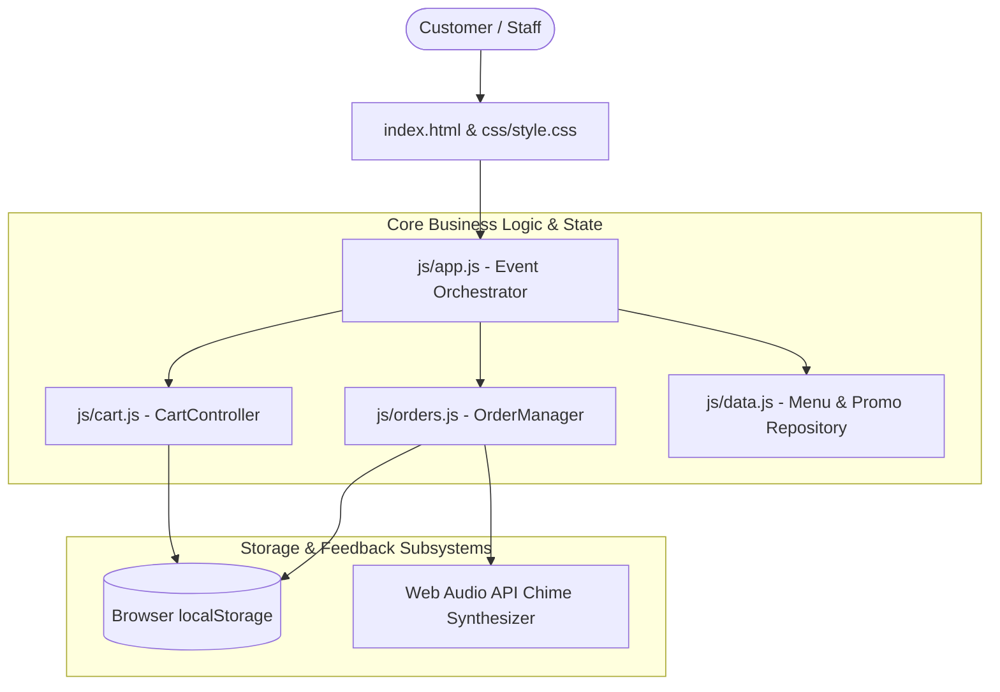

# Topic 5: Software Project Development
## Project: Aura Bistro - Restaurant Ordering System
**Deliverable**: Complete Software Project Deliverable with Source Code, Architecture, and Step-by-Step Implementation Guide.  
**Tech Stack**: Vanilla HTML5, Vanilla CSS3 (Custom Design Tokens & Glassmorphism), Modern Modular JavaScript (ES6+), LocalStorage Persistence, Web Audio API.  
**Experience Level**: Intermediate Software Engineering.

---

## 1. Project Overview & Business Value
In the modern hospitality industry, manual paper ordering leads to long wait times, billing mistakes, kitchen bottlenecks, and lost revenue. **Aura Bistro** is a modern, responsive web-based Restaurant Ordering System designed to streamline the entire customer-to-kitchen dining lifecycle.

### Key Highlights:
1. **Interactive Guest Experience**: High-resolution dish presentation, real-time category filtering, dietary preference tags (Vegetarian, Spicy, Chef's Pick), and price sorting.
2. **Deep Dish Customization**: Add-on modifiers (e.g. shaved truffle, extra sauce), spice tolerance configuration, and guest dietary notes.
3. **Cart & Dynamic Pricing Engine**: Real-time recalculation of subtotal, tiered promotional vouchers (e.g., `AURAVIP15`), 10% VAT tax, and 5% service fee.
4. **Dining Mode Agility**: Seamless toggle between Dine-In (Table # assignment) and Takeaway/Delivery pickup.
5. **Kitchen Display System (KDS)**: Dedicated staff console to track tickets by status (`Pending` &rarr; `Cooking` &rarr; `Ready` &rarr; `Served`), with live timers, audio chimes, and daily sales metrics.
6. **Real-Time Live Order Tracker**: Visual 4-step progress stepper allowing customers to monitor preparation status.

---

## 2. System Architecture & Design
The system follows a clean **Model-View-Controller (MVC)** client-side architecture using pure, framework-free web standards.



### Directory Structure:
```
c:\Users\LY HENG\Desktop\S-P-D\
├── index.html          # Semantic HTML5 Single-Page Application (SPA) structure
├── css/
│   └── style.css       # Complete design system, glassmorphism, dark/light theme, animations
├── js/
│   ├── data.js         # Menu catalog, categories, seed orders, and discount promo codes
│   ├── cart.js         # Reactive cart controller, quantity adjustments, tax & voucher math
│   ├── orders.js       # Order lifecycle manager, KDS ticket queue, Web Audio synth
│   └── app.js          # Master controller, modal handlers, search/filter pipeline, toast engine
└── README.md           # Project documentation, software engineering specs, and setup instructions
```

---

## 3. Software Requirements Specification (SRS)

### Functional Requirements (FR)
- **FR-01 (Menu Exploration)**: The customer must be able to view dishes organized by categories and filter by dietary tags (Vegetarian, Spicy, Chef's Pick).
- **FR-02 (Live Search & Sort)**: The customer must be able to search dish names/descriptions in real-time and sort by price or rating.
- **FR-03 (Dish Customizer)**: The customer must be able to select spice preferences and choose extra paid add-ons.
- **FR-04 (Order Staging & Cart)**: The cart must recalculate subtotals, VAT tax (10%), service fee (5%), and promotional voucher discounts.
- **FR-05 (Checkout Workflow)**: The customer must provide guest details, dining location (Table # or Takeaway), and select a payment method (KHQR, Card, Cash).
- **FR-06 (Order Tracking)**: The customer must have access to a live status bar tracking the progress of their placed order.
- **FR-07 (Kitchen Display Station)**: Staff must be able to review incoming tickets, advance order states, simulate test tickets, and inspect daily sales revenue.

### Non-Functional Requirements (NFR)
- **Zero External Dependencies**: Operates 100% natively in any standard web browser without requiring `npm install` or backend server configuration.
- **High Performance & Responsive**: Fluid 60fps animations, mobile-friendly layouts, and instant DOM updates.
- **State Persistence**: Cart items, theme preference, and order queues persist across browser reloads via `localStorage`.
- **Accessibility & Aesthetics**: High-contrast typography (`Outfit` & `Plus Jakarta Sans`), ARIA attributes, and cohesive dark/light mode tokens.

---

## 4. Step-by-Step Implementation Guide

### Step 1: Laying Out the Semantic Structure (`index.html`)
1. Create header with restaurant branding, view switcher tabs (Menu, Live Tracker, Kitchen KDS), dining mode toggle, dark theme toggle, and floating cart summary button.
2. Structure the **Customer Ordering View** featuring a gourmet hero banner, search bar with dietary chips, category pill navigation, dishes grid, and sticky cart sidebar.
3. Structure the **Live Order Tracker View** with split cards and timeline stepper.
4. Structure the **Kitchen Display System View** with real-time status metric counters and active order tickets.
5. Add accessible dialog modals for **Dish Customization**, **Checkout Form**, and **Order Receipt**.

### Step 2: Crafting the Design System (`css/style.css`)
1. Define CSS Custom Properties (`:root` and `[data-theme="dark"]`) with warm amber (`#f59e0b`), fiery orange (`#f97316`), and fresh emerald (`#10b981`).
2. Implement modern card components with hover lift effects (`transform: translateY(-4px)`), smooth shadows, and responsive grid columns.
3. Style the checkout drawer, stepper progress lines, KDS order tickets, and floating toast notifications.

### Step 3: Establishing the Culinary Catalog (`js/data.js`)
1. Define `MENU_ITEMS` array containing complete dish models with pricing, categories, ratings, prep times, calories, spice options, and extra toppings.
2. Define `PROMO_CODES` dictionary providing tiered percentages (e.g. `AURAVIP15` = 15%, `WELCOME10` = 10%).
3. Populate `SEED_ORDERS` so that the Live Tracker and Kitchen Display Station are immediately populated with sample orders on first run.

### Step 4: Building the Reactive Cart Controller (`js/cart.js`)
1. Construct the `CartController` class with `loadCartState()` and `saveCartState()`.
2. Implement `addItem()` with a unique composite key (`dishId_spiceLevel_addons`) so distinct configurations of the same dish are stored separately.
3. Implement `calculateTotals()` to cleanly apply discount math, 10% VAT, and 5% service fee.
4. Provide a pub/sub subscription listener pattern (`subscribe()`) so that any cart change automatically refreshes all UI elements.

### Step 5: Engineering Order Lifecycle & KDS Management (`js/orders.js`)
1. Construct `OrderManager` to store active orders in `localStorage`.
2. Implement state transition methods: `pending` &rarr; `cooking` &rarr; `ready` &rarr; `served`.
3. Build a synthesizer using browser **Web Audio API** to generate rich, pleasant audio chimes when an order is placed or marked ready, without requiring external MP3 audio assets.

### Step 6: Connecting Events & User Interactions (`js/app.js`)
1. Connect category pill clicks, live search input with instant debounced filtering, and sorting dropdown.
2. Wire up the dish customizer modal to compute live additive pricing as users check toppings.
3. Wire up the checkout form submission to trigger receipt generation, reset the cart, and play sound notifications.
4. Wire up KDS ticket action buttons ("Start Cooking", "Mark Ready", "Complete & Serve") to update order status.

---

## 5. How to Run & Test the Application

### Option 1: Direct Browser Launch
Simply double click or open `index.html` in any modern web browser (Google Chrome, Microsoft Edge, Firefox, or Safari).

### Option 2: Using Local Live Server (Recommended)
If using VS Code or terminal:
```powershell
# In PowerShell / Terminal inside project folder:
npx serve .
# Or open directly via default browser:
Start-Process "index.html"
```

---

## 6. Verification Test Scenarios

| Test Case ID | Action | Expected Result |
| :--- | :--- | :--- |
| **TC-01** | Filter by "Vegetarian" chip | Only vegetarian dishes (Tagliatelle, Burrata, Artichoke Bowl, etc.) display. |
| **TC-02** | Type "Wagyu" in search bar | Wagyu Ribeye and Wagyu Smash Burger appear instantly. |
| **TC-03** | Click "Customize" on Wagyu Ribeye, add "Truffle", change spice | Modal computes live price increase; item added with full specifications. |
| **TC-04** | Click "Apply To Cart" on hero promo banner | Promo `AURAVIP15` is applied; cart bill shows green -15% deduction line. |
| **TC-05** | Complete checkout with Name & Phone | Cart clears, receipt modal pops up with detailed breakdown, audio chime sounds. |
| **TC-06** | Switch to "Kitchen KDS" tab | Placed order appears at top of KDS grid; click "Start Cooking" to transition ticket. |
| **TC-07** | Switch to "Live Tracker" tab | Active order progress stepper updates in real-time matching KDS status. |
| **TC-08** | Click Moon/Sun theme toggle | Seamless switch between Light and Dark mode with persistent preference. |

---

## 7. Software Project Defense & Presentation Q&A
When presenting Topic 5 to evaluators or professors:
- **Q: Why choose Vanilla HTML, CSS, and JS over a heavy framework like React or Angular?**  
  *A: Vanilla web technologies provide maximum execution speed, zero build-step overhead, guaranteed cross-browser compatibility, and demonstrate pure foundational mastery of the DOM, Event Loop, and State Management.*
- **Q: How is data consistency maintained between the Customer Cart and the Kitchen?**  
  *A: Through synchronous event broadcasting and local storage persistence. When an order is placed, `OrderManager` writes the order entity and triggers reactive subscribers that immediately update the KDS queue, active badges, and live tracker views.*
- **Q: How are dish customizations handled without conflicts?**  
  *A: The system uses deterministic fingerprint keys (`generateItemKey`). A dish with extra truffle and spicy seasoning is treated as a distinct line item from a standard preparation of the same dish.*
