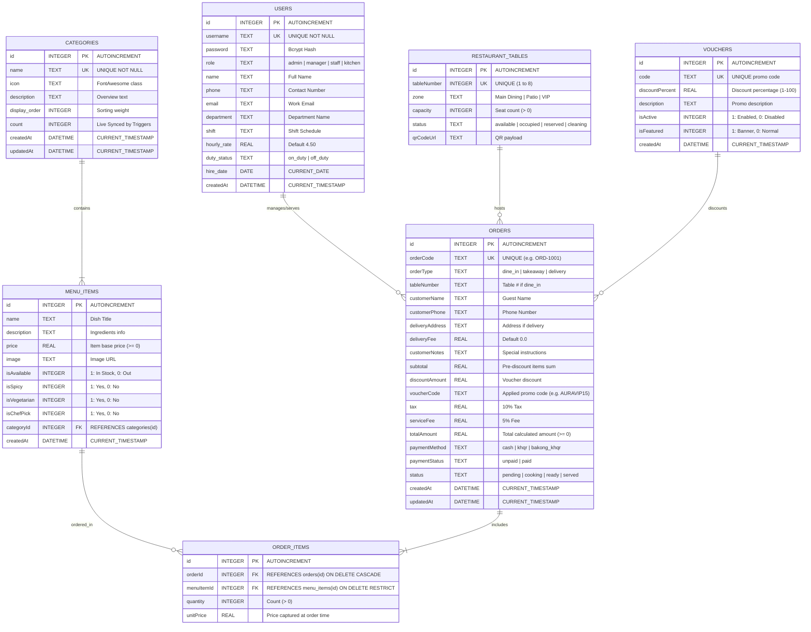
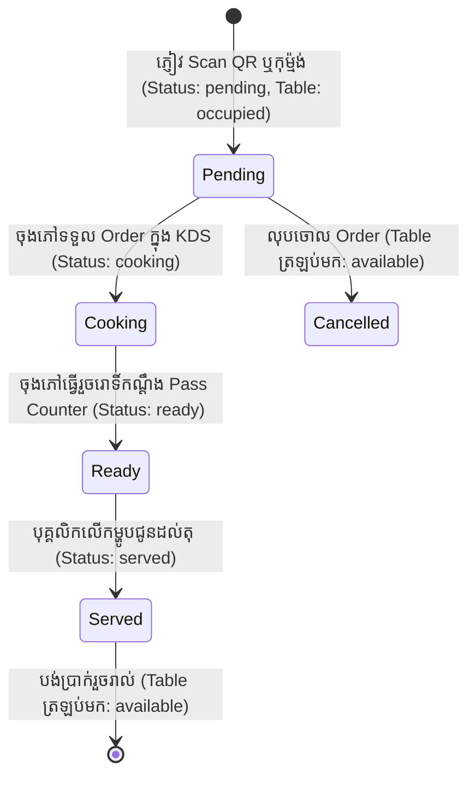

# 📊 Restaurant Ordering System (Aura Bistro) - Comprehensive Database Architecture & Specification

ឯកសារមេនេះ (**Single Source of Truth**) ផ្តល់នូវព័ត៌មានលម្អិតស៊ីជម្រៅបំផុតអំពី**ស្ថាបត្យកម្មប្រព័ន្ធទិន្នន័យ (Database Architecture)**, **ដ្យាក្រាមទំនាក់ទំនងទិន្នន័យពិត (Re-designed ERD)**, **រចនាសម្ព័ន្ធតារាងទាំង ៧ តាមស្តង់ដារ SQL អន្តរជាតិ [ឈ្មោះនៅមុខ ឆ្វេង ➔ ប្រភេទនៅក្រោយ ស្តាំ]**, **គោលដៅ និងតួនាទីនៃទិន្នន័យ (Data Goals)**, **ដែនកំណត់ទិន្នន័យ និងសមត្ថភាពផ្ទុក (Data Constraints & Practical Capacity)**, **វដ្តជីវិតទិន្នន័យ (Order & Table Lifecycles)**, ព្រមទាំង**ការផ្សារភ្ជាប់រវាងកូដ និងប្រព័ន្ធទិន្នន័យ (Feature & Code Mapping)** នៅក្នុងគម្រោង **Restaurant Ordering System (ROS)**។

---

## 📑 មាតិកា (Table of Contents)
1. [ទិដ្ឋភាពទូទៅនៃស្ថាបត្យកម្ម Database (Architecture Overview)](#1-ទិដ្ឋភាពទូទៅនៃស្ថាបត្យកម្ម-database)
2. [ដ្យាក្រាមទំនាក់ទំនងទិន្នន័យពិត (Re-designed ERD)](#2-ដ្យាក្រាមទំនាក់ទំនងទិន្នន័យពិត-re-designed-erd)
3. [រចនាសម្ព័ន្ធតារាងទាំង ៧ និងគោលដៅទិន្នន័យ (Standard SQL Schemas & Goals)](#3-រចនាសម្ព័ន្ធតារាងទាំង-៧-និងគោលដៅទិន្នន័យ)
4. [ការវិភាគទិន្នន័យជាក់ស្តែងក្នុង Database (Live DB Statistics)](#4-ការវិភាគទិន្នន័យជាក់ស្តែងក្នុង-database)
5. [ដែនកំណត់ និងលក្ខខណ្ឌនៃទិន្នន័យ (Data Constraints & Technical Limitations)](#5-ដែនកំណត់-និងលក្ខខណ្ឌនៃទិន្នន័យ)
6. [វដ្តជីវិតនៃទិន្នន័យស្នូល (Core Data Lifecycles)](#6-វដ្តជីវិតនៃទិន្នន័យស្នូល)
7. [ការផ្សារភ្ជាប់រវាងកូដ និង Database (Feature & Code Mapping)](#7-ការផ្សារភ្ជាប់រវាងកូដ-និង-database)
8. [ការត្រួតពិនិត្យស៊ីជម្រៅលើលំហូរ Checkout & Promo Discounts](#8-ការត្រួតពិនិត្យស៊ីជម្រៅលើលំហូរ-checkout--promo-discounts)

---

## 1. ទិដ្ឋភាពទូទៅនៃស្ថាបត្យកម្ម Database

គម្រោង Aura Bistro ដំណើរការដោយប្រព័ន្ធទិន្នន័យ **Native SQLite (`node:sqlite`)** របស់ Node.js Runtime (v22+) ដែលផ្តល់នូវល្បឿនប្រតិបត្តិការលឿនបំផុត (Microsecond latency) តាមរយៈការតភ្ជាប់ C++ Native Bindings ដោយផ្ទាល់ដោយមិនចាំបាច់មាន external daemon ឡើយ។

* **ទីតាំងផ្ទុកឯកសារ Database:** `backend/data/restaurant.db`
* **ឯកសារជំនួយការសរសេរ:** 
  - `restaurant.db-wal` (Write-Ahead Log សម្រាប់កត់ត្រាការផ្លាស់ប្តូរមុនពេល Commit)
  - `restaurant.db-shm` (Shared-Memory index សម្រួលដល់ការអានដំណាលគ្នា)
* **ការកំណត់កម្រិត Engine (Engine Pragmas):**
  - `PRAGMA journal_mode = WAL;` — បើកមុខងារ Write-Ahead Logging អនុញ្ញាតឱ្យមាន Concurrent Reads និង Writes ដំណាលគ្នាដោយមិន Lock Database ទាំងមូល។
  - `PRAGMA foreign_keys = ON;` — បង្ខំឱ្យប្រព័ន្ធគោរពតាម Foreign Key Constraints យ៉ាងតឹងរ៉ឹងបំផុត។
* **យន្តការប្រតិបត្តិការ (Transaction Safety):** ប្រើប្រាស់ `db.transaction()` សម្រាប់ការបញ្ចូល Order និង Order Items ធានាគោលការណ៍ **ACID (Atomicity, Consistency, Isolation, Durability)**។

---

## 2. ដ្យាក្រាមទំនាក់ទំនងទិន្នន័យពិត (Re-designed ERD)

ខាងក្រោមនេះជា Mermaid Entity Relationship Diagram ដែលត្រូវបានកែសម្រួលរចនាឡើងវិញតាមស្តង់ដារអន្តរជាតិ៖  
👉 **ឈ្មោះជួរឈរ (Column Name)** ស្ថិតនៅខាងមុខ (ឆ្វេង)  
👉 **ប្រភេទជួរឈរ (Data Type)** ស្ថិតនៅខាងក្រោយ (ស្តាំ)

### ការបែងចែកប្រភេទទំនាក់ទំនងក្នុង ERD (Relationship Classification):

| ទំនាក់ទំនង (Relationship) | ប្រភេទទំនាក់ទំនង (Type) | ជួរឈរភ្ជាប់ (Keys) | យន្តការអនុវត្ត (Implementation) |
| :--- | :---: | :--- | :--- |
| `CATEGORIES` ➔ `MENU_ITEMS` | **Physical Foreign Key** | `menu_items.categoryId` ➔ `categories.id` | ការពារដោយ SQLite DDL (`ON DELETE RESTRICT`) |
| `ORDERS` ➔ `ORDER_ITEMS` | **Physical Foreign Key** | `order_items.orderId` ➔ `orders.id` | ការពារដោយ SQLite DDL (`ON DELETE CASCADE`) |
| `MENU_ITEMS` ➔ `ORDER_ITEMS` | **Physical Foreign Key** | `order_items.menuItemId` ➔ `menu_items.id` | ការពារដោយ SQLite DDL (`ON DELETE RESTRICT`) |
| `VOUCHERS` ➔ `ORDERS` | **Logical / Soft Relationship** | `orders.voucherCode` ➔ `vouchers.code` | គ្រប់គ្រងដោយ Backend Controller (`orderController.js`) ដោយអនុញ្ញាតឱ្យ `NULL` ពេលមិនប្រើ Voucher |
| `RESTAURANT_TABLES` ➔ `ORDERS` | **Logical / Soft Relationship** | `orders.tableNumber` ➔ `restaurant_tables.tableNumber` | គ្រប់គ្រងដោយ Backend Logic ដោយអនុញ្ញាតឱ្យ `NULL` ពេលកុម្ម៉ង់ Takeaway/Delivery |
| `USERS` ➔ `ORDERS` | **Conceptual / Business Workflow** | បុគ្គលិក KDS & Floor Staff | តំណាងឱ្យលំហូរការងារបុគ្គលិកទទួល និងធ្វើម្ហូបតាម Orders (មិនមានជួរឈរ `userId` ក្នុងតារាង `orders` ឡើយ) |

---

## 3. រចនាសម្ព័ន្ធតារាងទាំង ៧ និងគោលដៅទិន្នន័យ (Standard SQL Schemas & Goals)

> [!TIP]
> គ្រប់តារាងទាំងអស់ត្រូវបានរៀបចំតាមស្តង់ដារ SQL អន្តរជាតិ៖  
> 👉 **ឈ្មោះជួរឈរ (Column Name)** ស្ថិតនៅខាងមុខ (ខាងឆ្វេង)  
> 👉 **ប្រភេទជួរឈរ (Data Type)** ស្ថិតនៅខាងក្រោយ (ខាងស្តាំ)

### 📊 តារាងសង្ខេបចំនួនជួរឈរតាមតារាងនីមួយៗ (Column Count Summary)

| # | ឈ្មោះតារាង (Table Name) | ចំនួនជួរឈរ (Total Columns) | តួនាទីស្នូលក្នុងប្រព័ន្ធ (Core Role) |
| :- | :--- | :---: | :--- |
| **1** | `users` | **១៣ ជួរឈរ** | គណនីបុគ្គលិក, សិទ្ធិ RBAC, និងព័ត៌មាន HR Roster |
| **2** | `categories` | **៨ ជួរឈរ** | ប្រភេទមុខម្ហូប, រូបតំណាង Icon, និងចំនួនមុខម្ហូបក្នុងប្រភេទ |
| **3** | `menu_items` | **១១ ជួរឈរ** | បញ្ជីម្ហូប, តម្លៃ, រូបភាព, ស្តុក, និងស្លាកចំណាំ Dietary Flags |
| **4** | `orders` | **១៩ ជួរឈរ** | វិក្កយបត្រកុម្ម៉ង់, ការបំបែកពន្ធ/សេវាកម្ម, Voucher, និង KDS Status |
| **5** | `order_items` | **៥ ជួរឈរ** | មុខម្ហូបលម្អិតក្នុងវិក្កយបត្រ, ចំនួនចាន, និងតម្លៃឯកតា Snapshot |
| **6** | `restaurant_tables` | **៦ ជួរឈរ** | ប្លង់តុអាហារ, តំបន់ Zones, ចំនួនកៅអី, និងស្ថានភាពតុ |
| **7** | `vouchers` | **៧ ជួរឈរ** | ប័ណ្ណប្រូម៉ូសិនបញ្ចុះតម្លៃ, ភាគរយ Discount, និងការបង្ហាញបដា |
| **សរុប** | **៧ តារាង** | **៦៩ ជួរឈរ** | **ប្រព័ន្ធគ្រប់គ្រងភោជនីយដ្ឋានពេញលេញ (Full Suite)** |

---

### 3.1. តារាង `users` (គណនីបុគ្គលិក និងសិទ្ធិគ្រប់គ្រង RBAC — ១៣ ជួរឈរ)
* **ចំនួនជួរឈរសរុប (Total Columns):** **១៣ ជួរឈរ (13 Columns)**
* **គោលដៅទិន្នន័យ (Data Goal):** គ្រប់គ្រងអត្តសញ្ញាណបុគ្គលិក បញ្ជាក់សុពលភាពតាមរយៈ JWT Token និងអនុវត្តការបែងចែកសិទ្ធិតាមតួនាទី (RBAC) ទៅកាន់ ៨ ស្ថានីយការងារ។

| ឈ្មោះជួរឈរ (Column Name) | ប្រភេទ (Data Type) | Nullable | លក្ខខណ្ឌ / Default | ការពិពណ៌នា (Description) |
| :--- | :--- | :---: | :--- | :--- |
| **`id`** | `INTEGER` | NO | `PRIMARY KEY AUTOINCREMENT` | លេខសម្គាល់អ្នកប្រើប្រាស់ |
| **`username`** | `TEXT` | NO | `UNIQUE` | ឈ្មោះគណនីចូលប្រព័ន្ធ |
| **`password`** | `TEXT` | NO | - | Bcrypt Hashed Password |
| **`role`** | `TEXT` | NO | `CHECK (role IN ('admin', 'manager', 'staff', 'kitchen')) DEFAULT 'staff'` | តួនាទី RBAC |
| **`name`** | `TEXT` | YES | `NULL` | ឈ្មោះពេញ |
| **`phone`** | `TEXT` | YES | `NULL` | លេខទូរស័ព្ទ |
| **`email`** | `TEXT` | YES | `NULL` | អ៊ីមែលផ្លូវការ |
| **`department`** | `TEXT` | YES | `'Front of House & Service'` | ផ្នែកបំពេញការងារ |
| **`shift`** | `TEXT` | YES | `'Morning Shift (07:00 - 15:00)'` | វេនការងារ |
| **`hourly_rate`** | `REAL` | YES | `4.50` | ប្រាក់ឈ្នួលគិតជាម៉ោង |
| **`duty_status`** | `TEXT` | YES | `'on_duty'` | ស្ថានភាព (`on_duty` / `off_duty`) |
| **`hire_date`** | `DATE` | YES | `CURRENT_DATE` | ថ្ងៃចូលធ្វើការ |
| **`createdAt`** | `DATETIME` | YES | `CURRENT_TIMESTAMP` | ពេលបង្កើតគណនី |

* **គោលបំណង និងតួនាទីនៃជួរឈរនីមួយៗ (Detailed Column Goals & Roles):**
  * `id`: សម្គាល់អត្តសញ្ញាណស្វ័យប្រវត្តិតែមួយគត់សម្រាប់បុគ្គលិកម្នាក់ៗ (Primary Key)។
  * `username`: ឈ្មោះគណនីសម្រាប់បុគ្គលិកវាយបញ្ចូលពេល Login ចូលកាន់ប្រព័ន្ធ (Unique Not Null)។
  * `password`: លេខកូដសម្ងាត់ដែលត្រូវបាន Hash ការពារដោយ Bcrypt Algorithm មុនពេលរក្សាទុក ធានាសុវត្ថិភាពដាច់ខាត។
  * `role`: កំណត់តួនាទីសិទ្ធិ (`admin`, `manager`, `staff`, `kitchen`) សម្រាប់អនុញ្ញាត ឬរារាំងការចូលកាន់ស្ថានីយការងារទាំង ៨។
  * `name`: ឈ្មោះពេញរបស់បុគ្គលិកសម្រាប់បង្ហាញលើ Header ស្វាគមន៍ និងលើសន្លឹកវិក្កយបត្របម្រើភ្ញៀវ។
  * `phone`: លេខទូរស័ព្ទផ្ទាល់ខ្លួនសម្រាប់ទាក់ទងបន្ទាន់ក្នុងបញ្ជី Staff Roster។
  * `email`: អ៊ីមែលការងារផ្លូវការរបស់បុគ្គលិកសម្រាប់កត់ត្រាក្នុងប្រព័ន្ធ HR។
  * `department`: ដេប៉ាតឺម៉ង់ដែលបុគ្គលិកបម្រើការ (ឧ. Front of House, Kitchen, Bar)។
  * `shift`: វេនការងារប្រចាំថ្ងៃរបស់បុគ្គលិក (ឧ. វេនព្រឹក 07:00 - 15:00, វេនល្ងាច 15:00 - 23:00)។
  * `hourly_rate`: អត្រាប្រាក់ឈ្នួលគិតជាម៉ោង (USD/Hour) សម្រាប់គណនាចំណាយកម្លាំងពលកម្ម។
  * `duty_status`: ស្ថានភាពជាក់ស្តែងកំពុងបំពេញការងារ (`on_duty` កំពុងធ្វើការ, `off_duty` សម្រាក)។
  * `hire_date`: កាលបរិច្ឆេទដែលបុគ្គលិកបានចាប់ផ្តើមចូលបម្រើការងារដំបូងក្នុងភោជនីយដ្ឋាន។
  * `createdAt`: ពេលវេលា និងកាលបរិច្ឆេទដែលគណនីនេះត្រូវបានបង្កើតឡើងក្នុងប្រព័ន្ធ។

---

### 3.2. តារាង `categories` (ប្រភេទទំនិញ/មុខម្ហូប — ៨ ជួរឈរ)
* **ចំនួនជួរឈរសរុប (Total Columns):** **៨ ជួរឈរ (8 Columns)**
* **គោលដៅទិន្នន័យ (Data Goal):** បែងចែកប្រភេទម្ហូបដើម្បីងាយស្រួលដល់ភ្ញៀវស្វែងរកលើ Digital Menu និងជួយចុងភៅបែងចែកចង្ក្រានធ្វើម្ហូប។

| ឈ្មោះជួរឈរ (Column Name) | ប្រភេទ (Data Type) | Nullable | លក្ខខណ្ឌ / Default | ការពិពណ៌នា (Description) |
| :--- | :--- | :---: | :--- | :--- |
| **`id`** | `INTEGER` | NO | `PRIMARY KEY AUTOINCREMENT` | លេខសម្គាល់ Category |
| **`name`** | `TEXT` | NO | `UNIQUE` | ឈ្មោះប្រភេទម្ហូប |
| **`icon`** | `TEXT` | YES | `'fa-solid fa-utensils'` | FontAwesome Class |
| **`description`** | `TEXT` | YES | `NULL` | ការពិពណ៌នា |
| **`display_order`** | `INTEGER` | YES | `0` | លំដាប់បង្ហាញ |
| **`count`** | `INTEGER` | YES | `0` | ចំនួនមុខម្ហូប (Sync ដោយ SQLite Triggers) |
| **`createdAt`** | `DATETIME` | YES | `CURRENT_TIMESTAMP` | ពេលបង្កើត |
| **`updatedAt`** | `DATETIME` | YES | `CURRENT_TIMESTAMP` | ពេលកែប្រែ |

* **គោលបំណង និងតួនាទីនៃជួរឈរនីមួយៗ (Detailed Column Goals & Roles):**
  * `id`: លេខសម្គាល់ស្វ័យប្រវត្តិនៃប្រភេទមុខម្ហូប (Primary Key)។
  * `name`: ឈ្មោះប្រភេទមុខម្ហូប (ឧ. Starters, Mains, Steaks...) ប្រើសម្រាប់ដាក់លើប៊ូតុង Tab ស្វែងរកម្ហូប។
  * `icon`: ឈ្មោះ FontAwesome CSS class (ឧ. `fa-solid fa-drumstick-bite`) សម្រាប់បង្ហាញរូបតំណាងលើប៊ូតុង Tab ប្រភេទម្ហូប។
  * `description`: ការពិពណ៌នាសង្ខេបអំពីទម្រង់មុខម្ហូបក្នុងប្រភេទនីមួយៗ។
  * `display_order`: លេខរៀងទម្ងន់សម្រាប់តម្រៀបលំដាប់លំដោយនៃប្រភេទម្ហូបលើ Menu (ឧ. ម្ហូបកុម្ម៉ង់មុន ➔ ម្ហូបចានគោល ➔ បង្អែម)។
  * `count`: ចំនួនមុខម្ហូបជាក់ស្តែងដែលមានក្នុងប្រភេទនោះ ដែលត្រូវបានធ្វើបច្ចុប្បន្នភាពស្វ័យប្រវត្តិតាមរយៈ SQLite Triggers (`AFTER INSERT`, `AFTER DELETE`, `AFTER UPDATE`)។
  * `createdAt`: ពេលវេលាដែលប្រភេទមុខម្ហូបត្រូវបានបង្កើតឡើង។
  * `updatedAt`: ពេលវេលាចុងក្រោយដែលព័ត៌មានប្រភេទម្ហូបត្រូវបានកែសម្រួល។

---

### 3.3. តារាង `menu_items` (មុខម្ហូប និងភេសជ្ជៈ — ១១ ជួរឈរ)
* **ចំនួនជួរឈរសរុប (Total Columns):** **១១ ជួរឈរ (11 Columns)**
* **គោលដៅទិន្នន័យ (Data Goal):** រក្សាទុកព័ត៌មានលម្អិតនៃមុខម្ហូប តម្លៃ ស្លាកចំណាំពិសេស និងស្ថានភាពស្តុក (`isAvailable`)។

| ឈ្មោះជួរឈរ (Column Name) | ប្រភេទ (Data Type) | Nullable | លក្ខខណ្ឌ / Default | ការពិពណ៌នា (Description) |
| :--- | :--- | :---: | :--- | :--- |
| **`id`** | `INTEGER` | NO | `PRIMARY KEY AUTOINCREMENT` | លេខសម្គាល់ម្ហូប |
| **`name`** | `TEXT` | NO | - | ឈ្មោះមុខម្ហូប |
| **`description`** | `TEXT` | YES | `NULL` | គ្រឿងផ្សំ / ការពិពណ៌នា |
| **`price`** | `REAL` | NO | `CHECK(price >= 0)` | តម្លៃលក់ ($) |
| **`image`** | `TEXT` | YES | `NULL` | រូបភាពម្ហូប |
| **`isAvailable`** | `INTEGER` | NO | `DEFAULT 1` | ស្ថានភាព (1: មាន, 0: អស់) |
| **`isSpicy`** | `INTEGER` | YES | `DEFAULT 0` | ហិរ (1/0) |
| **`isVegetarian`** | `INTEGER` | YES | `DEFAULT 0` | បួស (1/0) |
| **`isChefPick`** | `INTEGER` | YES | `DEFAULT 0` | Chef's Pick (1/0) |
| **`categoryId`** | `INTEGER` | NO | `REFERENCES categories(id) ON DELETE RESTRICT` | FK ទៅ Category |
| **`createdAt`** | `DATETIME` | YES | `CURRENT_TIMESTAMP` | ពេលបង្កើត |

* **គោលបំណង និងតួនាទីនៃជួរឈរនីមួយៗ (Detailed Column Goals & Roles):**
  * `id`: លេខសម្គាល់ស្វ័យប្រវត្តិនៃមុខម្ហូប ឬភេសជ្ជៈនីមួយៗ (Primary Key)។
  * `name`: ឈ្មោះពេញរបស់មុខម្ហូបដែលបង្ហាញលើ Card មុខម្ហូប និងលើសន្លឹក KDS ផ្ទះបាយ។
  * `description`: គ្រឿងផ្សំលម្អិត រសជាតិ និងប្រវត្តិមុខម្ហូបសម្រាប់ឱ្យភ្ញៀវអានមុនពេលសម្រេចចិត្តកុម្ម៉ង់។
  * `price`: តម្លៃលក់ជាប្រាក់ដុល្លារ ($) ក្នុងមួយចាន (ការពារដោយលក្ខខណ្ឌ `CHECK(price >= 0)`)។
  * `image`: URL ឬផ្លូវតំណភ្ជាប់រូបភាពម្ហូបជាក់ស្តែង សម្រាប់បង្ហាញលើ Digital Menu។
  * `isAvailable`: ស្ថានភាពស្តុកម្ហូប (1: មានក្នុងស្តុកកុម្ម៉ង់បាន, 0: អស់ស្តុក 86'd មិនអនុញ្ញាតឱ្យកុម្ម៉ង់)។
  * `isSpicy`: ស្លាកចំណាំម្ហូបហឹរ (1: បង្ហាញ Icon ម្ទេស 🌶️ និងគាំទ្រ Filter ម្ហូបហឹរ, 0: មិនហឹរ)។
  * `isVegetarian`: ស្លាកចំណាំម្ហូបបួស (1: បង្ហាញ Icon ស្លឹកឈើ/បន្លែ 🥦 និងគាំទ្រ Filter ម្ហូបបួស, 0: ម្ហូបធម្មតា)។
  * `isChefPick`: ស្លាកចំណាំម្ហូបពិសេសប្រចាំហាង (1: បង្ហាញ Badge "Chef's Pick" ⭐ លើទំព័រមុខ, 0: ធម្មតា)។
  * `categoryId`: Foreign Key ភ្ជាប់ទៅកាន់ `categories.id` ដើម្បីចាត់ថ្នាក់ម្ហូប (ការពារដោយ `ON DELETE RESTRICT`)។
  * `createdAt`: ពេលវេលាដែលមុខម្ហូបត្រូវបានបញ្ចូលក្នុងបញ្ជី Menu។

---

### 3.4. តារាង `orders` (វិក្កយបត្រកុម្ម៉ង់ — ១៩ ជួរឈរ)
* **ចំនួនជួរឈរសរុប (Total Columns):** **១៩ ជួរឈរ (19 Columns)**
* **គោលដៅទិន្នន័យ (Data Goal):** កត់ត្រារាល់ប្រតិបត្តិការលក់ លេខកូដវិក្កយបត្រ តម្លៃបូកសរុប ពន្ធ Tax 10% សេវាកម្ម Fee 5% ការបញ្ចុះតម្លៃ និងស្ថានភាពធ្វើម្ហូប។

| ឈ្មោះជួរឈរ (Column Name) | ប្រភេទ (Data Type) | Nullable | លក្ខខណ្ឌ / Default | ការពិពណ៌នា (Description) |
| :--- | :--- | :---: | :--- | :--- |
| **`id`** | `INTEGER` | NO | `PRIMARY KEY AUTOINCREMENT` | ID វិក្កយបត្រ |
| **`orderCode`** | `TEXT` | NO | `UNIQUE` | កូដសម្គាល់ (ឧ. `ORD-1001`) |
| **`orderType`** | `TEXT` | YES | `'dine_in'` | `dine_in`, `takeaway`, `delivery` |
| **`tableNumber`** | `TEXT` | YES | `NULL` | លេខតុ (សម្រាប់ Dine-in) |
| **`customerName`** | `TEXT` | YES | `'Valued Guest'` | ឈ្មោះភ្ញៀវ |
| **`customerPhone`** | `TEXT` | YES | `NULL` | លេខទូរស័ព្ទ |
| **`deliveryAddress`** | `TEXT` | YES | `NULL` | អាសយដ្ឋានដឹកជញ្ជូន |
| **`deliveryFee`** | `REAL` | NO | `DEFAULT 0.0` | ថ្លៃដឹក |
| **`customerNotes`** | `TEXT` | YES | `NULL` | ចំណាំពិសេស |
| **`subtotal`** | `REAL` | NO | `DEFAULT 0.0` | តម្លៃសរុបមុខម្ហូបមុនបញ្ចុះតម្លៃ |
| **`discountAmount`** | `REAL` | NO | `DEFAULT 0.0` | ចំនួនទឹកប្រាក់បញ្ចុះតម្លៃពី Voucher |
| **`voucherCode`** | `TEXT` | YES | `NULL` | កូដប័ណ្ណបញ្ចុះតម្លៃ |
| **`tax`** | `REAL` | NO | `DEFAULT 0.0` | ពន្ធរដ្ឋ 10% |
| **`serviceFee`** | `REAL` | NO | `DEFAULT 0.0` | សេវាកម្មភោជនីយដ្ឋាន 5% |
| **`totalAmount`** | `REAL` | NO | `DEFAULT 0.0 CHECK(totalAmount >= 0)` | តម្លៃទូទាត់សរុបចុងក្រោយ |
| **`paymentMethod`** | `TEXT` | YES | `'cash'` | `cash`, `khqr`, `bakong_khqr` |
| **`paymentStatus`** | `TEXT` | YES | `'unpaid'` | `unpaid`, `paid` |
| **`status`** | `TEXT` | YES | `'pending'` | `pending`, `cooking`, `ready`, `served`, `cancelled` |
| **`createdAt`** | `DATETIME` | YES | `CURRENT_TIMESTAMP` | ពេលកុម្ម៉ង់ |
| **`updatedAt`** | `DATETIME` | YES | `CURRENT_TIMESTAMP` | ពេលកែប្រែ |

* **គោលបំណង និងតួនាទីនៃជួរឈរនីមួយៗ (Detailed Column Goals & Roles):**
  * `id`: លេខសម្គាល់ស្វ័យប្រវត្តិនៃប្រតិបត្តិការកុម្ម៉ង់ក្នុងប្រព័ន្ធ (Primary Key)។
  * `orderCode`: លេខកូដវិក្កយបត្រងាយស្រួលចំណាំ (ឧ. `ORD-1001`) សម្រាប់ភ្ញៀវផ្ទៀងផ្ទាត់ និងចុងភៅហៅសន្លឹកបុង។
  * `orderType`: ទម្រង់នៃការកុម្ម៉ង់ (`dine_in` ញ៉ាំក្នុងហាង, `takeaway` ខ្ចប់ទៅផ្ទះ, `delivery` ដឹកជញ្ជូន)។
  * `tableNumber`: លេខតុអាហារដែលភ្ញៀវកំពុងអង្គុយ (សម្រាប់ Dine-in) ប្រើសម្រាប់គ្រប់គ្រងប្លង់តុ និងបម្រើម្ហូប។
  * `customerName`: ឈ្មោះភ្ញៀវដែលបានកុម្ម៉ង់ សម្រាប់ហៅឈ្មោះ ឬបោះពុម្ពលើបង្កាន់ដៃ។
  * `customerPhone`: លេខទូរស័ព្ទភ្ញៀវ សម្រាប់ទាក់ទងពេលដឹកជញ្ជូន ឬពេលម្ហូបរួចរាល់។
  * `deliveryAddress`: អាសយដ្ឋានលម្អិតរបស់ភ្ញៀវ សម្រាប់ករណីកុម្ម៉ង់ដឹកជញ្ជូនដល់ផ្ទះ (Delivery)។
  * `deliveryFee`: ថ្លៃសេវាដឹកជញ្ជូនគិតជាប្រាក់ដុល្លារ (លំនាំដើម $0.0) បូកបញ្ចូលក្នុងតម្លៃសរុប។
  * `customerNotes`: ចំណាំពិសេសរបស់ភ្ញៀវទៅកាន់ផ្ទះបាយ (ឧ. "កុំដាក់ខ្ទឹមបារាំង", "សុំហឹរខ្លាំង")។
  * `subtotal`: ផលបូកតម្លៃមុខម្ហូបទាំងអស់មុនពេលអនុវត្តការបញ្ចុះតម្លៃពី Voucher។
  * `discountAmount`: ចំនួនទឹកប្រាក់ដែលត្រូវបានកាត់បន្ថយដោយសារការប្រើប្រាស់ Voucher បញ្ចុះតម្លៃ។
  * `voucherCode`: កូដប័ណ្ណបញ្ចុះតម្លៃជាក់ស្តែងដែលត្រូវបានអនុវត្ត (ឧ. `AURAVIP15`)។
  * `tax`: ចំនួនទឹកប្រាក់ពន្ធរដ្ឋ 10% ដែលត្រូវបានគណនា និងកត់ត្រាទុកយ៉ាងសុក្រឹត។
  * `serviceFee`: ចំនួនទឹកប្រាក់ថ្លៃសេវាកម្មភោជនីយដ្ឋាន 5% សម្រាប់បុគ្គលិកបម្រើការ។
  * `totalAmount`: ទឹកប្រាក់សរុបចុងក្រោយដែលភ្ញៀវត្រូវទូទាត់ (`subtotal - discount + tax + serviceFee + deliveryFee`)។
  * `paymentMethod`: វិធីសាស្ត្រទូទាត់ប្រាក់ (`cash` ប្រាក់សុទ្ធ, `khqr` ស្កេន KHQR, `bakong_khqr` បាគង)។
  * `paymentStatus`: ស្ថានភាពទូទាត់ប្រាក់ជាក់ស្តែង (`unpaid` មិនទាន់បង់, `paid` បានទូទាត់រួចរាល់)។
  * `status`: វដ្តជីវិតនៃការចម្អិនម្ហូបលើ KDS (`pending` ➔ `cooking` ➔ `ready` ➔ `served` / `cancelled`)។
  * `createdAt`: ពេលវេលាជាក់ស្តែងដែលការកុម្ម៉ង់ត្រូវបានបង្កើតឡើង ប្រើសម្រាប់គិតម៉ោងរង់ចាំ និងរបាយការណ៍លក់។
  * `updatedAt`: ពេលវេលាចុងក្រោយដែលស្ថានភាពកុម្ម៉ង់ត្រូវបានផ្លាស់ប្តូរ (ឧ. ពី Cooking ទៅ Ready)។

---

### 3.5. តារាង `order_items` (មុខម្ហូបក្នុងវិក្កយបត្រ — ៥ ជួរឈរ)
* **ចំនួនជួរឈរសរុប (Total Columns):** **៥ ជួរឈរ (5 Columns)**
* **គោលដៅទិន្នន័យ (Data Goal):** កត់ត្រាមុខម្ហូបលម្អិត ចំនួន និងតម្លៃឯកតា `unitPrice` ជាក់ស្តែងនៅពេលកុម្ម៉ង់ ដើម្បីការពាររបាយការណ៍ហិរញ្ញវត្ថុចាស់ៗ។

| ឈ្មោះជួរឈរ (Column Name) | ប្រភេទ (Data Type) | Nullable | លក្ខខណ្ឌ / Default | ការពិពណ៌នា (Description) |
| :--- | :--- | :---: | :--- | :--- |
| **`id`** | `INTEGER` | NO | `PRIMARY KEY AUTOINCREMENT` | ID |
| **`orderId`** | `INTEGER` | NO | `REFERENCES orders(id) ON DELETE CASCADE` | FK ទៅ Orders |
| **`menuItemId`** | `INTEGER` | NO | `REFERENCES menu_items(id) ON DELETE RESTRICT` | FK ទៅ Menu Items |
| **`quantity`** | `INTEGER` | NO | `CHECK(quantity > 0)` | ចំនួនចាន |
| **`unitPrice`** | `REAL` | NO | - | តម្លៃឯកតាពេលកុម្ម៉ង់ |

* **គោលបំណង និងតួនាទីនៃជួរឈរនីមួយៗ (Detailed Column Goals & Roles):**
  * `id`: លេខសម្គាល់ស្វ័យប្រវត្តិនៃជួរមុខម្ហូបក្នុងវិក្កយបត្រ (Primary Key)។
  * `orderId`: Foreign Key ភ្ជាប់ទៅកាន់ `orders.id` (លុបដោយស្វ័យប្រវត្តិតាមរយៈ `ON DELETE CASCADE` បើលុប Order)។
  * `menuItemId`: Foreign Key ភ្ជាប់ទៅកាន់ `menu_items.id` (ហាមឃាត់ការលុបតាមរយៈ `ON DELETE RESTRICT` បើម្ហូបធ្លាប់មានក្នុង Order)។
  * `quantity`: ចំនួនចាន ឬចំនួនកែវដែលបានកុម្ម៉ង់ (ត្រូវតែធំជាង ០ ដាច់ខាត `CHECK(quantity > 0)`)។
  * `unitPrice`: តម្លៃឯកតានៃមុខម្ហូបនៅខណៈពេលដែលភ្ញៀវកុម្ម៉ង់ (Snapshot Price) ការពារកុំឱ្យខូចរបាយការណ៍ហិរញ្ញវត្ថុពេល Menu ឡើងថ្លៃថ្ងៃក្រោយ។

---

### 3.6. តារាង `restaurant_tables` (ប្លង់តុ និងការទទួលភ្ញៀវ — ៦ ជួរឈរ)
* **ចំនួនជួរឈរសរុប (Total Columns):** **៦ ជួរឈរ (6 Columns)**
* **គោលដៅទិន្នន័យ (Data Goal):** គ្រប់គ្រងប្លង់តុអាហារផ្ទាល់ក្នុងហាង (Floor Plan), តំបន់ (Zones), ចំនួនកៅអី, និងបង្កើត QR Code សម្រាប់តុនីមួយៗ។

| ឈ្មោះជួរឈរ (Column Name) | ប្រភេទ (Data Type) | Nullable | លក្ខខណ្ឌ / Default | ការពិពណ៌នា (Description) |
| :--- | :--- | :---: | :--- | :--- |
| **`id`** | `INTEGER` | NO | `PRIMARY KEY AUTOINCREMENT` | ID |
| **`tableNumber`** | `INTEGER` | NO | `UNIQUE` | លេខតុ (1, 2, 3...) |
| **`zone`** | `TEXT` | YES | `'Main Dining'` | តំបន់ (Patio, Window, VIP, ...) |
| **`capacity`** | `INTEGER` | YES | `4 CHECK(capacity > 0)` | ចំនួនកៅអី |
| **`status`** | `TEXT` | YES | `CHECK(status IN ('available', 'occupied', 'reserved', 'cleaning')) DEFAULT 'available'` | ស្ថានភាពតុ |
| **`qrCodeUrl`** | `TEXT` | YES | `NULL` | URL តំណភ្ជាប់ QR |

* **គោលបំណង និងតួនាទីនៃជួរឈរនីមួយៗ (Detailed Column Goals & Roles):**
  * `id`: លេខសម្គាល់ស្វវត្តិនៃតុអាហារ (Primary Key)។
  * `tableNumber`: លេខតុជាក់ស្តែងក្នុងហាង (1 ដល់ 8) កំណត់ជា `UNIQUE` មិនអាចជាន់លេខគ្នាបានឡើយ។
  * `zone`: តំបន់ប្លង់តុក្នុងភោជនីយដ្ឋាន (ឧ. 'Main Dining Hall', 'Patio Terrace', 'VIP Wine Lounge')។
  * `capacity`: ចំនួនកៅអីអង្គុយអតិបរមាដែលអាចទទួលភ្ញៀវបាននៅតុនោះ (`CHECK(capacity > 0)`)។
  * `status`: ស្ថានភាពជាក់ស្តែងនៃតុ (`available` ទំនេរ, `occupied` មានភ្ញៀវ, `reserved` កក់ទុក, `cleaning` កំពុងរៀបចំ)។
  * `qrCodeUrl`: ផ្លូវតំណភ្ជាប់ទិន្នន័យ QR Code សម្រាប់បោះពុម្ពដាក់លើតុឱ្យភ្ញៀវស្កេនកុម្ម៉ង់។

---

### 3.7. តារាង `vouchers` (យុទ្ធនាការប្រូម៉ូសិន និងបញ្ចុះតម្លៃ — ៧ ជួរឈរ)
* **ចំនួនជួរឈរសរុប (Total Columns):** **៧ ជួរឈរ (7 Columns)**
* **គោលដៅទិន្នន័យ (Data Goal):** គ្រប់គ្រងប័ណ្ណបញ្ចុះតម្លៃ ភាគរយបញ្ចុះ និងកំណត់ការបង្ហាញបដាពិសេសលើទំព័រដើម។

| ឈ្មោះជួរឈរ (Column Name) | ប្រភេទ (Data Type) | Nullable | លក្ខខណ្ឌ / Default | ការពិពណ៌នា (Description) |
| :--- | :--- | :---: | :--- | :--- |
| **`id`** | `INTEGER` | NO | `PRIMARY KEY AUTOINCREMENT` | ID ប័ណ្ណ |
| **`code`** | `TEXT` | NO | `UNIQUE` | កូដបញ្ចុះតម្លៃ (ឧ. `AURAVIP15`) |
| **`discountPercent`** | `REAL` | NO | `CHECK(discountPercent > 0 AND discountPercent <= 100)` | ភាគរយបញ្ចុះ (1% ដល់ 100%) |
| **`description`** | `TEXT` | YES | `NULL` | ការពិពណ៌នា |
| **`isActive`** | `INTEGER` | NO | `DEFAULT 1` | ស្ថានភាព (1: ប្រើបាន, 0: ផ្អាក) |
| **`isFeatured`** | `INTEGER` | NO | `DEFAULT 0` | បង្ហាញលើបដា (1: បង្ហាញ, 0: ធម្មតា) |
| **`createdAt`** | `DATETIME` | YES | `CURRENT_TIMESTAMP` | ពេលបង្កើត |

* **គោលបំណង និងតួនាទីនៃជួរឈរនីមួយៗ (Detailed Column Goals & Roles):**
  * `id`: លេខសម្គាល់ស្វ័យប្រវត្តិនៃប័ណ្ណបញ្ចុះតម្លៃ (Primary Key)។
  * `code`: កូដអក្សរធំសម្គាល់ប័ណ្ណបញ្ចុះតម្លៃ (ឧ. `AURAVIP15`, `WELCOME10`) កំណត់ជា `UNIQUE`។
  * `discountPercent`: ភាគរយបញ្ចុះតម្លៃគិតជា % ចន្លោះពី 1% ដល់ 100% (`CHECK(discountPercent > 0 AND discountPercent <= 100)`)។
  * `description`: ការពិពណ៌នាអំពីយុទ្ធនាការបញ្ចុះតម្លៃសម្រាប់បង្ហាញលើបដាផ្សាយពាណិជ្ជកម្ម។
  * `isActive`: កុងតាក់បើក/បិទការប្រើប្រាស់ប័ណ្ណ (1: អនុញ្ញាតឱ្យប្រើបាន, 0: ផុតកំណត់ ឬផ្អាកប្រើ)។
  * `isFeatured`: កំណត់ថាតើត្រូវបង្ហាញលើបដាប្រូម៉ូសិនពិសេសលើផ្ទាំង Checkout ដែរឬទេ (1: បង្ហាញ, 0: មិនបង្ហាញ)។
  * `createdAt`: ពេលវេលាដែលប័ណ្ណបញ្ចុះតម្លៃត្រូវបានបង្កើតឡើងក្នុងប្រព័ន្ធ។

---

## 4. ការវិភាគទិន្នន័យជាក់ស្តែងក្នុង Database (Live DB Statistics)

ផ្អែកលើការ Query ផ្ទាល់លើ Database ជាក់ស្តែងក្នុង `backend/data/restaurant.db`៖

| # | តារាង (Table Name) | ចំនួនជួរជាក់ស្តែង (Live Rows) | ការពិពណ៌នាទិន្នន័យជាក់ស្តែង |
| :- | :--- | :---: | :--- |
| **1** | `users` | **៦ នាក់** | `admin`, `manager`, `staff`, `kitchen`, `chef`, `alex_bar` |
| **2** | `categories` | **៦ ប្រភេទ** | `Starters & Tapas`, `Artisan Mains`, `Prime Steaks & Grill`, `Handcrafted Pastas`, `Decadent Desserts`, `Craft Drinks` |
| **3** | `menu_items` | **១២ មុខ** | មុខម្ហូបស្នូល ២ មុខក្នុងមួយប្រភេទ (Scallops, Burrata, Wagyu Burger, Salmon, Wagyu Ribeye, Tomahawk, Tagliatelle, Ravioli, Lava Sphere, Matcha Crème Brûlée, Citrus Elixir, Hibiscus Fizz) |
| **4** | `orders` | **៥ វិក្កយបត្រ** | វិក្កយបត្រកុម្ម៉ង់គំរូដើម (ORD-1001 ដល់ ORD-1005 — ស្ថានភាព Served, គ្មានសំបុត្រកកស្ទះលើ KDS) |
| **5** | `order_items` | **៥ ជួរ** | មុខម្ហូបដែលបានកុម្ម៉ង់ជាប់ជាមួយ Orders នីមួយៗ (Unit Price & Quantity) |
| **6** | `restaurant_tables` | **៨ តុ** | តុ ០១ ដល់ តុ ០៨ គ្រប់គ្រងតាម Floor Plan (ស្ថានភាព Available ទាំងអស់) |
| **7** | `vouchers` | **៤ កូដ** | `AURAVIP15` (15%), `WELCOME10` (10%), `CHEF25` (25%), `BISTRO20` (20%) |
| **សរុប** | **៧ តារាង** | **៤៦ ជួរទិន្នន័យ** | ដំណើរការរលូន ១០០% ស្អាតបាត គ្មានទិន្នន័យរាត់រាយ |

---

## 5. ដែនកំណត់ និងលក្ខខណ្ឌនៃទិន្នន័យ (Data Constraints & Technical Limitations)

### ៥.១. ដែនកំណត់កម្រិត Schema (Schema Constraints):
- **Primary & Unique Keys:** `users.username`, `vouchers.code`, `orders.orderCode`, និង `restaurant_tables.tableNumber` មិនអាចស្ទួនគ្នាបានឡើយ (`UNIQUE`)។
- **Check Constraints (សុពលភាពតក្កវិជ្ជា):**
  - `menu_items.price >= 0` និង `orders.totalAmount >= 0` (តម្លៃមិនអាចអវិជ្ជមាន)។
  - `order_items.quantity > 0` (ចំនួនកុម្ម៉ង់ត្រូវតែយ៉ាងតិច ១)។
  - `vouchers.discountPercent > 0 AND discountPercent <= 100` (បញ្ចុះតម្លៃបានចន្លោះ 1% ដល់ 100%)។
- **Foreign Key Protection (សុវត្ថិភាពទំនាក់ទំនង):**
  - `orders` ➔ `order_items`: កំណត់ `ON DELETE CASCADE` (បើតារាង Order ត្រូវលុប មុខម្ហូបក្នុងវិក្កយបត្រនោះលុបតាមស្វ័យប្រវត្តិ)។
  - `menu_items` ➔ `order_items`: កំណត់ `ON DELETE RESTRICT` (ហាមឃាត់មិនឱ្យលុបមុខម្ហូបណាដែលធ្លាប់មានប្រវត្តិកុម្ម៉ង់ក្នុងវិក្កយបត្រឡើយ ដោយ Return HTTP 409 Conflict)។

### ៥.២. ដែនកំណត់កម្រិត Engine (SQLite Technical Limitations):
1. **Single-Writer Concurrency:** SQLite អនុញ្ញាតឱ្យមាន Reader ច្រើនដំណាលគ្នា ក៏ប៉ុន្តែអនុញ្ញាតឱ្យមាន Writer តែមួយគត់ក្នុងពេលតែមួយ។ (យើងបានដោះស្រាយតាមរយៈ **WAL Mode** ដើម្បីកាត់បន្ថយការ Lock)។
2. **Floating-Point Precision:** SQLite ប្រើប្រភេទ `REAL` (IEEE 754) សម្រាប់លេខក្បៀស ដែលអាចមានបញ្ហាលម្អៀងក្បៀស (ឧ. `0.1 + 0.2 = 0.30000000000000004`)។ (យើងបានដោះស្រាយក្នុង Backend ដោយប្រើការបង្គត់ក្បៀស `Number(val.toFixed(2))` ជានិច្ច)។
3. **No Native Boolean & DateTime:** SQLite គ្មានប្រភេទ Boolean (ប្រើ `INTEGER 1/0`) និងគ្មាន DateTime ពិតប្រាកដ (ប្រើ `TEXT ISO 8601`)។
4. **Storage Limits:** ទំហំអតិបរមារបស់ឯកសារ SQLite DB គឺ **140 Terabytes** (គាំទ្ររហូតដល់ ~9.2 Quintillion Rows ដោយប្រើ 64-bit Integer Primary Keys)។

### ៥.៣. ការប្រើប្រាស់ជាក់ស្តែងសម្រាប់ភោជនីយដ្ឋាន (Practical Capacity):

ក្នុងប្រតិបត្តិការជាក់ស្តែងរបស់ភោជនីយដ្ឋាន តារាងដែលកើនទិន្នន័យលឿនជាងគេគឺតារាង `orders` និង `order_items`៖

* **សេណារីយ៉ូជាក់ស្តែង (ឧទាហរណ៍៖ ហាងលក់ដាច់ខ្លាំង):**
  * ទទួលភ្ញៀវបាន **១,០០០ Orders ក្នុងមួយថ្ងៃ** (ស្មើនឹងប្រហែល ៣,០០០ ទៅ ៤,០០០ `order_items` ក្នុងមួយថ្ងៃ)
  * **ក្នុងរយៈពេល ១ ឆ្នាំ:** កើនបានប្រមាណ **៣៦៥,០០០ Orders** (ទំហំ Database ប្រើប្រាស់ត្រឹមតែ **~50 MB ទៅ 100 MB** ប៉ុណ្ណោះ!)
  * **ក្នុងរយៈពេល ១០ ឆ្នាំ:** កើនបានប្រមាណ **៣,៦៥០,០០០ Orders** (ទំហំ Database នៅតែតូចល្មម **~500 MB ទៅ 1 GB**)

👉 **សន្និដ្ឋាន:** SQLite របស់គម្រោងនេះ អាចដំណើរការបាន **រាប់សិបឆ្នាំ** ដោយរលូន និងមិនបារម្ភរឿងពេញទិន្នន័យឡើយ។

---

## 6. វដ្តជីវិតនៃទិន្នន័យស្នូល (Core Data Lifecycles)

### ៦.១. វដ្តជីវិតនៃវិក្កយបត្រ (Order Lifecycle Flow)

### ៦.២. វដ្តជីវិតនៃតុអាហារ (Table State Transitions)
* **Available (ទំនេរ):** តុគ្មាន Order សកម្មឡើយ អាចទទួលភ្ញៀវថ្មីបាន។
* **Occupied (មានភ្ញៀវ):** កើតឡើងដោយស្វ័យប្រវត្តិភ្លាមៗនៅពេលមានការកុម្ម៉ង់បែប Dine-in ចូលក្នុងប្រព័ន្ធ។
* **Cleaning / Reserved (សម្អាត / កក់ទុក):** អាចផ្លាស់ប្តូរដោយផ្ទាល់ដៃដោយ Admin ឬ Manager តាមរយៈ Endpoint `PATCH /api/tables/:id/status`។
* **Release back to Available:** កើតឡើងដោយស្វ័យប្រវត្តិនៅពេល Order ទាំងអស់នៅតុនោះត្រូវបានប្តូរទៅជា `'served'`, `'completed'`, ឬ `'cancelled'`។

---

## 7. ការផ្សារភ្ជាប់រវាងកូដ និង Database (Feature & Code Mapping)

| មុខងារ (Feature) | Backend Controller | Database Table(s) | REST API Endpoints | Frontend Integration |
| :--- | :--- | :--- | :--- | :--- |
| **Auth & Staff RBAC** | `authController.js`, `authMiddleware.js` | `users` | `POST /api/auth/login` `GET /api/auth/me` | `AuthContext.jsx`, `LoginModal.jsx` |
| **Staff & HR Station** | `staffController.js` | `users` | `GET /api/staff` `POST /api/staff` `PUT /api/staff/:id` `DELETE /api/staff/:id` | `StaffManagement.jsx` (ដោះស្រាយ `staff-1` ID) |
| **Menu & Categories** | `menuController.js` | `categories` `menu_items` | `GET /api/categories` `GET /api/menu` `POST /api/menu` | `AdminMenu.jsx`, `MenuContext.jsx` (ដោះស្រាយ `dish-1` ID) |
| **Orders & Checkout** | `orderController.js` | `orders` `order_items` | `POST /api/orders` `GET /api/orders/:id` | `OrderContext.jsx`, `CheckoutModal.jsx`, `TrackOrder.jsx` |
| **Kitchen KDS** | `orderController.js` | `orders` `order_items` | `GET /api/orders?status=...` `PATCH /api/orders/:id/status` | `KitchenDashboard.jsx` (4 stages: pending -> cooking -> ready -> served) |
| **Vouchers & Promo** | `voucherController.js` `statsController.js` | `vouchers` | `GET /api/vouchers` `POST /api/vouchers/verify` | `CartSidebar.jsx`, `CheckoutModal.jsx` |
| **Analytics & Tables** | `statsController.js` | `orders` `restaurant_tables` | `GET /api/stats/summary` `GET /api/tables` | `AdminOverview.jsx` |
| **Bakong KHQR** | `bakongController.js` | `orders` (`paymentStatus`) | `POST /api/bakong/generate` `GET /api/bakong/check/:md5` | `BakongModal.jsx` |

---

## 8. ការត្រួតពិនិត្យស៊ីជម្រៅលើលំហូរ Checkout & Promo Discounts

នេះជា**ការរកឃើញដ៏សំខាន់បំផុត (Critical Discovery)** ពីការ Audit ទៅលើរបៀបដែល Frontend និង Backend ធ្លាប់ធ្វើការជាមួយគ្នាកាលពីមុន៖

1. **នៅលើ Frontend (`CartContext.jsx` & `OrderContext.jsx`):**
   - ភ្ញៀវបញ្ចូល Voucher ឧទាហរណ៍ `CHEF25` (បញ្ចុះ 25%)។
   - Frontend គណនាឃើញ៖ Subtotal = \$100, Discount = \$25, DiscountedSubtotal = \$75, Tax 10% = \$7.50, Fee 5% = \$3.75 => Total = \$86.25។
   - Object `newOrder` បង្កើតឡើងដោយមាន `discount: 25`, `promoCode: 'CHEF25'`, `total: 86.25`។
2. **ការផ្ញើទៅកាន់ Backend (`frontend/src/services/api.js` - function `saveOrder`):**
   - ក្នុង function `saveOrder` កូដបង្កើត payload បែរជា**មិនបានផ្ញើ** `discount`, `promoCode`, `subtotal`, ឬ `total` ទៅកាន់ Backend ឡើយ!
3. **នៅលើ Backend (`backend/src/controllers/orderController.js` - function `createOrder`):**
   - Backend ទទួលតែ items ហើយធ្វើការបូកតម្លៃដើម `subtotal = sum(unitPrice * quantity) = $100`។
   - Backend គណនា Total ថ្មីដោយខ្លួនឯង៖ `tax = $10`, `serviceFee = $5` => `totalAmount = $115.00`!
   - Backend រក្សាទុក `$115.00` ចូលទៅក្នុង Database តារាង `orders` ដោយ**គ្មានការបញ្ចុះតម្លៃ 25% ឡើយ**!
4. **នៅលើ Customer Tracker (`TrackOrder.jsx`):**
   - នៅពេលទំព័រ Track Order ទាញទិន្នន័យពី Backend មកវិញ វិក្កយបត្ររបស់ភ្ញៀវបង្ហាញតម្លៃពេញ **\$115.00** ជំនួសឱ្យតម្លៃបញ្ចុះ **\$86.25**!

👉 **ដំណោះស្រាយដែលបានអនុវត្ត:** `saveOrder` ត្រូវបានកែប្រែឱ្យបញ្ជូន `voucherCode`, `discountAmount`, `subtotal`, `tax`, `serviceFee`, `totalAmount` ហើយ `createOrder` ធ្វើការផ្ទៀងផ្ទាត់ និងកត់ត្រាតម្លៃហិរញ្ញវត្ថុពិតប្រាកដចូលក្នុង SQLite Database។

---
*ឯកសារនេះជាឯកសារយោងស្ថាបត្យកម្មប្រព័ន្ធទិន្នន័យផ្លូវការ (Single Source of Truth) លើ branch `database-config`។*
