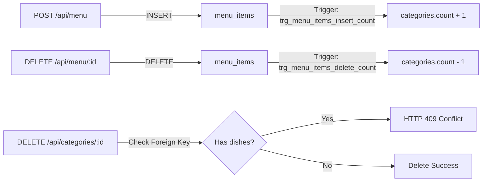

# 🌐 ឯកសារមគ្គុទ្ទេសក៍ API ពេញលេញនៃប្រព័ន្ធ Aura Bistro (Complete API Reference v2.0)

ឯកសារនេះរៀបរាប់យ៉ាងលម្អិតអំពី **RESTful API Endpoints ទាំង ៣៦** (រួមមាន ៣៧ Registered Route Handlers) ដែលត្រូវបានបង្កើត និងដំណើរការដោយ Express.js Backend (`http://localhost:5050`) សម្រាប់គម្រោង **Restaurant Ordering System (Aura Bistro)** ដោយភ្ជាប់ជាមួយរចនាសម្ព័ន្ធទិន្នន័យពិតប្រាកដក្នុង SQL Database (Native SQLite & Supabase PostgreSQL Schemas)។

---

## 📑 មាតិកា (Table of Contents)
1. [ទិដ្ឋភាពទូទៅនៃ API Engine & Base URL](#1-ទិដ្ឋភាពទូទៅនៃ-api-engine--base-url)
2. [ស្ថាបត្យកម្មលំហូរ Request Lifecycle (Architecture Diagram)](#2-ស្ថាបត្យកម្មលំហូរ-request-lifecycle)
3. [ប្រព័ន្ធសុវត្ថិភាព ការពារ Brute-force & RBAC](#3-ប្រព័ន្ធសុវត្ថិភាព-ការពារ-brute-force--rbac)
4. [តារាងសង្ខេប API Endpoints ទាំង ៣៦ (Complete Endpoints Summary)](#4-តារាងសង្ខេប-api-endpoints-ទាំង-៣៦)
5. [សេចក្តីលម្អិតនៃ API តាមផ្នែកទាំង ១០ និងការភ្ជាប់ជាមួយ SQL Schemas (Detailed Endpoint Specifications & SQL Mapping)](#5-សេចក្តីលម្អិតនៃ-api-តាមផ្នែកទាំង-១០-និងការភ្ជាប់ជាមួយ-sql-schemas)
   - [៥.១. ប្រព័ន្ធពិនិត្យសុខភាព (System Health - ១ Endpoint)](#៥១-ប្រព័ន្ធពិនិត្យសុខភាព-system-health)
   - [៥.២. គណនី និងសុវត្ថិភាព (Authentication & RBAC - ២ Endpoints)](#៥២-គណនី-និងសុវត្ថិភាព-authentication--rbac)
   - [៥.៣. ប្រភេទមុខម្ហូប (Categories CRUD - ៤ Endpoints)](#៥៣-ប្រភេទមុខម្ហូប-categories-crud)
   - [៥.៤. បញ្ជីម្ហូបអាហារ និងស្តុក (Menu Items & Stock - ៦ Endpoints)](#៥៤-បញ្ជីម្ហូបអាហារ-និងស្តុក-menu-items--stock)
   - [៥.៥. ប្រព័ន្ធកុម្ម៉ង់ ផ្ទះបាយ KDS & វិក្កយបត្រ (Orders, KDS & Receipt - ៦ Endpoints)](#៥៥-ប្រព័ន្ធកុម្ម៉ង់-ផ្ទះបាយ-kds--វិក្កយបត្រ-orders-kds--receipt)
   - [៥.៦. ប័ណ្ណបញ្ចុះតម្លៃ និងប្រូម៉ូសិន (Vouchers & Promo - ៥ Endpoints)](#៥៦-ប័ណ្ណបញ្ចុះតម្លៃ-និងប្រូម៉ូសិន-vouchers--promo)
   - [៥.៧. ប្លង់តុ និងស្ថានភាពតុ (Restaurant Floor Tables - ៣ Endpoints)](#៥៧-ប្លង់តុ-និងស្ថានភាពតុ-restaurant-floor-tables)
   - [៥.៨. បញ្ជីបុគ្គលិក និងធនធានមនុស្ស (Staff Roster & HR - ៤ Endpoints)](#៥៨-បញ្ជីបុគ្គលិក-និងធនធានមនុស្ស-staff-roster--hr)
   - [៥.៩. របាយការណ៍ និងស្ថិតិហិរញ្ញវត្ថុ (Stats & Financial Analytics - ១ Endpoint)](#៥៩-របាយការណ៍-និងស្ថិតិហិរញ្ញវត្ថុ-stats--financial-analytics)
   - [៥.១០. ប្រព័ន្ធទូទាត់ប្រាក់បាគង KHQR (Bakong Payment - ៤ Endpoints)](#៥១០-ប្រព័ន្ធទូទាត់ប្រាក់បាគង-khqr-bakong-payment)
6. [ស្វ័យប្រវត្តិកម្ម Database Triggers & Foreign Key Constraints](#6-ស្វ័យប្រវត្តិកម្ម-database-triggers--foreign-key-constraints)
7. [គំរូកូដ cURL សម្រាប់សាកល្បងរហ័ស (cURL Testing Guide)](#7-គំរូកូដ-curl-សម្រាប់សាកល្បងរហ័ស)
8. [លេខកូដឆ្លើយតបស្តង់ដារ HTTP Status Codes](#8-លេខកូដឆ្លើយតបស្តង់ដារ-http-status-codes)

---

## 1. ទិដ្ឋភាពទូទៅនៃ API Engine & Base URL

* **Backend Engine:** Node.js (v22+) + Express.js (Modular MVC Architecture)
* **Database Driver:** Native SQLite (`node:sqlite` in WAL Mode)
* **Base Server URL:** `http://localhost:5050`
* **API Prefix:** `http://localhost:5050/api`
* **Content-Type:** `application/json`
* **ចំនួន Endpoints សរុប:** **៣៦ Endpoints ស្នូល** (រួមមាន ៣៧ Route Handlers)

---

## 2. ស្ថាបត្យកម្មលំហូរ Request Lifecycle

ដ្យាក្រាមខាងក្រោមបង្ហាញពីលំហូរការងារនៅពេល Client (Customer/Admin/KDS) បាញ់ HTTP Request ចូលមកកាន់ Server៖

```mermaid
flowchart TD
    Client["Client App (React / KDS / POS)"] -->|HTTP Request| Express["Express Server (:5050)"]
    Express --> Cors["CORS & Body Parser"]
    Cors --> RateLimiter{"Rate Limiter\n(Login & Promo)"}
    
    RateLimiter -->|Too Fast (>30 req/min)| HTTP429["HTTP 429 Too Many Requests"]
    RateLimiter -->|Allowed| AuthMW{"Auth Middleware\nverifyToken"}
    
    AuthMW -->|Public Routes| Router["Controller Router"]
    AuthMW -->|Missing/Bad Token| HTTP401["HTTP 401 Unauthorized"]
    AuthMW -->|Valid JWT| RoleGuard{"Role Guard\nrequireRole(admin, ...)"}
    
    RoleGuard -->|Forbidden Role| HTTP403["HTTP 403 Forbidden"]
    RoleGuard -->|Authorized| Router
    
    Router --> Controller["Business Logic Controllers"]
    Controller -->|Read / Write| SQLite["Native SQLite Engine (WAL Mode)"]
    
    Controller -->|Order Created/Updated| SSE["SSE Live Stream Broadcaster\n(/api/orders/stream)"]
    SSE -->|Real-time Push| KDS["Kitchen KDS & Table Placards"]
    
    SQLite --> Result["SQL Result / ACID Transaction"]
    Result --> JSONResponse["HTTP JSON Response (200, 201, 404, 409)"]
    JSONResponse --> Client
```

---

## 3. ប្រព័ន្ធសុវត្ថិភាព ការពារ Brute-force & RBAC

### ក. In-Memory Sliding Window Rate Limiter
ប្រព័ន្ធការពារស្វ័យប្រវត្តិដើម្បីការពារការលួចទាយ Password ឬ Promo Voucher៖
* `POST /api/auth/login`: កម្រិតត្រឹម ៣០ ដង/នាទី ក្នុងមួយ IP (លើសពីនេះ ឆ្លើយតប `HTTP 429 Too Many Requests`)។
* `POST /api/vouchers/verify`: កម្រិតត្រឹម ៤០ ដង/នាទី ក្នុងមួយ IP។

### ខ. ការផ្ទៀងផ្ទាត់ JWT Token & Role-Based Access Control (RBAC)
```http
Authorization: Bearer <JWT_ACCESS_TOKEN>
```
1. **`admin`**: មានសិទ្ធិពេញលេញលើប្រព័ន្ធទាំងមូល (អាចបង្កើត, កែប្រែ, និងលុប Category, Menu, Staff, Voucher)។
2. **`manager`**: មានសិទ្ធិគ្រប់គ្រងបញ្ជីមុខម្ហូប, ប្រភេទម្ហូប, ប័ណ្ណបញ្ចុះតម្លៃ, និងបុគ្គលិក (មិនអាចលុបទិន្នន័យស្នូលបានទេ)។
3. **`kitchen`**: មានសិទ្ធិចូលកាន់ផ្ទះបាយ KDS, ប្តូរស្ថានភាពម្ហូប (Cooking ➔ Ready), និងបិទបើកស្តុកម្ហូប (In Stock / Out of Stock)។
4. **`staff`**: មានសិទ្ធិមើលបញ្ជីតុ, កុម្ម៉ង់ម្ហូបជំនួសភ្ញៀវ, និងប្តូរស្ថានភាពតុ (Available ➔ Occupied ➔ Served)។
5. **`Public (Guest)`**: អតិថិជនទូទៅអាចចូលមើល Menu, Category, កុម្ម៉ង់ម្ហូប (Checkout), ផ្ទៀងផ្ទាត់ Voucher, និងទូទាត់ Bakong KHQR ដោយមិនចាំបាច់ Login ឡើយ។

---

## 4. តារាងសង្ខេប API Endpoints ទាំង ៣៦ (Complete Endpoints Summary)

| # | Method | API Endpoint Link | សិទ្ធិចូលប្រើ (Access/RBAC) | តារាង SQL ដែលពាក់ព័ន្ធ (SQL Table Mapping) | មុខងារសង្ខេប (Description) |
| :- | :---: | :--- | :---: | :---: | :--- |
| **១. ប្រព័ន្ធពិនិត្យសុខភាព (System Health - 1)** | | | | | |
| **1** | `GET` | `http://localhost:5050/api/health` | 🌐 Public | *(គ្មានតារាង - Memory Check)* | ពិនិត្យស្ថានភាពដំណើរការរបស់ Backend Server |
| **២. គណនី និងសុវត្ថិភាព (Authentication & RBAC - 2)** | | | | | |
| **2** | `POST` | `http://localhost:5050/api/auth/login` | 🌐 Public (Rate-Limited) | `users` | ផ្ទៀងផ្ទាត់ Username & Password រួចចេញ JWT Token |
| **3** | `GET` | `http://localhost:5050/api/auth/me` | 🔒 Protected | `users` | ទទួលព័ត៌មាន Profile នៃគណនីដែលកំពុង Login |
| **៣. ប្រភេទមុខម្ហូប (Categories CRUD - 4)** | | | | | |
| **4** | `GET` | `http://localhost:5050/api/categories` | 🌐 Public | `categories` JOIN `menu_items` | ទាញយកបញ្ជីប្រភេទមុខម្ហូបទាំងអស់ + ចំនួនម្ហូបក្នុងប្រភេទ |
| **5** | `POST` | `http://localhost:5050/api/categories` | 🛡️ Admin, Manager | `categories` | បង្កើតប្រភេទមុខម្ហូបថ្មី (Starters, Steaks...) |
| **6** | `PUT` | `http://localhost:5050/api/categories/:id` | 🛡️ Admin, Manager | `categories` | កែប្រែឈ្មោះប្រភេទម្ហូប, Icon, ឬលំដាប់បង្ហាញ |
| **7** | `DELETE` | `http://localhost:5050/api/categories/:id` | 👑 Admin Only | `categories` (Restrict by `menu_items`) | លុបប្រភេទមុខម្ហូប (ជាប់ 409 Conflict បើមានមុខម្ហូប) |
| **៤. បញ្ជីម្ហូបអាហារ និងស្តុក (Menu Items & Stock - 6)** | | | | | |
| **8** | `GET` | `http://localhost:5050/api/menu` | 🌐 Public | `menu_items` JOIN `categories` | ទាញយកបញ្ជីមុខម្ហូបទាំងអស់ (មាន Filter និង Sort) |
| **9** | `GET` | `http://localhost:5050/api/menu/:id` | 🌐 Public | `menu_items` JOIN `categories` | មើលព័ត៌មានលម្អិតមុខម្ហូបមួយ (គាំទ្រ `dish-1` ឬ `1`) |
| **10** | `POST` | `http://localhost:5050/api/menu` | 🛡️ Admin, Manager | `menu_items` ➔ Trigger `categories.count` | បញ្ចូលមុខម្ហូបថ្មីក្នុងបញ្ជី Menu (Trigger +1) |
| **11** | `PUT` | `http://localhost:5050/api/menu/:id` | 🛡️ Admin, Manager | `menu_items` | កែប្រែតម្លៃ, ឈ្មោះ, ឬព័ត៌មានម្ហូប |
| **12** | `PATCH` | `http://localhost:5050/api/menu/:id/toggle` | 👨‍🍳 Staff, Kitchen, Admin | `menu_items` (`isAvailable`) | បិទ/បើកស្ថានភាពស្តុកម្ហូប (In-Stock / Out-of-Stock) |
| **13** | `DELETE` | `http://localhost:5050/api/menu/:id` | 👑 Admin Only | `menu_items` (Restrict by `order_items`) | លុបមុខម្ហូបចេញពី Menu (Trigger -1 / ជាប់ 409 បើមាន Order) |
| **៥. ប្រព័ន្ធកុម្ម៉ង់ ផ្ទះបាយ KDS & វិក្កយបត្រ (Orders, KDS & Receipt - 6)** | | | | | |
| **14** | `POST` | `http://localhost:5050/api/orders` | 🌐 Public (Customer) | `orders` + `order_items` + `restaurant_tables` | បញ្ជូនការកុម្ម៉ង់ថ្មី (ACID Transaction + Table Occupied) |
| **15** | `GET` | `http://localhost:5050/api/orders/stream` | 🌐 Public / KDS | *(In-Memory SSE Stream)* | 📡 **Live SSE Stream** សម្រាប់ផ្ទះបាយ KDS ទទួល Order ភ្លាមៗ |
| **16** | `GET` | `http://localhost:5050/api/orders` | 🌐 Public / Internal | `orders` JOIN `order_items` JOIN `menu_items` | ទាញយកបញ្ជី Orders (គាំទ្រ `?page=1&limit=20` & `?date=`) |
| **17** | `GET` | `http://localhost:5050/api/orders/:id/receipt` | 🌐 Public / Staff | `orders` JOIN `order_items` | 🖨️ **ទាញយកទិន្នន័យវិក្កយបត្រកម្ដៅ (80mm/58mm Thermal)** |
| **18** | `GET` | `http://localhost:5050/api/orders/:id` | 🌐 Public | `orders` JOIN `order_items` | តាមដានស្ថានភាព Order ជាក់លាក់ (តាម ID ឬ ORD Code) |
| **19** | `PATCH` | `http://localhost:5050/api/orders/:id/status` | 👨‍🍳 Floor, Kitchen, Admin | `orders.status` ➔ `restaurant_tables.status` | ផ្លាស់ប្តូរស្ថានភាពធ្វើម្ហូប (Cooking ➔ Ready ➔ Served ➔ Free Table) |
| **៦. ប័ណ្ណបញ្ចុះតម្លៃ និងប្រូម៉ូសិន (Vouchers & Promo - 5)** | | | | | |
| **20** | `GET` | `http://localhost:5050/api/vouchers` | 🌐 Public | `vouchers` | ទាញយកបញ្ជីប័ណ្ណបញ្ចុះតម្លៃដែលមានសុពលភាព |
| **21** | `POST` | `http://localhost:5050/api/vouchers/verify` | 🌐 Public (Rate-Limited) | `vouchers` | ផ្ទៀងផ្ទាត់កូដប្រូម៉ូសិន និងគណនាចំនួនបញ្ចុះតម្លៃ |
| **22** | `POST` | `http://localhost:5050/api/vouchers` | 🛡️ Admin, Manager | `vouchers` | បង្កើតប័ណ្ណបញ្ចុះតម្លៃថ្មី |
| **23** | `PUT` | `http://localhost:5050/api/vouchers/:id` | 🛡️ Admin, Manager | `vouchers` | កែប្រែភាគរយ ឬបើក/បិទប័ណ្ណបញ្ចុះតម្លៃ |
| **24** | `DELETE` | `http://localhost:5050/api/vouchers/:id` | 👑 Admin Only | `vouchers` | លុបប័ណ្ណបញ្ចុះតម្លៃចេញពីប្រព័ន្ធ |
| **៧. ប្លង់តុ និងស្ថានភាពតុ (Restaurant Floor Tables - 3)** | | | | | |
| **25** | `GET` | `http://localhost:5050/api/tables` | 🌐 Public / Staff | `restaurant_tables` | ទាញយកបញ្ជីប្លង់តុទាំង ៨ និងស្ថានភាពទំនេរ/មានភ្ញៀវ |
| **26** | `PATCH` | `http://localhost:5050/api/tables/:id/status` | 👨‍🍳 Floor Staff, Admin | `restaurant_tables` | ប្តូរស្ថានភាពតុ (Available, Occupied, Cleaning...) |
| **27** | `PUT` | `http://localhost:5050/api/tables/:id` | 👨‍🍳 Floor Staff, Admin | `restaurant_tables` | កែប្រែព័ត៌មានតុ (សមត្ថភាពកៅអី, តំបន់, ឬស្ថានភាព) |
| **៨. បញ្ជីបុគ្គលិក និងធនធានមនុស្ស (Staff Roster & HR - 4)** | | | | | |
| **28** | `GET` | `http://localhost:5050/api/staff` | 🌐 Public / Internal | `users` | ទាញយកបញ្ជីរាយនាមបុគ្គលិកទាំងអស់ |
| **29** | `POST` | `http://localhost:5050/api/staff` | 🛡️ Admin, Manager | `users` | បង្កើតគណនីបុគ្គលិកថ្មី (Waiter, Chef, Bar...) |
| **30** | `PUT` | `http://localhost:5050/api/staff/:id` | 🛡️ Admin, Manager | `users` | កែប្រែព័ត៌មានបុគ្គលិក, ប្រាក់ឈ្នួល, វេនការងារ |
| **31** | `DELETE` | `http://localhost:5050/api/staff/:id` | 👑 Admin Only | `users` | លុបគណនីបុគ្គលិកចេញពីប្រព័ន្ធ |
| **៩. ស្ថិតិហិរញ្ញវត្ថុ និងរបាយការណ៍ (Stats & Analytics - 1)** | | | | | |
| **32** | `GET` | `http://localhost:5050/api/stats/summary` | 🛡️ Admin, Manager | Aggregated from `orders` & `restaurant_tables` | មើលចំណូលពិត (Realized Revenue), ចំនួន Orders, Avg Ticket |
| **១០. ប្រព័ន្ធទូទាត់ប្រាក់បាគង KHQR (Bakong Payment - 4)** | | | | | |
| **33** | `POST` | `http://localhost:5050/api/bakong/generate` | 🌐 Public | *(NBC EMVCo Generator)* | បង្កើតកូដ KHQR និងរូបភាព QR តាមស្តង់ដារ NBC |
| **34** | `GET` | `http://localhost:5050/api/bakong/check/:md5` | 🌐 Public | *(NBC Transaction Lookup)* | ពិនិត្យស្ថានភាពទូទាត់ប្រាក់តាម MD5 Transaction Hash |
| **35** | `POST` | `http://localhost:5050/api/bakong/settle` | 🌐 Public / Webhook | `orders` (`paymentStatus = 'paid'`) | ទូទាត់វិក្កយបត្របាគង និងប្តូរ status ទៅជា Paid ស្វ័យប្រវត្តិ |
| **36** | `POST` | `http://localhost:5050/api/bakong/webhook` | 🌐 Public / Webhook | `orders` (`paymentStatus = 'paid'`) | ទទួល Callback បញ្ជាក់ការទូទាត់ពី Gateway ធនាគារជាតិ |

---

## 5. សេចក្តីលម្អិតនៃ API តាមផ្នែកទាំង ១០ និងការភ្ជាប់ជាមួយ SQL Schemas

### ៥.១. ប្រព័ន្ធពិនិត្យសុខភាព (System Health)

#### `GET /api/health`
* **សិទ្ធិចូលប្រើ:** 🌐 Public
* **SQL Database Mapping:** មិនភ្ជាប់តារាង (ពិនិត្យដំណើរការ Process Node.js និង SQLite Connection ក្នុង Memory)
* **Response (200 OK):**
```json
{
  "status": "healthy",
  "timestamp": "2026-11-21T12:40:00.000Z"
}
```

---

### ៥.២. គណនី និងសុវត្ថិភាព (Authentication & RBAC)

#### `POST /api/auth/login`
* **សិទ្ធិចូលប្រើ:** 🌐 Public (In-Memory Rate Limiter: ៣០ ដង/នាទី)
* **SQL Database Mapping:** តារាង `users`
  * Query: `SELECT * FROM users WHERE username = ?`
  * ផ្ទៀងផ្ទាត់ Password តាមរយៈ `bcrypt.compareSync(password, user.password)`
* **Request Body:**
```json
{
  "username": "admin",
  "password": "admin123"
}
```
* **Response (200 OK):**
```json
{
  "token": "eyJhbGciOiJIUzI1NiIsInR5cCI6IkpXVCJ9...",
  "user": {
    "id": 1,
    "username": "admin",
    "role": "admin",
    "name": "Sokha Vathna",
    "department": "Management & Operations",
    "duty_status": "on_duty"
  }
}
```
* **Error (401 Unauthorized):** `{"error": "Invalid username or password"}`
* **Error (429 Too Many Requests):** `{"error": "Too many login attempts. Please wait 1 minute before retrying."}`

#### `GET /api/auth/me`
* **សិទ្ធិចូលប្រើ:** 🔒 Protected (ត្រូវការ Header: `Authorization: Bearer <TOKEN>`)
* **SQL Database Mapping:** `SELECT id, username, role, name, phone, email, department, shift, hourly_rate, duty_status FROM users WHERE id = ?`
* **Response (200 OK):** ទទួលបាន Profile នៃគណនីដែលកំពុង Login។

---

### ៥.៣. ប្រភេទមុខម្ហូប (Categories CRUD)

#### `GET /api/categories`
* **សិទ្ធិចូលប្រើ:** 🌐 Public
* **SQL Database Mapping:**
  ```sql
  SELECT c.*, COUNT(m.id) as dishCount
  FROM categories c
  LEFT JOIN menu_items m ON c.id = m.categoryId
  GROUP BY c.id
  ORDER BY c.display_order ASC, c.id ASC;
  ```
* **Response (200 OK):**
```json
[
  {
    "id": "starters",
    "dbId": 1,
    "name": "Starters & Tapas",
    "icon": "fa-solid fa-plate-wheat",
    "description": "Small bites & artisan appetizers",
    "displayOrder": 1,
    "count": 2
  }
]
```

#### `POST /api/categories`
* **សិទ្ធិចូលប្រើ:** 🛡️ Admin, Manager
* **SQL Database Mapping:** `INSERT INTO categories (name, icon, description, display_order) VALUES (?, ?, ?, ?)`
* **Request Body:**
```json
{
  "name": "Artisan Beverages",
  "icon": "fa-solid fa-martini-glass",
  "description": "Craft cocktails and mocktails",
  "displayOrder": 7
}
```
* **Response (201 Created):**
```json
{
  "id": 7,
  "name": "Artisan Beverages",
  "icon": "fa-solid fa-martini-glass",
  "description": "Craft cocktails and mocktails",
  "displayOrder": 7,
  "count": 0
}
```

#### `PUT /api/categories/:id`
* **សិទ្ធិចូលប្រើ:** 🛡️ Admin, Manager
* **SQL Database Mapping:** `UPDATE categories SET name = ?, icon = ?, description = ?, display_order = ? WHERE id = ?` (គាំទ្រ ID ជាលេខ ឬជា Slug)

#### `DELETE /api/categories/:id`
* **សិទ្ធិចូលប្រើ:** 👑 Admin Only
* **SQL Database Mapping:**
  * ពិនិត្យ Foreign Key: `SELECT COUNT(*) as count FROM menu_items WHERE categoryId = ?`
  * ប្រសិនបើមានមុខម្ហូប ➔ **HTTP 409 Conflict**: `{"error": "Cannot delete category: existing menu items are assigned to this category."}`
  * ប្រសិនបើគ្មានមុខម្ហូប ➔ `DELETE FROM categories WHERE id = ?` ➔ **HTTP 200 OK**

---

### ៥.៤. បញ្ជីម្ហូបអាហារ និងស្តុក (Menu Items & Stock)

#### `GET /api/menu`
* **សិទ្ធិចូលប្រើ:** 🌐 Public
* **Query Parameters:** `?category=steaks`, `?dietary=spicy`, `?search=wagyu`
* **SQL Database Mapping:**
  ```sql
  SELECT m.*, c.name as categoryName
  FROM menu_items m
  JOIN categories c ON m.categoryId = c.id
  ORDER BY m.id ASC;
  ```
* **Response (200 OK):**
```json
[
  {
    "id": "dish-1",
    "dbId": 1,
    "name": "Truffle Glazed Wagyu Ribeye",
    "price": 38.50,
    "image": "https://images.unsplash.com/...",
    "description": "A5 Australian Wagyu ribeye...",
    "isAvailable": true,
    "inStock": true,
    "categoryId": 3,
    "categoryName": "Prime Steaks & Grill",
    "category": "steaks"
  }
]
```

#### `POST /api/menu`
* **សិទ្ធិចូលប្រើ:** 🛡️ Admin, Manager
* **SQL Database Mapping:** `INSERT INTO menu_items (name, description, price, image, isAvailable, categoryId) VALUES (?, ?, ?, ?, 1, ?)`
* **Database Trigger:** SQLite Trigger `trg_menu_items_insert_count` នឹងដំឡើង `categories.count = count + 1` ដោយស្វ័យប្រវត្តិ។

#### `PATCH /api/menu/:id/toggle`
* **សិទ្ធិចូលប្រើ:** 👨‍🍳 Staff, Kitchen, Admin
* **SQL Database Mapping:** `UPDATE menu_items SET isAvailable = CASE WHEN isAvailable = 1 THEN 0 ELSE 1 END WHERE id = ?`
* **Response (200 OK):**
```json
{
  "id": "dish-1",
  "isAvailable": false,
  "inStock": false,
  "message": "Stock status toggled successfully"
}
```

#### `DELETE /api/menu/:id`
* **សិទ្ធិចូលប្រើ:** 👑 Admin Only
* **SQL Database Mapping:**
  * ពិនិត្យមើលតារាង `order_items`: `SELECT COUNT(*) as count FROM order_items WHERE menuItemId = ?`
  * ប្រសិនបើធ្លាប់មានភ្ញៀវកុម្ម៉ង់ ➔ **HTTP 409 Conflict**: `{"error": "Cannot delete dish: dish is referenced in past customer orders. Toggle Out of Stock instead."}`
  * ប្រសិនបើមិនដែលមានការកុម្ម៉ង់ ➔ `DELETE FROM menu_items WHERE id = ?` ➔ Trigger `trg_menu_items_delete_count` បន្ថយ `categories.count` ស្វ័យប្រវត្តិ។

---

### ៥.៥. ប្រព័ន្ធកុម្ម៉ង់ ផ្ទះបាយ KDS & វិក្កយបត្រ (Orders, KDS & Receipt)

#### `POST /api/orders`
* **សិទ្ធិចូលប្រើ:** 🌐 Public (Customer)
* **SQL Database Mapping (ACID Transaction):**
  1. ផ្ទៀងផ្ទាត់ Voucher ពីតារាង `vouchers` (ដែល `isActive = 1`)
  2. គណនា Financial Breakdown: Subtotal, Discount, Tax (10%), Service Fee (5%), Total
  3. សរសេរចូលតារាង `orders`:
     ```sql
     INSERT INTO orders (orderCode, orderType, tableNumber, customerName, customerPhone, deliveryAddress, deliveryFee, customerNotes, subtotal, tax, serviceFee, discountAmount, voucherCode, totalAmount, paymentMethod, paymentStatus, status)
     VALUES (?, ?, ?, ?, ?, ?, ?, ?, ?, ?, ?, ?, ?, ?, ?, ?, 'pending');
     ```
  4. សរសេរគ្រប់មុខម្ហូបចូលតារាង `order_items`:
     ```sql
     INSERT INTO order_items (orderId, menuItemId, quantity, unitPrice) VALUES (?, ?, ?, ?);
     ```
  5. ប្រសិនបើកុម្ម៉ង់ Dine-in ➔ Update ស្ថានភាពតុស្វ័យប្រវត្តិ: `UPDATE restaurant_tables SET status = 'occupied' WHERE tableNumber = ?`
  6. Broadcast Event `order_created` ទៅកាន់ KDS តាមរយៈ SSE Stream `/api/orders/stream`។
* **Request Body:**
```json
{
  "orderType": "dine_in",
  "tableNumber": "04",
  "customerName": "Dara Roth",
  "customerPhone": "012345678",
  "subtotal": 85.00,
  "discountAmount": 12.75,
  "voucherCode": "AURAVIP15",
  "paymentMethod": "khqr",
  "items": [
    { "id": "dish-1", "quantity": 1, "price": 38.50 },
    { "id": "dish-2", "quantity": 2, "price": 24.00 }
  ]
}
```

#### `GET /api/orders/stream` (📡 Real-Time SSE Stream)
* **សិទ្ធិចូលប្រើ:** 🌐 Public / Kitchen KDS
* **ប្រភេទ Content:** `text/event-stream`
* **ព្រឹត្តិការណ៍ដែលផ្សាយផ្ទាល់ (Live Events):**
  * `order_created`: បាញ់ពេលមាន Order ថ្មីចូល
  * `order_status_updated`: បាញ់ពេលចង្ក្រានបាយប្តូរ Status (`cooking`, `ready`, `served`)

#### `GET /api/orders` (គាំទ្រ Pagination & Filtering)
* **Query Parameters:** `?page=1&limit=20`, `?date=2026-11-21`, `?status=cooking`
* **SQL Database Mapping:**
  ```sql
  SELECT * FROM orders WHERE ... ORDER BY id DESC;
  -- រួមជាមួយ Query order_items នៃ order នីមួយៗ
  SELECT oi.*, m.name, m.image FROM order_items oi JOIN menu_items m ON oi.menuItemId = m.id WHERE oi.orderId = ?;
  ```

#### `GET /api/orders/:id/receipt` (🖨️ 80mm/58mm Thermal Print Payload)
* **សិទ្ធិចូលប្រើ:** 🌐 Public / Staff
* **គោលបំណង:** បង្កើត Payload ស្តង់ដារ POS សម្រាប់បោះពុម្ពវិក្កយបត្រកម្ដៅ (Thermal Printer)។
* **Response (200 OK):**
```json
{
  "restaurant": {
    "name": "AURA BISTRO",
    "tagline": "Artisanal Gastronomy & Fine Dining",
    "address": "Preah Monivong Blvd, Phnom Penh, Cambodia",
    "telephone": "+855 23 999 888"
  },
  "invoice": {
    "orderCode": "ORD-1001",
    "dateTime": "2026-11-21 12:26:04",
    "diningMode": "DINE_IN",
    "tableNumber": "Table 04",
    "guestName": "Dara Roth",
    "paymentMethod": "KHQR",
    "paymentStatus": "PAID"
  },
  "lineItems": [
    { "name": "Truffle Glazed Wagyu Ribeye", "quantity": 1, "unitPrice": 38.50, "total": 38.50 }
  ],
  "financialSummary": {
    "subtotal": 38.50,
    "discountAmount": 5.78,
    "tax10Percent": 3.27,
    "serviceFee5Percent": 1.64,
    "netPayableAmount": 37.63
  }
}
```

#### `PATCH /api/orders/:id/status`
* **សិទ្ធិចូលប្រើ:** 👨‍🍳 Floor, Kitchen, Admin
* **SQL Database Mapping:**
  * Update: `UPDATE orders SET status = ? WHERE orderCode = ?`
  * ប្រសិនបើ Status = `'served'`: ពិនិត្យមើលថាតើមាន Order ផ្សេងទៀតកំពុងសកម្មលើតុនោះដែរឬទេ? ប្រសិនបើគ្មាន ➔ `UPDATE restaurant_tables SET status = 'available' WHERE tableNumber = ?` (ដោះលែងតុឱ្យទំនេរស្វ័យប្រវត្តិ)។
  * Broadcast `order_status_updated` តាម SSE។

---

### ៥.៦. ប័ណ្ណបញ្ចុះតម្លៃ និងប្រូម៉ូសិន (Vouchers & Promo)

#### `GET /api/vouchers`
* **សិទ្ធិចូលប្រើ:** 🌐 Public
* **SQL Database Mapping:** `SELECT * FROM vouchers ORDER BY id ASC`

#### `POST /api/vouchers/verify`
* **សិទ្ធិចូលប្រើ:** 🌐 Public (In-Memory Rate Limiter: ៤០ ដង/នាទី)
* **SQL Database Mapping:** `SELECT code, discountPercent, description, isActive FROM vouchers WHERE UPPER(code) = ?`
* **Request Body:** `{ "code": "AURAVIP15", "subtotal": 100.00 }`
* **Response (200 OK):**
```json
{
  "valid": true,
  "code": "AURAVIP15",
  "discountPercent": 15.0,
  "discountAmount": 15.00,
  "finalSubtotal": 85.00
}
```

---

### ៥.៧. ប្លង់តុ និងស្ថានភាពតុ (Restaurant Floor Tables)

#### `GET /api/tables`
* **សិទ្ធិចូលប្រើ:** 🌐 Public / Staff
* **SQL Database Mapping:** `SELECT * FROM restaurant_tables ORDER BY tableNumber ASC`

#### `PATCH /api/tables/:id/status`
* **សិទ្ធិចូលប្រើ:** 👨‍🍳 Floor Staff, Admin
* **SQL Database Mapping:** `UPDATE restaurant_tables SET status = ? WHERE id = ? OR tableNumber = ?`
* **Request Body:** `{ "status": "cleaning" }` (Statuses: `available`, `occupied`, `cleaning`, `reserved`)

---

### ៥.៨. បញ្ជីបុគ្គលិក និងធនធានមនុស្ស (Staff Roster & HR)

#### `GET /api/staff`
* **សិទ្ធិចូលប្រើ:** 🌐 Public / Internal
* **SQL Database Mapping:** `SELECT id, username, role, name, phone, email, department, shift, hourly_rate, duty_status, hire_date FROM users ORDER BY id ASC`

#### `POST /api/staff`
* **សិទ្ធិចូលប្រើ:** 🛡️ Admin, Manager
* **SQL Database Mapping:** `INSERT INTO users (username, password, role, name, phone, email, department, shift, hourly_rate, duty_status) VALUES (?, ?, ?, ?, ?, ?, ?, ?, ?, ?)`

---

### ៥.៩. របាយការណ៍ និងស្ថិតិហិរញ្ញវត្ថុ (Stats & Financial Analytics)

#### `GET /api/stats/summary`
* **សិទ្ធិចូលប្រើ:** 🛡️ Admin, Manager
* **SQL Database Mapping:**
  ```sql
  -- គណនាចំណូលពិតជាក់ស្តែង (Realized Revenue) ពី Order ដែល Served រួច
  SELECT 
    COUNT(*) as totalOrders,
    COALESCE(SUM(totalAmount), 0) as totalRevenue,
    COALESCE(AVG(totalAmount), 0) as avgOrderValue
  FROM orders 
  WHERE status IN ('served', 'completed', 'delivered');
  ```

---

### ៥.១០. ប្រព័ន្ធទូទាត់ប្រាក់បាគង KHQR (Bakong Payment)

#### `POST /api/bakong/generate`
* **សិទ្ធិចូលប្រើ:** 🌐 Public
* **Request Body:** `{ "amount": 45.50, "currency": "USD", "billNumber": "INV-1047" }`
* **Response (200 OK):** ទទួលបានកូដ KHQR ស្តង់ដារ NBC, MD5 Transaction Hash, និង DeepLink។

#### `POST /api/bakong/settle`
* **សិទ្ធិចូលប្រើ:** 🌐 Public / Webhook
* **SQL Database Mapping:** `UPDATE orders SET paymentStatus = 'Paid', status = 'cooking' WHERE orderCode = ?`

---

## 6. ស្វ័យប្រវត្តិកម្ម Database Triggers & Foreign Key Constraints

ប្រព័ន្ធ Aura Bistro បានបង្កប់នូវ Business Rules សំខាន់ៗចំនួន ៣ ដោយផ្ទាល់ក្នុងកម្រិត SQL Engine៖



1. **Category Dish Count Auto-Sync:** គ្រប់ពេលដែលមានការបន្ថែម ឬលុបមុខម្ហូប ចំនួនមុខម្ហូបក្នុងប្រភេទនីមួយៗនឹងត្រូវ Synchronized ស្វ័យប្រវត្តិតាមរយៈ SQL Triggers។
2. **Foreign Key Protection (HTTP 409 Conflict):** ការពារមិនឱ្យមានទិន្នន័យខូចខាត (Orphan Rows) ដោយហាមឃាត់ការលុប Category ឬ Dish ដែលមានទិន្នន័យពាក់ព័ន្ធ។
3. **Table Occupancy Automation:** តុនឹងប្តូរទៅជា `occupied` ដោយស្វ័យប្រវត្តិកាលណាមាន Order Dine-in ចូល ហើយនឹងដោះលែងមក `available` វិញភ្លាមៗពេល Order ត្រូវបាន `served`។

---

## 7. គំរូកូដ cURL សម្រាប់សាកល្បងរហ័ស (cURL Testing Guide)

### ១. ចូលប្រព័ន្ធ (Login) ទទួល JWT Token:
```bash
curl -X POST http://localhost:5050/api/auth/login \
  -H "Content-Type: application/json" \
  -d '{"username":"admin","password":"admin123"}'
```

### ២. ពិនិត្យវិក្កយបត្រតាមទំព័រ (Pagination):
```bash
curl -X GET "http://localhost:5050/api/orders?page=1&limit=5"
```

### ៣. ទាញយកទិន្នន័យព្រីនវិក្កយបត្រកម្ដៅ (Thermal Receipt):
```bash
curl -X GET http://localhost:5050/api/orders/ORD-1001/receipt
```

### ៤. ភ្ជាប់ទៅកាន់ Live SSE Stream របស់ផ្ទះបាយ:
```bash
curl -N -H "Accept:text/event-stream" http://localhost:5050/api/orders/stream
```

### ៥. ផ្ទៀងផ្ទាត់កូដបញ្ចុះតម្លៃ (Voucher Verify):
```bash
curl -X POST http://localhost:5050/api/vouchers/verify \
  -H "Content-Type: application/json" \
  -d '{"code":"AURAVIP15","subtotal":100}'
```

---

## 8. លេខកូដឆ្លើយតបស្តង់ដារ HTTP Status Codes

| លេខកូដ (Status) | អត្ថន័យបច្ចេកទេស | ឧទាហរណ៍ជាក់ស្តែងក្នុងប្រព័ន្ធ |
| :---: | :--- | :--- |
| **`200 OK`** | សំណើជោគជ័យ | ទាញយកទិន្នន័យ (GET) ឬកែប្រែទិន្នន័យជោគជ័យ |
| **`201 Created`** | បង្កើតទិន្នន័យជោគជ័យ | បង្កើត Order, Menu Item, ឬ Staff ថ្មី |
| **`400 Bad Request`** | ទិន្នន័យមិនត្រឹមត្រូវ | ខ្វះ Parameter ឬទម្រង់ JSON ខុស |
| **`401 Unauthorized`** | អត់ទាន់ Login ឬ Token ខូច | ចូលទៅកាន់ Protected API ដោយគ្មាន Bearer Token |
| **`403 Forbidden`** | សិទ្ធិមិនគ្រប់គ្រាន់ (RBAC) | គណនី `staff` ព្យាយាមលុប Category ឬ Menu Item |
| **`404 Not Found`** | រកមិនឃើញទិន្នន័យ | រកមិនឃើញលេខកូដ Order ឬ Voucher ដែលបានបញ្ចូល |
| **`409 Conflict`** | ប៉ះពាល់ Foreign Key Integrity | ព្យាយាមលុប Category ដែលកំពុងមានមុខម្ហូប ឬលុបម្ហូបដែលធ្លាប់ Order |
| **`429 Too Many Requests`** | បាញ់ Request ញឹកញាប់ពេក | ព្យាយាម Login ខុសលើសពី ៣០ ដងក្នុងមួយនាទី (Rate Limiting) |
| **`500 Server Error`** | កំហុសបច្ចេកទេសខាងក្នុង | កំហុសដែលមិនបានរំពឹងទុករបស់ Server Engine |
