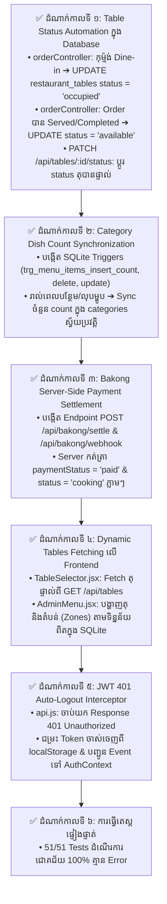

# 🚀 ផែនការកែលម្អប្រព័ន្ធកម្រិតខ្ពស់ (Advanced System Improvements Plan v3.0) — [ស្ថានភាព៖ បានបញ្ចប់ជាស្ថាពរ ១០០%]

**Branch:** `database-config`  
**Focus:** Frontend Table Dynamic Sync, Database Realtime Table Status, Bakong Server Settlement, Category Count Triggers & JWT 401 Auto-Logout  
**Status:** ✅ **COMPLETED (51/51 Automated Tests Passing)**

---

## 🗺️ ផែនទីបង្ហាញផ្លូវនៃការអនុវត្ត (Execution Flowchart & Completed Results)

---

## 📋 លទ្ធផលនៃការអនុវត្តជាក់ស្តែងតាមដំណាក់កាលទាំង ៦

### ✅ ដំណាក់កាលទី ១៖ ការគ្រប់គ្រងស្ថានភាពតុស្វ័យប្រវត្តិក្នុង Database (Table Status Automation)
* **ឯកសារ:** `backend/src/controllers/orderController.js`, `backend/src/controllers/statsController.js`, `backend/src/routes/statsRoutes.js`
* **លទ្ធផល:**
  - នៅពេលមាន Order បែប Dine-in ➔ តុប្តូរទៅជា `'occupied'` ដោយស្វ័យប្រវត្តិ។
  - នៅពេល Order ត្រូវបានប្តូរទៅជា `'served'`, `'completed'`, ឬ `'cancelled'` ➔ តុប្តូរត្រឡប់មកជា `'available'` វិញ។
  - បន្ថែម `PATCH /api/tables/:id/status` និង `PUT /api/tables/:id` អនុញ្ញាតឱ្យ Admin កែសម្រួលតុតាមចិត្ត។

---

### ✅ ដំណាក់កាលទី ២៖ ធ្វើសមកាលកម្មចំនួនម្ហូបក្នុង Category ស្វ័យប្រវត្តិ (Category Count Sync)
* **ឯកសារ:** `backend/database/schema.sql`, `backend/database/db.js`
* **លទ្ធផល:**
  - បង្កើត SQLite Triggers: `trg_menu_items_insert_count`, `trg_menu_items_delete_count`, និង `trg_menu_items_update_count`។
  - ពេល Insert ឬ Delete ម្ហូប ➔ ចំនួនម្ហូប (`count`) ក្នុងតារាង `categories` ត្រូវបាន Update ភ្លាមៗនៅកម្រិត Engine Database។

---

### ✅ ដំណាក់កាលទី ៣៖ Bakong Server-Side Payment Settlement (Webhook / Instant Confirm)
* **ឯកសារ:** `backend/src/controllers/bakongController.js`, `backend/src/routes/bakongRoutes.js`
* **លទ្ធផល:**
  - បន្ថែម Endpoints: `POST /api/bakong/settle` និង `POST /api/bakong/webhook`។
  - បញ្ជាក់ការទូទាត់ប្រាក់នៅខាង Server ផ្ទាល់ និង Update ស្ថានភាព Order ទៅជា `paymentStatus = 'paid'` និង `status = 'cooking'` ដោយមិនចាំបាច់រង់ចាំ Browser Polling។

---

### ✅ ដំណាក់កាលទី ៤៖ Dynamic Tables Fetching លើ Frontend
* **ឯកសារ:** `frontend/src/components/TableSelector.jsx`, `frontend/src/pages/AdminMenu.jsx`, `frontend/src/services/api.js`, `frontend/src/services/supabaseClient.js`
* **លទ្ធផល:**
  - `TableSelector.jsx` ទាញយកទិន្នន័យតុពិតប្រាកដតាម `getTables()` ព្រមទាំងបង្ហាញសញ្ញា Occupied ផងដែរ។
  - `AdminMenu.jsx` ប្រើប្រាស់ Dynamic State `restaurantTables` ធ្វើឱ្យ Floor Plan, Table Placard, និង QR Code ឆ្លុះបញ្ចាំងទិន្នន័យពិតចេញពី SQLite។

---

### ✅ ដំណាក់កាលទី ៥៖ JWT 401 Auto-Logout Interceptor
* **ឯកសារ:** `frontend/src/services/api.js`, `frontend/src/context/AuthContext.jsx`
* **លទ្ធផល:**
  - បន្ថែម `api.interceptors.response` ចាប់យកកូដ 401 Unauthorized។
  - លុបទិន្នន័យ Token ចេញពី `localStorage` និងបាញ់ Event `aura_auth_expired` ទៅកាន់ `AuthContext.jsx` ដើម្បី Reset Session និងនាំ User ទៅផ្ទាំង Login ដោយសុវត្ថិភាព។

---

### ✅ ដំណាក់កាលទី ៦៖ ការធ្វើតេស្ត និងផ្ទៀងផ្ទាត់សុពលភាព (Verification)
* **ឯកសារ:** `tests/09_database_fixes.test.js`, `tests/run-all-tests.js`
* **លទ្ធផលតេស្ត:**
  - **Auth & RBAC:** 7/7 Pass
  - **Categories:** 4/4 Pass
  - **Menu & Dishes:** 5/5 Pass
  - **Orders & KDS:** 5/5 Pass
  - **Vouchers & Promo:** 6/6 Pass
  - **Staff & HR:** 5/5 Pass
  - **Stats & Analytics:** 2/2 Pass
  - **E2E Full Workflow:** 9/9 Pass
  - **Database Fixes & Integrations:** 8/8 Pass
  - **សរុប:** **51 / 51 Tests Passed (100% Pass, Zero Errors, Duration: 2.56s)**
