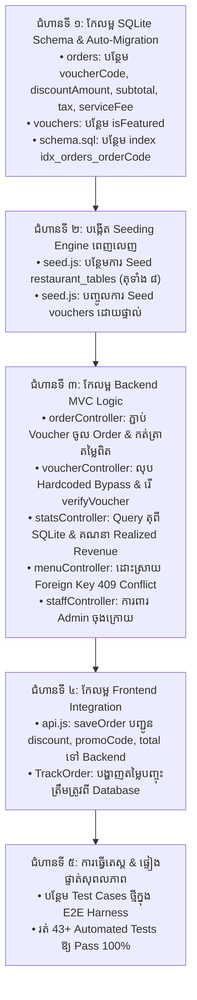

# 🛠️ ផែនការដោះស្រាយ និងកែលម្អប្រព័ន្ធទិន្នន័យពេញលេញ (Database Fix Plan v2.0)

**Branch:** `database-config`  
**Target:** SQLite Database (`node:sqlite`), Seed Engine, Backend MVC Controllers, Frontend Integration & Automated Test Suite  
**Objective:** ដោះស្រាយរាល់បញ្ហាខុសឆ្គងទាំង ១១ ចំណុច ដោយធ្វើសមកាលកម្មរវាង Specification ក្នុង `README.md` ជាមួយ SQLite Schema, Backend Logic និង Frontend Flow ឱ្យត្រឹមត្រូវ ១០០%។

---

## 🧭 ផែនទីបង្ហាញផ្លូវនៃការអនុវត្ត (Architecture & Implementation Flow)



---

## 📋 ព័ត៌មានលម្អិតនៃជំហានទាំង ៥ (Detailed Action Steps)

### ជំហានទី ១៖ កែលម្អ Database Schema & Auto-Migration
1. **ឯកសារ `backend/database/schema.sql`:**
   * **តារាង `orders`:** បន្ថែមជួរឈរហិរញ្ញវត្ថុចំនួន ៥៖
     ```sql
     subtotal REAL NOT NULL DEFAULT 0.0,
     tax REAL NOT NULL DEFAULT 0.0,
     serviceFee REAL NOT NULL DEFAULT 0.0,
     discountAmount REAL NOT NULL DEFAULT 0.0,
     voucherCode TEXT,
     ```
   * **តារាង `vouchers`:** បន្ថែមជួរឈរ `isFeatured INTEGER NOT NULL DEFAULT 0`។
   * **Indexes:** បន្ថែម `CREATE INDEX IF NOT EXISTS idx_orders_orderCode ON orders(orderCode);` ក្នុង `schema.sql`។
2. **ឯកសារ `backend/database/db.js` (Zero-Downtime Auto-Migration):**
   * ប្រើ `PRAGMA table_info` ពិនិត្យជួរឈរនៃតារាង `orders` និង `vouchers`។
   * ប្រសិនបើខ្វះ ដំណើរការ `ALTER TABLE orders ADD COLUMN ...` និង `ALTER TABLE vouchers ADD COLUMN isFeatured ...` ដោយស្វ័យប្រវត្តិដើម្បីកុំឱ្យបាត់បង់ទិន្នន័យចាស់ដែលមានក្នុង `restaurant.db`។

---

### ជំហានទី ២៖ បង្កើត Seeding Engine ពេញលេញសម្រាប់ `restaurant_tables` និង `vouchers`
1. **ឯកសារ `backend/database/seed.js`:**
   * បន្ថែមការ Seed តុទាំង ៨ ចូលទៅក្នុងតារាង `restaurant_tables`៖
     - តុ 01 (Patio Terrace, កៅអី 2)
     - តុ 02 (Window View, កៅអី 4)
     - តុ 03 (Cozy Booth, កៅអី 4)
     - តុ 04 (Main Dining Hall, កៅអី 6)
     - តុ 05 (VIP Wine Lounge, កៅអី 8)
     - តុ 06 (Main Dining Hall, កៅអី 4)
     - តុ 07 (Patio Terrace, កៅអី 2)
     - តុ 08 (Chef Counter, កៅអី 2)
   * ដាក់បញ្ចូលការ Seed `vouchers` ចូលក្នុង `seed.js` ដោយផ្ទាល់ (`AURAVIP15` 15%, `WELCOME10` 10%, `CHEF25` 25%, `BISTRO20` 20%) ជាមួយ `isFeatured`។
2. **ដំណើរការ:** `node backend/database/seed.js` ដើម្បី Populate ទិន្នន័យស្រស់ស្អាតចូល SQLite។

---

### ជំហានទី ៣៖ កែលម្អ Backend MVC Logic

#### ៣.១. Order Controller (`backend/src/controllers/orderController.js`)
* **ការបង្កើត Order (`createOrder`):**
  - ទទួល `voucherCode`, `discountAmount`, `subtotal`, `tax`, `serviceFee` ពី Client Body។
  - ប្រសិនបើមាន `voucherCode`៖ Query មើលក្នុង SQLite `SELECT * FROM vouchers WHERE UPPER(code) = ? AND isActive = 1`។
  - ប្រសិនបើ Voucher ត្រឹមត្រូវ គណនា Discount និងដកចេញពី Subtotal រួចគណនា Tax 10% និង Service Fee 5% លើតម្លៃដែលបានបញ្ចុះរួច។
  - កត់ត្រា `subtotal`, `tax`, `serviceFee`, `discountAmount`, `voucherCode`, `totalAmount` ចូលតារាង `orders` តាមរយៈ Transaction។
* **ការទាញយក Orders (`getOrders` & `getOrderById`):**
  - ត្រឡប់តម្លៃពិតប្រាកដចេញពី Database (`subtotal`, `tax`, `serviceFee`, `discountAmount`, `voucherCode`) ដោយ**លុបចោលរូបមន្តស្មាន `ord.totalAmount * 0.85`**។
* **Normalization:** កំណត់ `paymentStatus` ឱ្យមានស្តង់ដារ (`unpaid`, `paid`, `counter`)។

#### ៣.២. Voucher Controller & Routing (`voucherController.js`, `voucherRoutes.js`, `statsController.js`)
* រើ function `verifyVoucher` ពី `statsController.js` មកដាក់ក្នុង `voucherController.js`។
* **លុបចោល Hardcoded `PROMO_CODES` Object ទាំងស្រុង** ដើម្បីឱ្យប្រព័ន្ធពឹងផ្អែកលើ Database ១០០%។ ប្រសិនបើ Voucher ត្រូវបាន Admin ប្តូរទៅ `isActive = 0` ឬលុបចេញពី Database នោះប្រព័ន្ធនឹងបដិសេធ (Return 404/400) មិនឱ្យប្រើបានឡើយ។
* ភ្ជាប់ Route `POST /api/vouchers/verify` ក្នុង `voucherRoutes.js`។

#### ៣.៣. Stats & Analytics Controller (`statsController.js`)
* **`getTables`:** កែប្រែឱ្យ Query `SELECT * FROM restaurant_tables ORDER BY tableNumber ASC` ចេញពី SQLite (ជាមួយ Fallback ប្រសិនបើតារាងទទេ)។
* **`getSummary`:** កែប្រែ `totalRevenue` ឱ្យគណនាតែ Order ដែលបានបង់ប្រាក់ពិតប្រាកដ (`WHERE paymentStatus IN ('paid', 'Paid') OR status IN ('served', 'completed', 'delivered')`)។

#### ៣.៤. Menu & Category Controller (`menuController.js`)
* ក្នុង `deleteMenuItem` និង `deleteCategory`៖ ចាប់យកកំហុស `FOREIGN KEY constraint failed` (`SQLITE_CONSTRAINT`) ហើយ Return `res.status(409).json({ error: 'Cannot delete item because it is referenced in past orders or contains dishes.' })` ជំនួសឱ្យ 500 Error។

#### ៣.៥. Staff Controller (`staffController.js`)
* ក្នុង `deleteStaff`៖ បន្ថែម Guard ការពារកុំឱ្យលុបគណនី Admin ចុងក្រោយគេបង្អស់។

---

### ជំហានទី ៤៖ កែលម្អ Frontend Integration
1. **ឯកសារ `frontend/src/services/api.js` (function `saveOrder`):**
   * កែប្រែ Payload បញ្ជូនទិន្នន័យឱ្យបានពេញលេញទៅ Backend៖
     ```javascript
     voucherCode: order.promoCode || null,
     discountAmount: Number(order.discount || 0),
     subtotal: Number(order.subtotal || 0),
     tax: Number(order.tax || 0),
     serviceFee: Number(order.serviceFee || 0),
     totalAmount: Number(order.total || 0)
     ```
2. **Customer Tracker & Checkout Verification:**
   * ផ្ទៀងផ្ទាត់ថាទំព័រ `TrackOrder.jsx` បង្ហាញវិក្កយបត្រជាមួយតម្លៃបញ្ចុះត្រឹមត្រូវពី Database។

---

### ជំហានទី ៥៖ ការធ្វើតេស្តផ្ទៀងផ្ទាត់ (Verification & Testing)
1. **ដំណើរការតេស្ត:** `node tests/run-all-tests.js` (ធានាថា 43 Automated Tests ដើមនៅតែ Pass ទាំងអស់)។
2. **បន្ថែមតេស្តថ្មី:**
   - តេស្តការកុម្ម៉ង់ Order ជាមួយ Voucher និងផ្ទៀងផ្ទាត់ថា SQLite កត់ត្រា Discount និង Total ត្រឹមត្រូវ។
   - តេស្តការ Deactivate Seed Voucher (`AURAVIP15`) និងផ្ទៀងផ្ទាត់ថាប្រព័ន្ធបដិសេធមិនឱ្យប្រើ (គ្មាន Hardcoded Bypass)។
   - តេស្តទាញយកតុពីតារាង `restaurant_tables` ក្នុង SQLite។
   - តេស្តការលុបម្ហូបដែលជាប់ Foreign Key (រំពឹងទុក 409 Conflict)។
3. **ការពិនិត្យ Git Status & Commit:** ធ្វើ Commit ការងារទាំងអស់នៅលើ branch `database-config`។

---

## 🛡️ ការការពារទិន្នន័យចាស់ (Data Safety)
* មុនពេលដំណើរការ Migration យើងនឹង Copy Backup ឯកសារ `backend/data/restaurant.db` ទៅកាន់ `backend/data/restaurant_pre_fix_backup.db` ដើម្បីធានាសុវត្ថិភាពទិន្នន័យ ១០០%។
