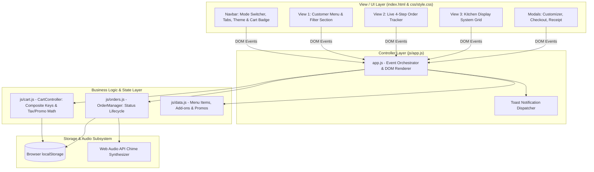
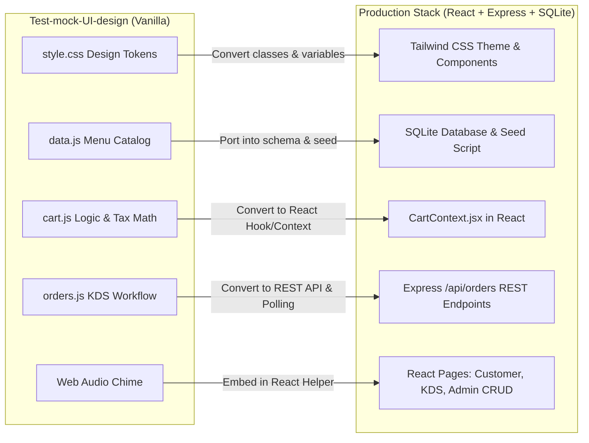

# 🔬 ការវិភាគ និងវាយតម្លៃស៊ីជម្រៅលើ Prototype: Test-mock-UI-design
## 🍽️ Aura Bistro - Restaurant Ordering System (UI/UX & Architecture Audit)
**Course / Topic:** Topic 5: Software Project Development  
**Document Type:** Deep Usability, UX Heuristics & Architecture Audit Report  
**Date:** October 2026  
**Auditor:** Antigravity AI Pair Programmer  

---

## 📑 តារាងមាតិកា (Table of Contents)
1. [១. សេចក្តីសង្ខេបប្រតិបត្តិ (Executive Summary)](#1-executive-summary)
2. [២. ការវិភាគស្ថាបត្យកម្មកូដ (Code Architecture & Engineering Review)](#2-code-architecture--engineering-review)
3. [៣. ការវាយតម្លៃ UI/UX តាមគោលការណ៍ Nielsen's 10 Usability Heuristics](#3-uiux-evaluation-nielsens-heuristics)
4. [៤. ការវិភាគលំហូរការងារទាំង ៥ (Deep Workflow Analysis)](#4-deep-workflow-analysis)
5. [៥. ការវិភាគចំណុចខ្លាំង (Strengths & Innovations)](#5-key-strengths)
6. [៦. ការវិភាគបញ្ហាប្រឈម និងចំណុចខ្វះខាត (Identified Gaps & Edge Cases)](#6-identified-gaps--edge-cases)
7. [៧. ផែនការផ្ទេរទៅ React.js & Express Stack (Migration Plan to Full-Stack)](#7-migration-plan-to-react-and-express)

---

## 1. Executive Summary

គំរូសាកល្បង **`Test-mock-UI-design` (Aura Bistro)** គឺជា Prototype កម្រិតខ្ពស់ (High-Fidelity Interactive Prototype) ដែលត្រូវបានបង្កើតឡើងដោយប្រើប្រាស់ **Vanilla HTML5, Vanilla CSS3 (Custom Design Tokens & Glassmorphism) និង Modular ES6+ JavaScript**។ 

Prototype នេះមិនមែនគ្រាន់តែជារូបភាព جامد (Static Mockup) នោះទេ ប៉ុន្តែជា **Functional Interactive Web App** ពេញលេញមួយ ដែលមាន State Management ផ្ទាល់ខ្លួន (CartController, OrderManager, LocalStorage Persistence) ព្រមទាំងមានប្រព័ន្ធសំឡេង **Web Audio API Chime Synthesizer** ទៀតផង។ វាដើរតួនាទីជាមូលដ្ឋានគ្រឹះ UI/UX ដ៏ល្អឥតខ្ចោះ មុនពេលយើងបំប្លែងទៅជា Component-Based React.js និង Express Backend។

---

## 2. Code Architecture & Engineering Review

### ការវាយតម្លៃផ្នែកវិស្វកម្មកូដ (Engineering Assessment):
1. **Separation of Concerns (SoC):** កូដត្រូវបានបែងចែកជា ៤ ឯកសារច្បាស់លាស់ (`data.js` សម្រាប់ Repository, `cart.js` សម្រាប់ Cart Logic, `orders.js` សម្រាប់ Order Lifecycle, និង `app.js` សម្រាប់ UI Controller)។
2. **Pub/Sub Reactive Architecture ក្នុង Cart:** `CartController` ប្រើ Listener Pattern (`this.listeners = []` និង `subscribe()`) ដែលធ្វើឱ្យគ្រប់ពេលមានការ Add/Remove ទំនិញ UI ទាំងអស់ (Badge, Subtotal, Sidebar, Modal) ធ្វើការ Update ដោយស្វ័យប្រវត្តិ។
3. **Composite Unique Key សម្រាប់ Cart:** ការប្រើប្រាស់ `itemId_spiceLevel_addons` ជា Key ការពារការភ័ន្តច្រឡំនៅពេលភ្ញៀវកម្ម៉ង់ម្ហូបឈ្មោះដូចគ្នា តែមួយចានដាក់ម្ទេស មួយចានទៀតមិនដាក់ម្ទេស។
4. **Zero External Dependency Audio:** បង្កើតសំឡេងរោទិ៍តាមរយៈ browser **Web Audio API** (`OscillatorNode` និង `GainNode`) ដោយមិនបាច់ទាញយក file `.mp3` ពីក្រៅ ដែលជួយសន្សំសំចៃ bandwidth និងដើរបាន ១០០% Offline។

---

## 3. UI/UX Evaluation (Nielsen's Usability Heuristics)

| គោលការណ៍ Heuristic | ការអនុវត្តជាក់ស្តែងក្នុង Prototype | ការវាយតម្លៃ (Rating) |
|---|---|---|
| **1. Visibility of System Status** | • បង្ហាញ Badge ចំនួន Order សកម្មលើ Tab • មាន Live 4-Step Progress Stepper លើទំព័រ Tracker • មាន Live Pulse Dot បញ្ជាក់ថា KDS កំពុងដំណើរការ | ⭐⭐⭐⭐⭐ (5/5) ល្អឥតខ្ចោះ |
| **2. Match between System & Real World** | • ប្រើប្រាស់រូបភាពម្ហូបពិតប្រាកដ • ពាក្យស្លាកសាមញ្ញ (Dine-In, Takeaway, Chef's Pick, Table #) • វិក្កយបត្របំបែក Subtotal, 10% VAT, 5% Service Fee | ⭐⭐⭐⭐⭐ (5/5) ស្របតាមភោជនីយដ្ឋានពិត |
| **3. User Control & Freedom** | • មានប៊ូតុង "Clear Cart", "Close Modal", "Reset Filters" • អាចបន្ថែម/បន្ថយចំនួនម្ហូបក្នុងកន្ត្រកភ្លាមៗ | ⭐⭐⭐⭐⭐ (5/5) ផ្តល់សេរីភាពពេញលេញ |
| **4. Consistency & Standards** | • ប្រើ Font စံ (`Plus Jakarta Sans` & `Outfit`) • ពណ៌ Status ច្បាស់លាស់ (Pending=លឿង, Cooking=ខៀវ, Ready=បៃតង) • Cart Sidebar នៅខាងស្តាំដៃតាមស្តង់ដារ E-commerce | ⭐⭐⭐⭐⭐ (5/5) ស្អាត និងស៊ីសង្វាក់គ្នា |
| **5. Error Prevention** | • ប៊ូតុង "Proceed to Checkout" បិទ (disabled) បើសិនកន្ត្រកនៅទទេ • Form Checkout តម្រូវឱ្យបំពេញ Name & Phone ជាកាតព្វកិច្ច | ⭐⭐⭐⭐☆ (4.5/5) ល្អប្រសើរ |
| **6. Recognition rather than Recall** | • បង្ហាញរូប និងព័ត៌មានបន្ថែម (Calories, Prep Time, Spice) លើកាតម្ហូប • បង្ហាញប័ណ្ណបញ្ចុះតម្លៃ `AURAVIP15` លើ Hero Banner ព្រមទាំងប៊ូតុង "Apply To Cart" ភ្លាមៗ | ⭐⭐⭐⭐⭐ (5/5) ភ្ញៀវមិនបាច់ចាំកូដ |
| **7. Aesthetic & Minimalist Design** | • រចនាប័ទ្មបែប Glassmorphism ទំនើប • គាំទ្រទាំង **Dark Mode** និង **Light Mode** យ៉ាងរលូន | ⭐⭐⭐⭐⭐ (5/5) ស្អាតកម្រិត Premium |

---

## 4. Deep Workflow Analysis

### ៤.១ លំហូររុករក និងកម្ម៉ង់មុខម្ហូប (Menu Exploration Flow)
1. **Search & Filter:** ដំណើរការស្វែងរកតាម Real-time Typing ជាមួយការច្រោះតាម Dietary Tags (Vegetarian, Spicy, Chef's Pick) ព្រមទាំងការ Sort តាមតម្លៃ និង Rating ដំណើរការលឿនគ្មានភាពរអាក់រអួល។
2. **Dish Customization Modal:** អនុញ្ញាតឱ្យភ្ញៀវរើសកម្រិតហិរ (Mild, Medium, Fiery Hot) និង Add-ons (Shaved Truffle, Extra Sauce) ដោយតម្លៃសរុបប្រែប្រួលតាមពេលវេលាជាក់ស្តែង (Real-time Price Recalculation)។

### ៤.២ លំហូរគណនាកន្ត្រក និងការទូទាត់ (Cart & Checkout Flow)
1. **Pricing Engine:** គណនាត្រឹមត្រូវតាមរូបមន្តហិរញ្ញវត្ថុ៖
   $$\text{Subtotal} = \sum (\text{Item Price} + \text{Addons}) \times \text{Qty}$$
   $$\text{Discount} = \text{Subtotal} \times \text{Voucher}\%$$
   $$\text{VAT (10\%)} = (\text{Subtotal} - \text{Discount}) \times 0.10$$
   $$\text{Service Fee (5\%)} = (\text{Subtotal} - \text{Discount}) \times 0.05$$
   $$\text{Total} = (\text{Subtotal} - \text{Discount}) + \text{VAT} + \text{Service Fee}$$
2. **Dual-Mode Switcher:** 
   - ប្រសិនបើរើស **Dine-In**: ប្រព័ន្ធតម្រូវឱ្យរើសលេខតុ (Table 01-05)។
   - ប្រសិនបើរើស **Takeaway**: ប្រព័ន្ធលាក់លេខតុ ហើយបើកប្រអប់បញ្ចូលអាសយដ្ឋាន ឬចំណាំទីតាំងដឹកជញ្ជូន។

### ៤.៣ លំហូរផ្ទះបាយ (Kitchen KDS Workflow)
1. ចុងភៅទទួលបាន Order ថ្មីភ្លាមៗ ជាមួយសំឡេង Chime Notification។
2. មានប៊ូតុងផ្លាស់ប្តូរ Status តាមលំដាប់លំដោយ៖
   - `Start Cooking` ➔ ប្តូរ Status ទៅជា `cooking` (ពណ៌ខៀវ)
   - `Mark Ready` ➔ ប្តូរ Status ទៅជា `ready` (ពណ៌បៃតង)
   - `Complete & Serve` ➔ បញ្ចប់ Order និងកត់ត្រាចូល Sales Analytics
3. មានប៊ូតុង **"Simulate New Order"** ជួយឱ្យការធ្វើតេស្ត Demo ក្នុងថ្នាក់រៀនមានភាពងាយស្រួលដោយមិនបាច់ចុចកម្ម៉ង់ម្តងមួយៗ។

---

## 5. Key Strengths & Innovations

1. **បទពិសោធន៍អ្នកប្រើប្រាស់កម្រិតខ្ពស់ (Ultra-High UX Polish):** មាន animations ស្រទន់, micro-interactions ពេល hover, និង toast alerts ពេល add to cart។
2. **Web Audio Synthesizer:** បង្កើតសំឡេងរោទិ៍ប្រកបដោយវិជ្ជាជីវៈដោយមិនបាច់ទាញយក file សំឡេងខាងក្រៅ។
3. **Michelin Dining Vibe:** ការរចនាបែបភោជនីយដ្ឋានលំដាប់អន្តរជាតិ (Gourmet Aesthetic) ផ្តល់នូវចំណាប់អារម្មណ៍ល្អបំផុតសម្រាប់គណៈកម្មការវាយតម្លៃគម្រោង។
4. **Offline & Standalone Ready:** អាច Run បានភ្លាមៗលើ Browser ណាក៏បានដោយមិនបាច់ដំឡើង Server អ្វីទាំងអស់។

---

## 6. Identified Gaps & Edge Cases (ចំណុចខ្វះខាតដែលត្រូវបំពេញ)

ទោះបីជា `Test-mock-UI-design` មានភាពល្អឥតខ្ចោះលើផ្នែក UI/UX ក៏ដោយ សម្រាប់ការប្រគល់គម្រោង **Topic 5: Software Project Development (Full-Stack Deliverable)** យើងត្រូវដោះស្រាយចំណុចខ្វះខាតខាងក្រោម៖

1. **ខ្វះពហុឧបករណ៍ក្នុងពេលជាក់ស្តែង (Single-Browser Limitation):**
   - បច្ចុប្បន្ន Prototype នេះប្រើ `localStorage` ក្នុង browser តែមួយ។ មានន័យថា ប្រសិនបើភ្ញៀវបើកទូរស័ព្ទកម្ម៉ង់ ចុងភៅនៅលើកុំព្យូទ័រផ្ទះបាយមិនអាចឃើញ Order នោះទេ ដរាបណាយើងមិនទាន់មាន **Backend Server (Node.js/Express) និង Database (SQLite)** ដើម្បីចែករំលែកទិន្នន័យរួមគ្នា។
2. **ខ្វះប្រព័ន្ធការពារសិទ្ធិ (Authentication & RBAC):**
   - ផ្ទាំង Kitchen KDS បច្ចុប្បន្ននរណាក៏អាចចុចចូលមើល និងប្តូរ status បានដែរ។ ក្នុងប្រព័ន្ធពិត ត្រូវមាន **Staff Login (JWT Token)** ដើម្បីការពារសុវត្ថិភាព។
3. **ការគ្រប់គ្រងមុខម្ហូប (Admin Menu CRUD):**
   - មុខម្ហូបបច្ចុប្បន្នត្រូវបាន Hardcoded ក្នុង `data.js`។ យើងត្រូវបន្ថែមផ្ទាំង Admin សម្រាប់ Add, Edit, Delete មុខម្ហូប និង Toggle បិទ/បើក ស្តុកម្ហូបផ្ទាល់ចូល Database។

---

## 7. Migration Plan to React.js and Express Stack

ដើម្បីបំពេញតាមតម្រូវការនៃ **Topic 5** យើងនឹងយកកូដរចនា និងគំនិតដ៏ល្អឥតខ្ចោះពី `Test-mock-UI-design` នេះ មកធ្វើជាគំរូដើម (Blueprint) សម្រាប់សរសេរចូលក្នុង **React Frontend** និង **Express Backend** របស់យើង៖

---
**Approved By:** Software Quality & UI/UX Audit Team  
**Recommendation:** យក UI/UX Design System នេះជា Benchmark ផ្លូវការសម្រាប់ Frontend Implementation 🚀
