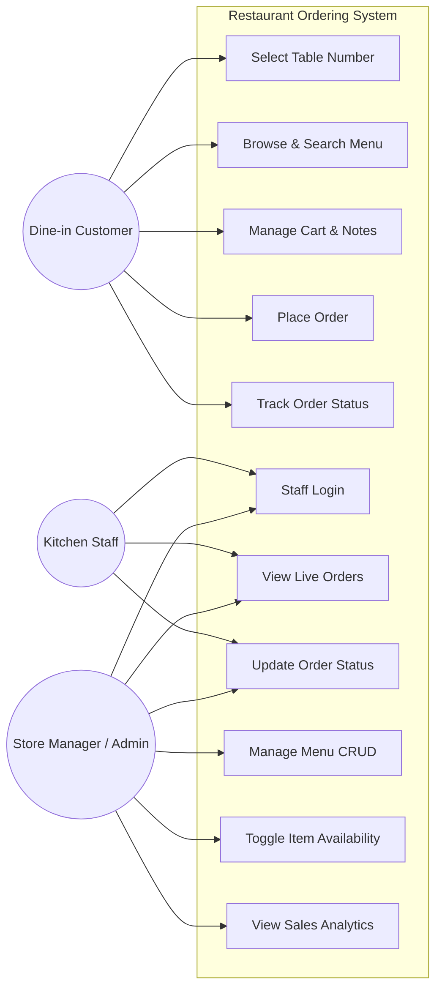
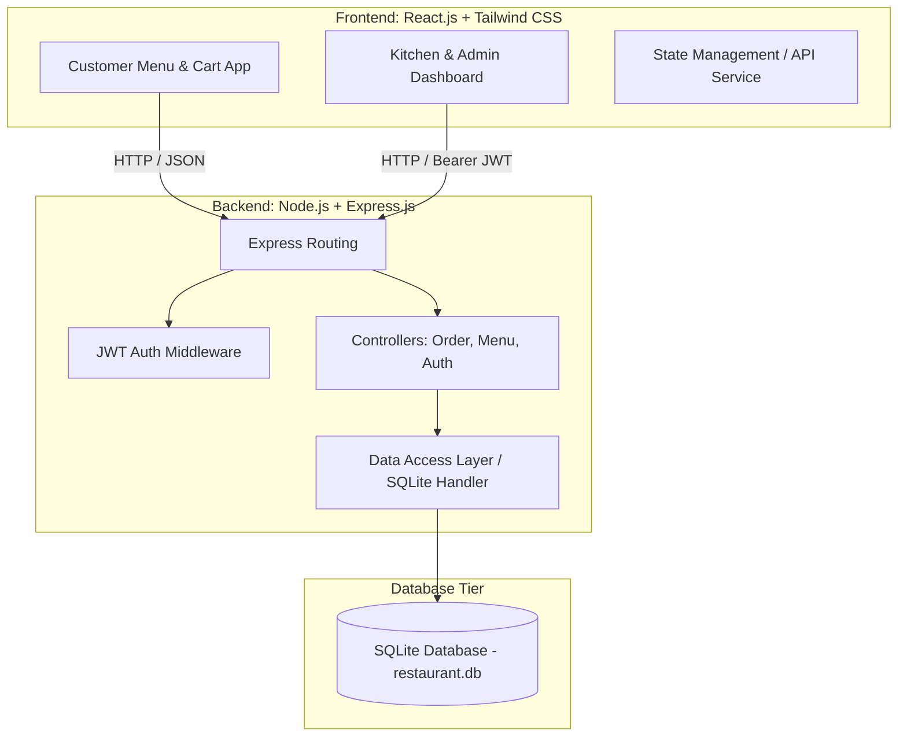
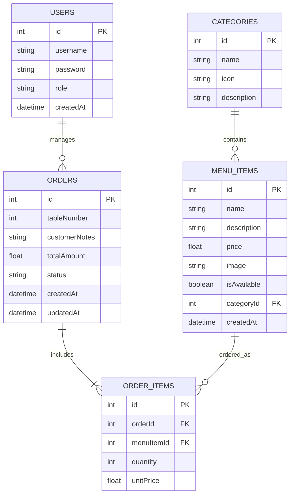
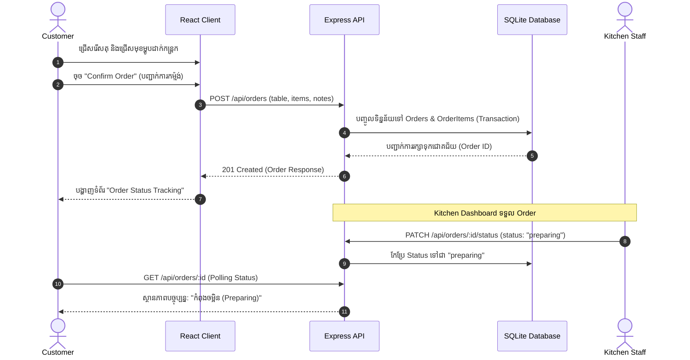

# 📋 Week 1: Project Planning & Requirements Specification
## 🍽️ Project Name: Restaurant Ordering System (ROS)
**Course / Topic:** Topic 5: Software Project Development  
**Document Version:** 1.0.0  
**Date:** October 2026  
**Tech Stack:** Frontend (React.js, Tailwind CSS) | Backend (Node.js, Express.js) | Database (SQLite / Prisma)  

---

## 📑 តារាងមាតិកា (Table of Contents)
1. [១. សេចក្តីផ្តើម និងបញ្ហាជាក់ស្តែង (Project Overview & Problem Statement)](#1-project-overview--problem-statement)
2. [២. អ្នកពាក់ព័ន្ធ និងតួនាទី (Stakeholder Analysis & User Personas)](#2-stakeholder-analysis--user-personas)
3. [៣. ការសិក្សាសមិទ្ធិលទ្ធភាព (Feasibility Study)](#3-feasibility-study)
4. [៤. តម្រូវការប្រព័ន្ធ (Functional & Non-Functional Requirements)](#4-requirements-specification)
5. [៥. ករណីប្រើប្រាស់ (Use Case Diagram & Specifications)](#5-use-case-analysis)
6. [៦. ស្ថាបត្យកម្មប្រព័ន្ធ (System Architecture & Technology Justification)](#6-system-architecture)
7. [៧. រចនាសម្ព័ន្ធទិន្នន័យ (Data Modeling & ERD)](#7-data-modeling--erd)
8. [៨. លំហូរការងាររបស់អ្នកប្រើប្រាស់ (User Flow & System Interactions)](#8-user-flow--system-interactions)
9. [៩. ផែនការបែងចែកការងារ (Work Breakdown Structure & Timeline)](#9-work-breakdown-structure--sprint-plan)
10. [១០. ការវាយតម្លៃហានិភ័យ (Risk Assessment & Mitigation)](#10-risk-assessment--mitigation)

---

## 1. Project Overview & Problem Statement

### 1.1 បញ្ហាជាក់ស្តែង (Problem Statement)
នៅក្នុងភោជនីយដ្ឋានបែបបុរាណ ការកត់ត្រាការកម្ម៉ង់ម្ហូបត្រូវបានធ្វើឡើងដោយប្រើក្រដាស និងប៊ិចតាមរយៈអ្នករត់តុ (Waiters)។ វិធីសាស្ត្រនេះបង្កឱ្យមានបញ្ហាប្រឈមធំៗដូចជា៖
* **កំហុសក្នុងការកត់ត្រា (Order Inaccuracy):** ការកត់ត្រាមិនច្បាស់លាស់ ការភ្លេចបន្ថែមចំណាំពិសេស (Special Instructions) ឬការស្តាប់ច្រឡំ។
* **ភាពយឺតយ៉ាវ (Operational Delays):** អ្នករត់តុត្រូវដើរយកក្រដាសទៅផ្ទះបាយ ដែលនាំឱ្យខាតពេលវេលាក្នុងម៉ោងមមាញឹក (Peak Hours)។
* **ការខ្វះតម្លាភាព (Lack of Real-time Tracking):** អតិថិជនមិនដឹងថាម្ហូបរបស់ខ្លួនកំពុងធ្វើ ឬរៀបចំរួចរាល់នៅពេលណា។
* **ការគ្រប់គ្រងមុខម្ហូបមិនទាន់ពេល (Inefficient Menu Management):** ពេលមុខម្ហូបណាមួយអស់ពីស្តុក បុគ្គលិកពិបាកជូនដំណឹងដល់ភ្ញៀវគ្រប់តុឱ្យបានទាន់ពេលវេលា។

### 1.2 ដំណោះស្រាយដែលបានស្នើឡើង (Proposed Solution)
**Restaurant Ordering System (ROS)** គឺជាប្រព័ន្ធ Web Application បែបទំនើប ឆ្លើយតបគ្រប់ទំហំអេក្រង់ (Responsive) ដែលគាំទ្រ **Dual-Channel Ordering (កម្ម៉ង់បានទាំង ២ ប្រព័ន្ធ)**៖
1. **Dine-in Ordering (កម្ម៉ង់ញ៉ាំនៅហាងផ្ទាល់):**
   - ភ្ញៀវជ្រើសរើសលេខតុ (Table Selection ឧ. Table 01-10)
   - មើលបញ្ជីមុខម្ហូប និងកុម្ម៉ង់ផ្ទាល់ពីតុ
   - ចុងភៅលើកជូនដល់តុជាក់ស្តែង
2. **Online Ordering (កម្ម៉ង់តាមអនឡាញ - Delivery & Takeaway):**
   - ភ្ញៀវអាចកម្ម៉ង់ពីផ្ទះ ឬពីចម្ងាយ
   - បញ្ចូលឈ្មោះ (Name), លេខទូរស័ព្ទ (Phone Number) និងអាសយដ្ឋានដឹកជញ្ជូន (Delivery Address)
   - គណនាថ្លៃដឹកជញ្ជូន (Delivery Fee) ដោយស្វ័យប្រវត្តិ
   - គាំទ្រជម្រើសទូទាត់៖ សាច់ប្រាក់ផ្ទាល់ (Cash on Delivery - COD) ឬ ស្កេន KHQR (QR Payment)
3. **Staff / Admin Portal (សម្រាប់អ្នកគ្រប់គ្រង និងផ្ទះបាយ):**
   - **Kitchen Display System (KDS):** បែងចែកស្លាកច្បាស់ៗរវាង `🍽️ Dine-in` និង `🛵 Online Delivery`
   - **Order Status Management:** តាមដានស្ថានភាពតាំងពីទទួល Order, ចម្អិន, រហូតដល់ដឹកជញ្ជូនដល់ផ្ទះ ឬលើកជូនដល់តុ
   - **Menu & Sales Analytics:** គ្រប់គ្រងមុខម្ហូប និងមើលស្ថិតិចំណូលបំបែកតាម Dine-in និង Online

---

## 2. Stakeholder Analysis & User Personas

| តួនាទី (Role) | ការពិពណ៌នា (Description) | តម្រូវការចម្បង (Primary Needs) |
|---|---|---|
| **Dine-in Customer** | ភ្ញៀវដែលមកទទួលទានផ្ទាល់នៅភោជនីយដ្ឋាន | មើលរូបភាពម្ហូប តម្លៃ ចំណាំពិសេស បញ្ជាទិញលឿន តាមដានស្ថានភាព |
| **Kitchen Staff** | ចុងភៅ និងបុគ្គលិកផ្នែករៀបចំម្ហូប | ឃើញ Order ភ្លាមៗ ដឹងលេខតុ និងចំណាំពិសេស ចុចប្តូរ Status |
| **Store Manager / Admin** | អ្នកគ្រប់គ្រងហាង និងអាជីវកម្ម | គ្រប់គ្រងមុខម្ហូប បន្ថែម/កែ/លុប កំណត់ In-stock/Out-of-stock មើលចំណូល |

---

## 3. Feasibility Study

1. **សមិទ្ធិលទ្ធភាពបច្ចេកទេស (Technical Feasibility):**  
   - ប្រើប្រាស់ **React.js + Tailwind CSS** សម្រាប់ UI ដែលផ្តល់នូវសមត្ថភាពដំណើរការលឿន (High Performance) និងសម្របតាមអេក្រង់ទូរស័ព្ទ ឬថេប្លេតបានយ៉ាងល្អឥតខ្ចោះ។
   - **Node.js + Express.js** ជាស្ថាបត្យកម្ម Event-driven ស្រាល និងរហ័ស ស័ក្តិសមបំផុតសម្រាប់ RESTful API ទទួលការបញ្ជាទិញ។
   - **SQLite** ផ្តល់នូវភាពងាយស្រួលដោយ Zero-configuration ពុំទាមទារ Server ដាច់ដោយឡែក សមស្របបំផុតសម្រាប់ការអភិវឌ្ឍ ការធ្វើតេស្ត និងការវាយតម្លៃក្នុងកម្រិត Intermediate។
2. **សមិទ្ធិលទ្ធភាពប្រតិបត្តិការ (Operational Feasibility):**  
   - ចំណុចប្រទាក់ (User Interface) រចនាឡើងយ៉ាងសាមញ្ញ (Intuitive UX) មិនទាមទារការបណ្តុះបណ្តាលស្មុគស្មាញដល់បុគ្គលិក និងភ្ញៀវឡើយ។
3. **សមិទ្ធិលទ្ធភាពសេដ្ឋកិច្ច (Economic Feasibility):**  
   - ប្រើប្រាស់បច្ចេកវិទ្យា Open-source 100% គ្មានការចំណាយលើថ្លៃអាជ្ញាប័ណ្ណ (License fee)។

---

## 4. Requirements Specification

### 4.1 Functional Requirements (FR)

#### Customer Functions:
* **FR-01 (Table Selection):** អតិថិជនអាចជ្រើសរើស ឬកំណត់លេខតុដែលខ្លួនកំពុងអង្គុយ។
* **FR-02 (Browse & Search Menu):** មើលបញ្ជីមុខម្ហូប ស្វែងរកតាមឈ្មោះ និងច្រោះតាមប្រភេទ (Appetizers, Main Courses, Desserts, Beverages)។
* **FR-03 (Dish Details & Customization):** មើលព័ត៌មានលម្អិត តម្លៃ និងបញ្ចូលចំណាំពិសេស (Special Requests ឧ. មិនដាក់ស្ករ មិនដាក់ម្ទេស)។
* **FR-04 (Cart Management):** បន្ថែម បន្ថយ បង្កើនចំនួន ឬលុបមុខម្ហូបចេញពីកន្ត្រក ព្រមទាំងគណនាតម្លៃសរុបដោយស្វ័យប្រវត្តិ។
* **FR-05 (Order Submission):** បញ្ជាក់ការកម្ម៉ង់ និងទទួលបាន Order ID សម្រាប់តាមដាន។
* **FR-06 (Order Tracking):** ពិនិត្យមើលស្ថានភាពម្ហូបជាក់ស្តែង (`pending` ➔ `preparing` ➔ `ready` ➔ `completed`)។

#### Admin & Kitchen Functions:
* **FR-07 (Staff Authentication):** ចុះឈ្មោះ និងចូលប្រើប្រាស់តាមរយៈ Email/Username និង Password (JWT Token)។
* **FR-08 (Live Kitchen Display):** បង្ហាញ Order ដែលទើបចូលមកដល់ភ្លាមៗ តាមលំដាប់លំដោយពេលវេលា។
* **FR-09 (Order Status Management):** បុគ្គលិកអាចចុចផ្លាស់ប្តូរស្ថានភាពពី Pending ទៅ Preparing, Ready ឬ Completed។
* **FR-10 (Menu CRUD):** បង្កើត កែប្រែ មើល និងលុបមុខម្ហូបក្នុងប្រព័ន្ធ។
* **FR-11 (Stock Toggle):** បិទ/បើក ភាពមាននៃមុខម្ហូប (In-stock / Out-of-stock) ភ្លាមៗ។
* **FR-12 (Sales Summary):** មើលស្ថិតិសង្ខេបនៃចំនួន Order សរុប និងប្រាក់ចំណូលសរុប។

### 4.2 Non-Functional Requirements (NFR)
* **NFR-01 (Performance):** API ឆ្លើយតបក្នុងរយៈពេលក្រោម 200ms ក្រោមលក្ខខណ្ឌធម្មតា។
* **NFR-02 (Usability):** UI រចនាឡើងជា Mobile-first សម្រាប់អតិថិជន និង Tablet/Desktop friendly សម្រាប់ផ្ទះបាយ។
* **NFR-03 (Reliability & Data Integrity):** រាល់ការបញ្ជាទិញត្រូវកត់ត្រាចូល Database ដោយសុវត្ថិភាព មិនឱ្យបាត់បង់ទិន្នន័យ (ACID compliance)។
* **NFR-04 (Security):** ពាក្យសម្ងាត់ត្រូវបាន Hash តាមរយៈ bcryptjs ហើយ Protected Endpoints ត្រូវបានការពារដោយ JWT Middleware។

---

## 5. Use Case Analysis

### 5.1 Use Case Diagram (Mermaid)

---

## 6. System Architecture

ប្រព័ន្ធត្រូវបានរៀបចំឡើងតាមស្ថាបត្យកម្ម **Decoupled Client-Server Architecture** តាមរយៈ **RESTful API**៖

---

## 7. Data Modeling & ERD

### 7.1 Entity Relationship Diagram (ERD)

### 7.2 Data Dictionary (សទ្ទានុក្រមទិន្នន័យ)

1. **CATEGORIES**:
   - `id`: Primary key (Integer, Auto-increment)
   - `name`: ឈ្មោះប្រភេទម្ហូប (e.g., Appetizers, Main Course, Drinks)
   - `icon`: និមិត្តសញ្ញា icon សម្រាប់បង្ហាញលើ UI
2. **MENU_ITEMS**:
   - `id`: Primary key
   - `name`: ឈ្មោះម្ហូប ឬភេសជ្ជៈ
   - `description`: ការពិពណ៌នាគ្រឿងផ្សំ
   - `price`: តម្លៃលក់គិតជាដុល្លារ ($)
   - `image`: URL រូបភាពម្ហូប
   - `isAvailable`: ស្ថានភាពស្តុក (`true` = មាន, `false` = អស់)
   - `categoryId`: Foreign Key ភ្ជាប់ទៅ Categories
3. **ORDERS**:
   - `id`: Primary key
   - `tableNumber`: លេខតុ (1, 2, 3...)
   - `customerNotes`: ចំណាំពិសេសពីភ្ញៀវ
   - `totalAmount`: តម្លៃសរុបនៃ Order
   - `status`: `pending` | `preparing` | `ready` | `completed` | `cancelled`
   - `createdAt`: ពេលវេលាបញ្ជាទិញ
4. **ORDER_ITEMS**:
   - `id`: Primary key
   - `orderId`: Foreign Key ភ្ជាប់ទៅ Orders
   - `menuItemId`: Foreign Key ភ្ជាប់ទៅ MenuItems
   - `quantity`: ចំនួនដែលបានកម្ម៉ង់
   - `unitPrice`: តម្លៃក្នុងមួយឯកតានៅពេលកម្ម៉ង់

---

## 8. User Flow & System Interactions

### 8.1 Order Placement Sequence Diagram

---

## 9. Work Breakdown Structure & Sprint Plan

| ដំណាក់កាល (Phase) | សកម្មភាពសំខាន់ (Key Activities) | លទ្ធផលរំពឹងទុក (Deliverables) |
|---|---|---|
| **Week 1** | **Planning & Requirements Analysis** • កំណត់ទំហំការងារ (Project Scope) • រៀបចំ SRS, ERD, Use Case & Architecture • បង្កើតឯកសារ `week-1-wiki.md` | ឯកសារ `week-1-wiki.md` ពេញលេញ |
| **Week 2** | **Backend API & Database Development** • Setup Node.js + Express.js • Config SQLite Database Schema & Migrations • បង្កើត Auth, Menu, Order APIs + Seed data | Backend API រួចរាល់ អាចធ្វើតេស្តជាមួយ Postman/REST |
| **Week 3** | **Frontend Customer Experience** • Setup React.js + Tailwind CSS • សរសេរទំព័រ Menu, Table Selector, Cart • ប្រព័ន្ធ Checkout & Order Status Tracking | Customer Web UI ដំណើរការពេញលេញ |
| **Week 4** | **Admin & Kitchen Staff Portal** • ទំព័រ Login សម្រាប់ Staff • Kitchen Display System (KDS) គ្រប់គ្រង Status • Menu Management (CRUD Modal, Stock Toggle) | Admin & Kitchen Dashboard ដំណើរការ |
| **Week 5** | **Integration, Testing & Deployment** • ភ្ជាប់ Frontend ទៅ Backend API 100% • ធ្វើតេស្ត End-to-End Test & Edge cases • សរសេរ README.md និងឯកសារប្រគល់គម្រោង | Complete Source Code & Project Delivery |

---

## 10. Risk Assessment & Mitigation

| ហានិភ័យ (Identified Risk) | កម្រិត (Severity) | វិធានការដោះស្រាយ (Mitigation Strategy) |
|---|---|---|
| អតិថិជនកម្ម៉ង់ច្រឡំតុ | មធ្យម (Medium) | តម្រូវឱ្យផ្ទៀងផ្ទាត់លេខតុម្តងទៀតមុនពេលចុចបញ្ជាក់ការទិញ (Confirmation Modal) |
| បាត់បង់ទិន្នន័យនៅពេល Server ដាច់ | ខ្ពស់ (High) | ប្រើប្រាស់ Database Transaction សម្រាប់ Order & OrderItems ធានាភាពត្រឹមត្រូវ 100% |
| បុគ្គលិកផ្ទះបាយភ្លេចប្តូរ Status | ទាប (Low) | បង្ហាញ Order តាមកូដពណ៌ (Status Color Coding: លឿង=Pending, ខៀវ=Preparing, បៃតង=Ready) |
| ម្ហូបអស់ពីស្តុកតែភ្ញៀវនៅតែកម្ម៉ង់បាន | មធ្យម (Medium) | បង្កើត Toggle Switch (In-stock/Out-of-stock) ដែលបិទមិនឱ្យចុច Add to Cart ភ្លាមៗ |

---
**Prepared By:** Antigravity AI Pair Programmer  
**Status:** Approved for Week 2 Backend Implementation 🚀
