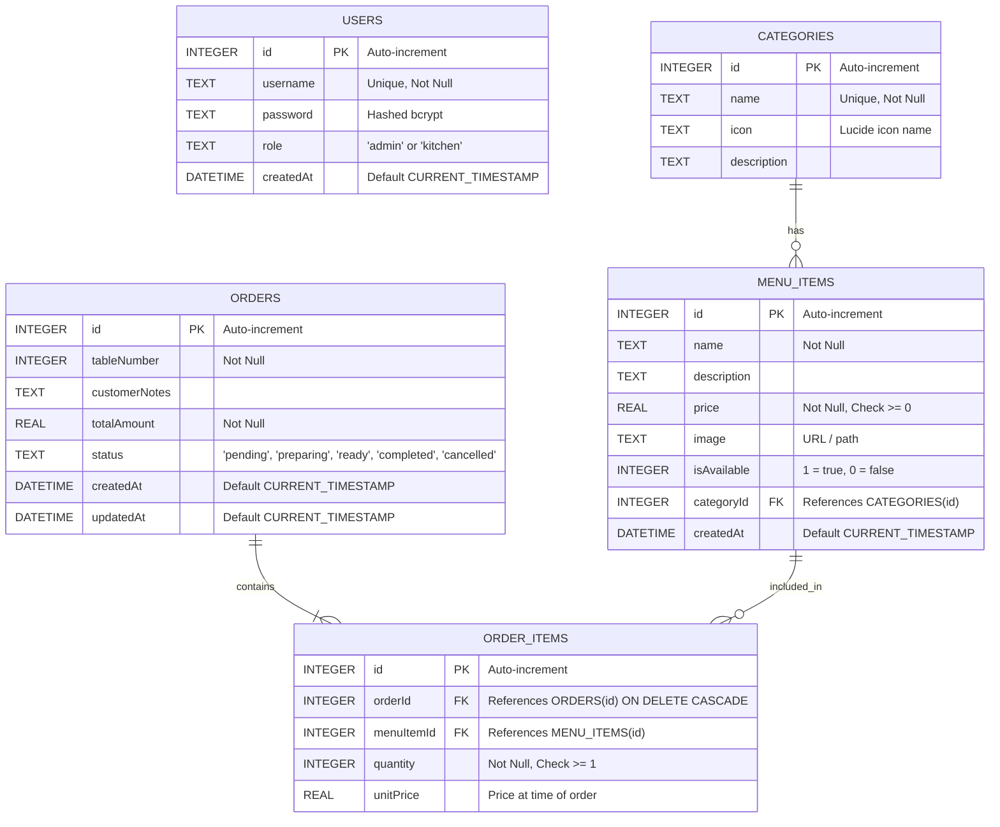
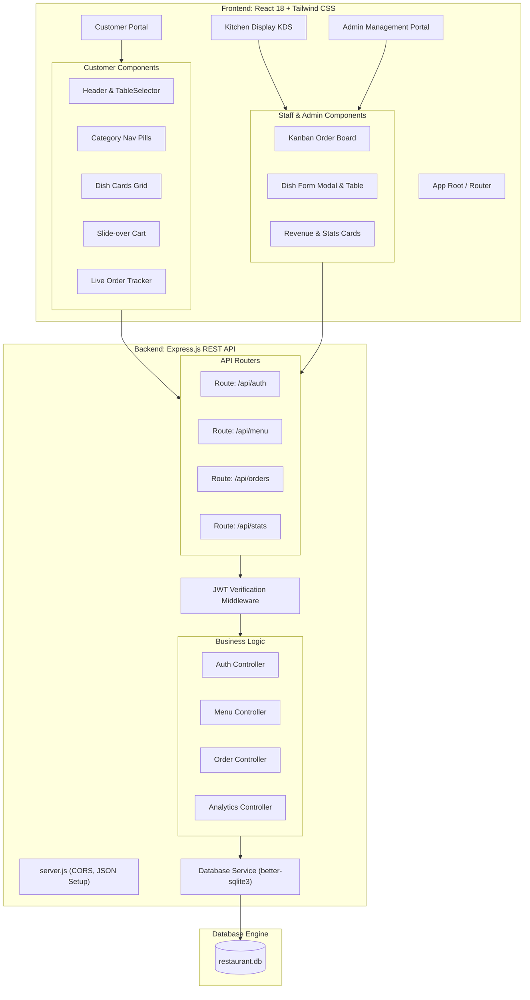
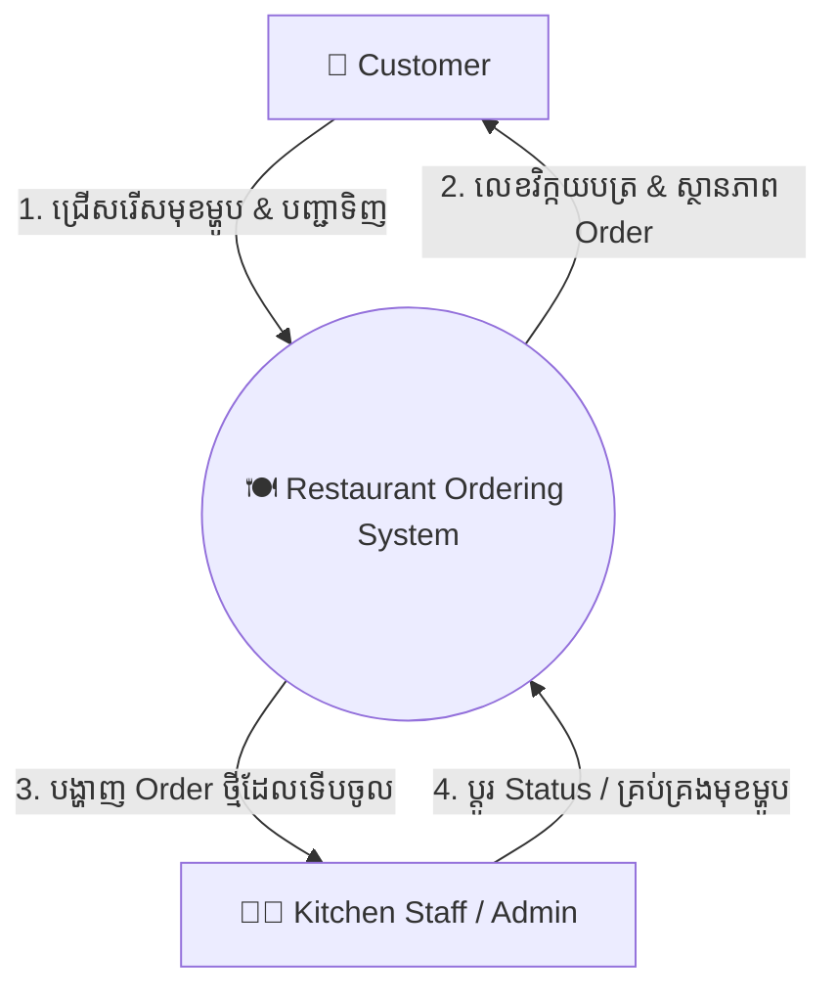
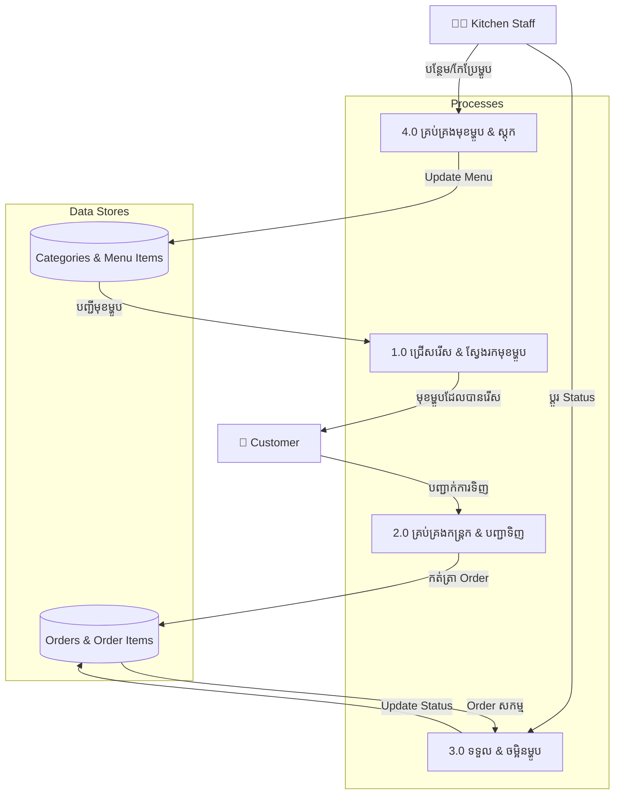

# 🎨 Week 2: UI/UX Design, ERD & Technical Architecture
## 🍽️ Project Name: Restaurant Ordering System (ROS)
**Course / Topic:** Topic 5: Software Project Development  
**Document Version:** 1.0.0  
**Date:** October 2026  
**Tech Stack:** React.js, Tailwind CSS, Node.js, Express.js, SQLite  

---

## 📑 តារាងមាតិកា (Table of Contents)
1. [១. ការរចនាប្រព័ន្ធ UI/UX (UI/UX Design System & Wireframes)](#1-uiux-design-system--wireframes)
2. [២. រចនាសម្ព័ន្ធទិន្នន័យលម្អិត និង ERD (Detailed ERD & Database Schema)](#2-detailed-erd--database-schema)
3. [៣. ស្ថាបត្យកម្មប្រព័ន្ធបច្ចេកទេស (System Architecture & Component Breakdown)](#3-system-architecture--component-breakdown)
4. [៤. កិច្ចព្រមព្រៀង API (RESTful API Contract Specification)](#4-restful-api-contract-specification)
5. [៥. រចនាសម្ព័ន្ធថត និងឯកសារគម្រោង (Project Directory Structure)](#5-project-directory-structure)
6. [៦. លំហូរទិន្នន័យ (Data Flow Diagrams - DFD Level 0 & Level 1)](#6-data-flow-diagrams-dfd)

---

## 1. UI/UX Design System & Wireframes

### 1.1 Design System & Color Palette
ដើម្បីបង្កើតបទពិសោធន៍អ្នកប្រើប្រាស់ (User Experience) ដ៏ទាក់ទាញ និងស្រួលប្រើទាំងលើ Mobile (សម្រាប់ភ្ញៀវ) និង Tablet/Desktop (សម្រាប់ផ្ទះបាយ) ប្រព័ន្ធត្រូវបានកំណត់ពណ៌ និង Typography តាមស្តង់ដារទំនើប៖

| ប្រភេទ (Type) | ពណ៌ (Color Code) | Tailwind Class | ការប្រើប្រាស់ (Usage) |
|---|---|---|---|
| **Primary Brand** | `#EA580C` (Warm Orange) | `bg-orange-600` | ប៊ូតុងបញ្ជាទិញ (Order CTA), តម្លៃ, Active Categories |
| **Secondary Brand** | `#0F172A` (Slate Navy) | `bg-slate-900` | Header, Sidebar, Text ចម្បង |
| **Accent / Highlight** | `#F97316` (Amber Orange)| `bg-orange-500` | Badges, Hover states, Cart notification count |
| **Status: Pending** | `#EAB308` (Yellow) | `bg-yellow-500` | Order ទើបចូលថ្មី (រង់ចាំផ្ទះបាយទទួល) |
| **Status: Preparing**| `#3B82F6` (Blue) | `bg-blue-500` | ចុងភៅកំពុងចម្អិន (Cooking in progress) |
| **Status: Ready** | `#10B981` (Green) | `bg-emerald-500` | ម្ហូបឆ្អិនរួចរាល់ (រួចរាល់សម្រាប់លើកជូនភ្ញៀវ) |
| **Status: Completed**| `#64748B` (Slate) | `bg-slate-500` | ការកម្ម៉ង់បានបញ្ចប់ និងទូទាត់រួចរាល់ |
| **Status: Cancelled**| `#EF4444` (Red) | `bg-red-500` | ការលុបចោលការកម្ម៉ង់ |

* **Typography:** `Inter` ឬ `Plus Jakarta Sans` សម្រាប់ភាសាអង់គ្លេស និង `Kantumruy Pro` សម្រាប់ភាសាខ្មែរ ដើម្បីភាពច្បាស់ និងងាយស្រួលអានលើគ្រប់អេក្រង់។
* **Responsive Breakpoints:** Mobile First (`< 640px`), Tablet (`640px - 1024px`), Desktop/Kitchen KDS (`> 1024px`)។

---

### 1.2 Layout & Wireframe Specifications

#### ក. អេក្រង់សម្រាប់អតិថិជន (Customer View Layout)
```
┌─────────────────────────────────────────────────────────────┐
│ 🍽️ FoodieHub  [ Table: 05 ▾ ]            [ 🛒 Cart (3) ]   │
├─────────────────────────────────────────────────────────────┤
│ 🔍 [ Search favorite food or drinks...                    ] │
├─────────────────────────────────────────────────────────────┤
│ [All]  [🔥 Popular]  [🥗 Appetizers]  [🍲 Main]  [🍹 Drinks] │
├─────────────────────────────────────────────────────────────┤
│  MENU GRID                                                  │
│  ┌───────────────────────┐       ┌───────────────────────┐  │
│  │ [ Image: Khmer Curry ]│       │ [ Image: Beef Lok Lak]│  │
│  │ Khmer Red Curry       │       │ Beef Lok Lak with Egg │  │
│  │ Rich coconut curry... │       │ Tender beef cubes...  │  │
│  │ $6.50   [ + Add ]     │       │ $7.00   [ + Add ]     │  │
│  └───────────────────────┘       └───────────────────────┘  │
│  ┌───────────────────────┐       ┌───────────────────────┐  │
│  │ [ Image: Iced Coffee ]│       │ [ Image: Mango Sticky]│  │
│  │ Iced Latte Coffee     │       │ Mango Sticky Rice     │  │
│  │ Fresh brewed beans... │       │ Sweet ripe mango...   │  │
│  │ $2.50   [ + Add ]     │       │ $3.50   [ + Add ]     │  │
│  └───────────────────────┘       └───────────────────────┘  │
├─────────────────────────────────────────────────────────────┤
│ 🛒 Total: $19.50 | 3 Items        [ View Cart & Order ➔ ]   │
└─────────────────────────────────────────────────────────────┘
```

#### ខ. ផ្ទាំងផ្ទះបាយ និងគ្រប់គ្រង (Kitchen Display System - KDS Wireframe)
```
┌─────────────────────────────────────────────────────────────┐
│ 👨‍🍳 KITCHEN DISPLAY SYSTEM          [Staff: Chef John] [🚪]│
├──────────────────────┬──────────────────────┬───────────────┤
│ 🟡 PENDING (2)       │ 🔵 PREPARING (1)     │ 🟢 READY (1)  │
├──────────────────────┼──────────────────────┼───────────────┤
│ ┌──────────────────┐ │ ┌──────────────────┐ │ ┌───────────┐ │
│ │ Order #104 (T-03)│ │ │ Order #102 (T-01)│ │ │Order #101 │ │
│ │ 3 mins ago       │ │ │ 12 mins ago      │ │ │Table 05   │ │
│ │ • 1x Lok Lak     │ │ │ • 2x Khmer Curry │ │ │• 1x Coffee│ │
│ │   [Note: No egg] │ │ │   [Note: Spicy]  │ │ │           │ │
│ │ • 1x Iced Tea    │ │ │                  │ │ │ [Done]    │ │
│ │ [Accept / Cook]  │ │ │ [Mark as Ready]  │ │ │           │ │
│ └──────────────────┘ │ └──────────────────┘ │ └───────────┘ │
└──────────────────────┴──────────────────────┴───────────────┘
```

---

## 2. Detailed ERD & Database Schema

### 2.1 Entity Relationship Diagram (ERD)



### 2.2 SQL DDL (SQLite Schema Script)

```sql
-- 1. Table Users
CREATE TABLE IF NOT EXISTS users (
    id INTEGER PRIMARY KEY AUTOINCREMENT,
    username TEXT NOT NULL UNIQUE,
    password TEXT NOT NULL,
    role TEXT CHECK(role IN ('admin', 'kitchen')) NOT NULL DEFAULT 'kitchen',
    createdAt DATETIME DEFAULT CURRENT_TIMESTAMP
);

-- 2. Table Categories
CREATE TABLE IF NOT EXISTS categories (
    id INTEGER PRIMARY KEY AUTOINCREMENT,
    name TEXT NOT NULL UNIQUE,
    icon TEXT DEFAULT 'Utensils',
    description TEXT
);

-- 3. Table MenuItems
CREATE TABLE IF NOT EXISTS menu_items (
    id INTEGER PRIMARY KEY AUTOINCREMENT,
    name TEXT NOT NULL,
    description TEXT,
    price REAL NOT NULL CHECK(price >= 0),
    image TEXT,
    isAvailable INTEGER NOT NULL DEFAULT 1,
    categoryId INTEGER NOT NULL,
    createdAt DATETIME DEFAULT CURRENT_TIMESTAMP,
    FOREIGN KEY (categoryId) REFERENCES categories(id) ON DELETE RESTRICT
);

-- 4. Table Orders (Supports both Dine-in & Online Delivery)
CREATE TABLE IF NOT EXISTS orders (
    id INTEGER PRIMARY KEY AUTOINCREMENT,
    orderType TEXT CHECK(orderType IN ('dine_in', 'delivery', 'takeaway')) NOT NULL DEFAULT 'dine_in',
    tableNumber INTEGER,                                  -- Required if orderType = 'dine_in'
    customerName TEXT,                                    -- Required if orderType in ('delivery', 'takeaway')
    customerPhone TEXT,                                   -- Required if orderType in ('delivery', 'takeaway')
    deliveryAddress TEXT,                                 -- Required if orderType = 'delivery'
    deliveryFee REAL NOT NULL DEFAULT 0.0,
    customerNotes TEXT,
    totalAmount REAL NOT NULL DEFAULT 0.0,
    paymentMethod TEXT CHECK(paymentMethod IN ('cash', 'khqr', 'cod')) NOT NULL DEFAULT 'cash',
    paymentStatus TEXT CHECK(paymentStatus IN ('unpaid', 'paid')) NOT NULL DEFAULT 'unpaid',
    status TEXT CHECK(status IN ('pending', 'preparing', 'ready', 'delivered', 'completed', 'cancelled')) NOT NULL DEFAULT 'pending',
    createdAt DATETIME DEFAULT CURRENT_TIMESTAMP,
    updatedAt DATETIME DEFAULT CURRENT_TIMESTAMP
);

-- 5. Table OrderItems
CREATE TABLE IF NOT EXISTS order_items (
    id INTEGER PRIMARY KEY AUTOINCREMENT,
    orderId INTEGER NOT NULL,
    menuItemId INTEGER NOT NULL,
    quantity INTEGER NOT NULL CHECK(quantity > 0),
    unitPrice REAL NOT NULL,
    FOREIGN KEY (orderId) REFERENCES orders(id) ON DELETE CASCADE,
    FOREIGN KEY (menuItemId) REFERENCES menu_items(id) ON DELETE RESTRICT
);

-- Indexes for Fast Query Performance
CREATE INDEX IF NOT EXISTS idx_menu_items_category ON menu_items(categoryId);
CREATE INDEX IF NOT EXISTS idx_orders_status ON orders(status);
CREATE INDEX IF NOT EXISTS idx_order_items_orderId ON order_items(orderId);
```

### 2.3 ការវិភាគកម្រិត Normalization (Normalization Analysis)
* **1NF (First Normal Form):** រាល់ Attribute ទាំងអស់ជាតម្លៃទោល (Atomic Values) គ្មានជួរទិន្នន័យដដែលៗ (Repeating Groups)។ Order items ត្រូវបានបំបែកចេញជា Table `order_items` ដោយឡែក។
* **2NF (Second Normal Form):** គ្រប់ Non-key Attributes ទាំងអស់អាស្រ័យទាំងស្រុងលើ Primary Key (No partial dependencies)។
* **3NF (Third Normal Form):** គ្មាន transitive dependency។ ឧទាហរណ៍ `unitPrice` ត្រូវបានរក្សាទុកក្នុង `order_items` ដើម្បីការពារការផ្លាស់ប្តូរតម្លៃម្ហូបនាពេលអនាគតមិនឱ្យប៉ះពាល់ដល់ប្រវត្តិនៃការលក់ចាស់ៗ។

---

## 3. System Architecture & Component Breakdown



---

## 4. RESTful API Contract Specification

### 4.1 Authentication Endpoints
| Method | Endpoint | Access | Body Payload | Response (200/201) |
|---|---|---|---|---|
| `POST` | `/api/auth/login` | Public | `{ username, password }` | `{ token, user: { id, username, role } }` |
| `GET` | `/api/auth/me` | Protected | None (Bearer Token) | `{ user: { id, username, role } }` |

### 4.2 Categories & Menu Items Endpoints
| Method | Endpoint | Access | Description |
|---|---|---|---|
| `GET` | `/api/categories` | Public | យកបញ្ជីប្រភេទមុខម្ហូបទាំងអស់ |
| `GET` | `/api/menu` | Public | យកបញ្ជីមុខម្ហូបទាំងអស់ (អាច filter តាម `?category=&search=`) |
| `POST` | `/api/menu` | Staff/Admin | បង្កើតមុខម្ហូបថ្មី |
| `PUT` | `/api/menu/:id` | Staff/Admin | កែប្រែព័ត៌មានមុខម្ហូប (ឈ្មោះ, តម្លៃ, រូបភាព...) |
| `PATCH`| `/api/menu/:id/toggle` | Staff/Admin | ប្តូរស្ថានភាព `isAvailable` (1 ឬ 0) |
| `DELETE`| `/api/menu/:id` | Admin | លុបមុខម្ហូបចេញ |

### 4.3 Orders Endpoints
| Method | Endpoint | Access | Request Body | Description |
|---|---|---|---|---|
| `POST` | `/api/orders` | Public | `{ tableNumber: 5, customerNotes: "...", items: [{ menuItemId: 1, quantity: 2 }] }` | បង្កើត Order ថ្មី |
| `GET` | `/api/orders` | Staff/Admin | Query: `?status=pending,preparing` | ទាញយកបញ្ជី Order សម្រាប់ផ្ទះបាយ |
| `GET` | `/api/orders/:id` | Public | None | ពិនិត្យមើលស្ថានភាព Order សម្រាប់ភ្ញៀវ |
| `PATCH`| `/api/orders/:id/status`| Staff/Admin | `{ status: "preparing" }` | ប្តូរ Status Order (`preparing`, `ready`, `completed`) |

### 4.4 Analytics & Reports Endpoints
| Method | Endpoint | Access | Description |
|---|---|---|---|
| `GET` | `/api/stats/summary` | Admin | របាយការណ៍សង្ខេប (Total Revenue, Active Orders, Completed Orders) |

---

## 5. Project Directory Structure (Clean, Simple & Fit for University Project)

រចនាសម្ព័ន្ធ Folder នៃគម្រោងត្រូវបានរៀបចំឡើងយ៉ាងស្អាត មានរបៀបរៀបរយតាមស្តង់ដារ **Clean MVC & Component-Based Pattern** ដែល **សាមញ្ញ ងាយយល់ និងស័ក្តិសមបំផុតសម្រាប់គម្រោងថ្នាក់សាកលវិទ្យាល័យ (University Project)**។ រចនាសម្ព័ន្ធនេះជួយឱ្យនិស្សិតងាយស្រួលពន្យល់ការពារគម្រោង (Presentation & Code Defense) ចំពោះមុខសាស្ត្រាចារ្យ និងគណៈកម្មការវាយតម្លៃ ដោយសារឯកសារនីមួយៗមានតួនាទីតែមួយច្បាស់លាស់ (Single Responsibility) ដោយគ្មានភាពស្មុគស្មាញជ្រុល (No Over-engineering)។

### 5.1 Simple & Clear File Tree

```
restaurant-ordering-system/
│
├── 📁 backend/                             # ផ្នែក Backend API (Node.js & Express.js)
│   ├── 📁 database/                        # គ្រប់គ្រង Database & ទិន្នន័យគំរូ
│   │   ├── db.js                           # ភ្ជាប់ SQLite Database (better-sqlite3)
│   │   ├── schema.sql                      # SQL Table Definitions (DDL)
│   │   ├── seed.js                         # បញ្ចូលទិន្នន័យគំរូដំបូង (Admin, Categories, Menu)
│   │   └── restaurant.db                   # ឯកសារ Database (បង្កើតឡើងដោយស្វ័យប្រវត្តិ)
│   │
│   ├── 📁 src/                             # កូដប្រភព Backend
│   │   ├── 📁 controllers/                 # Business Logic សម្រាប់ទទួល និងឆ្លើយតប API
│   │   │   ├── authController.js           # គ្រប់គ្រង Login & JWT Token
│   │   │   ├── menuController.js           # បង្កើត កែប្រែ លុប និងទាញយកបញ្ជីម្ហូប
│   │   │   ├── orderController.js          # បង្កើត Order & ប្តូរស្ថានភាពម្ហូប
│   │   │   └── statsController.js          # គណនាប្រាក់ចំណូល និងចំនួន Order សរុប
│   │   │
│   │   ├── 📁 middlewares/                 # កូដការពារ និងត្រួតពិនិត្យសិទ្ធិ
│   │   │   └── authMiddleware.js           # ផ្ទៀងផ្ទាត់ JWT Token មុនឱ្យចូល Admin/Kitchen
│   │   │
│   │   ├── 📁 routes/                      # កំណត់ URL Endpoints នៃប្រព័ន្ធ
│   │   │   ├── authRoutes.js               # /api/auth (Login)
│   │   │   ├── menuRoutes.js               # /api/menu & /api/categories
│   │   │   ├── orderRoutes.js              # /api/orders
│   │   │   └── statsRoutes.js              # /api/stats (Summary report)
│   │   │
│   │   └── server.js                       # ចំណុចចាប់ផ្តើមនៃ Server (Port, CORS, Express setup)
│   │
│   ├── .env.example                        # គំរូកំណត់ PORT និង JWT_SECRET
│   └── package.json                        # បញ្ជីបណ្ណាល័យ Backend (express, cors, better-sqlite3...)
│
├── 📁 frontend/                            # ផ្នែក Frontend UI (React.js + Tailwind CSS)
│   ├── 📁 public/                          # រូបភាព និង Static Files
│   │   └── favicon.ico
│   │
│   ├── 📁 src/                             # កូដប្រភព Frontend React
│   │   ├── 📁 components/                  # Reusable UI Components
│   │   │   ├── Navbar.jsx                  # របារខាងលើ បង្ហាញ Logo, លេខតុ និងកន្ត្រក
│   │   │   ├── TableSelector.jsx           # Modal សម្រាប់ភ្ញៀវរើសលេខតុ (Table 1-10)
│   │   │   ├── DishCard.jsx                # កាតបង្ហាញរូបម្ហូប តម្លៃ និងប៊ូតុង + Add
│   │   │   ├── CartModal.jsx               # ផ្ទាំងកន្ត្រកម្ហូប ពិនិត្យតម្លៃ និងចុច Confirm Order
│   │   │   ├── OrderCard.jsx               # កាតបង្ហាញ Order សម្រាប់ចុងភៅ និង Status Tracker
│   │   │   └── DishFormModal.jsx           # Form បន្ថែម/កែប្រែមុខម្ហូបសម្រាប់ Admin
│   │   │
│   │   ├── 📁 context/                     # Global State Management
│   │   │   ├── CartContext.jsx             # គ្រប់គ្រងទំនិញក្នុងកន្ត្រក និងលេខតុ
│   │   │   └── AuthContext.jsx             # គ្រប់គ្រងការ Login របស់បុគ្គលិក (Token)
│   │   │
│   │   ├── 📁 pages/                       # អេក្រង់សំខាន់ៗនៃកម្មវិធី (Screens)
│   │   │   ├── CustomerMenu.jsx            # ទំព័រដើមសម្រាប់ភ្ញៀវមើលម្ហូប និងកម្ម៉ង់
│   │   │   ├── TrackOrder.jsx              # ទំព័រតាមដានស្ថានភាព Order
│   │   │   ├── KitchenDashboard.jsx        # ផ្ទាំងផ្ទះបាយទទួល Order និងប្តូរ Status
│   │   │   ├── AdminMenu.jsx               # ផ្ទាំង Admin គ្រប់គ្រងបញ្ជីមុខម្ហូប (CRUD)
│   │   │   └── Login.jsx                   # ទំព័រ Login សម្រាប់ Staff & Admin
│   │   │
│   │   ├── 📁 services/                    # មុខងារទាក់ទង Backend API
│   │   │   └── api.js                      # Axios/Fetch Functions សម្រាប់ហៅ API
│   │   │
│   │   ├── App.jsx                         # Main Routing (React Router)
│   │   ├── main.jsx                        # React Root Rendering
│   │   └── index.css                       # Tailwind CSS Directives
│   │
│   ├── index.html                          # HTML Document Template
│   ├── tailwind.config.js                  # កំណត់ Theme ពណ៌ និង Font Tailwind
│   ├── vite.config.js                      # កំណត់ការ Build របស់ Vite
│   └── package.json                        # បញ្ជីបណ្ណាល័យ Frontend (react, lucide-react...)
│
├── week-1-wiki.md                          # ឯកសារផែនការ Week 1: Requirements & SRS
├── week-2-wiki.md                          # ឯកសារ Week 2: UI/UX, ERD & Architecture
├── README.md                               # ឯកសារណែនាំពីរបៀប Run គម្រោង
└── run.bat                                 # Script ចុចតែមួយដងដំណើរការទាំង Frontend និង Backend
```

---

### 5.2 ហេតុអ្វីបានជារចនាសម្ព័ន្ធនេះស័ក្តិសមបំផុតសម្រាប់ University Project?

1. **ភាពច្បាស់លាស់ និងងាយស្រួលការពារ (Easy to Defend in Presentation):**
   - ពេលសាស្ត្រាចារ្យសួរថា *"តើកូដផ្នែក Login នៅឯណា?"* និស្សិតអាចចង្អុលបង្ហាញភ្លាមៗទៅ `authController.js` (Backend) និង `Login.jsx` (Frontend)។
   - ពេលសួរថា *"តើការគណនាកន្ត្រកម្ហូបនៅឯណា?"* អាចឆ្លើយបានយ៉ាងរហ័សថាស្ថិតនៅ `CartContext.jsx`។

2. **ស្តង់ដារ MVC & Component Architecture ត្រឹមត្រូវ 100%:**
   - គោរពតាមអ្វីដែលបានបង្រៀននៅក្នុងសាកលវិទ្យាល័យ (Routes ➔ Controllers ➔ Database) ដោយមិនចាំបាច់មាន Layer ស្មុគស្មាញហួសហេតុដែលពិបាក Debug។

3. **Zero-Configuration & Easy Demonstration:**
   - ប្រើប្រាស់ SQLite ដែលឯកសារ Database (`restaurant.db`) នៅក្នុង Folder ស្រាប់ ធ្វើឱ្យងាយស្រួល Copy ដាក់ Flash Drive ឬផ្ញើ Zip File ឱ្យគ្រូវាយតម្លៃ ដោយគ្រូអាច Run បានភ្លាមៗដោយមិនបាច់ដំឡើង MySQL ឬ MongoDB Server ឡើយ។

4. **One-Click Run (`run.bat`):**
   - មាន Script ងាយស្រួលចុច Run តែម្តង ដំណើរការទាំង Server និង Client ក្នុងពេលតែមួយ ស័ក្តិសមបំផុតសម្រាប់ការ Demo ផ្ទាល់ក្នុងថ្នាក់។

---

---

## 6. Data Flow Diagrams (DFD)

### 6.1 DFD Level 0 (Context Diagram)



### 6.2 DFD Level 1 (Subsystems & Data Stores)



---
**Approved By:** Software Architecture Review Committee  
**Readiness:** Ready for Implementation 🚀
